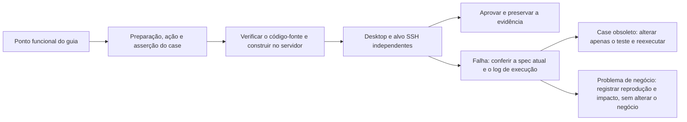

# Regressão do Guia de Testes de SSH do Desktop

Status: done

Esta rodada segue o "Guia de Testes da Nova Versão de Conexão Remota do ZCode" versão 41
(2026-10-09); a baseline de negócio é `a13999a28927f629d0c64080a5096cf8b4f23bae`. Apenas o
SSH do Desktop é verificado; celular, WSL e Docker não fazem parte do escopo desta rodada.
Contêineres Docker independentes no Linux servem apenas para simular um servidor SSH real.

Reutiliza-se a fila do servidor, com cada item usando HOME, sessão de exibição e alvo SSH
independentes. Primeiro verifica-se a lista completa de fontes; depois constroem-se Desktop,
Server e Agent no servidor. O replay de modelos serve para funcionalidade e ordem de falhas;
modelos reais rodam à parte em live-zapi / live-team. Um PASS exige simultaneamente ação do
usuário, asserção correspondente e evidência de execução; não se pode substituir a cobertura
por resultados de uma versão antiga ou por simplesmente passar por alguma página.

## Resultado da aceitação

Esta rodada concluiu a verificação de que todo ponto funcional do SSH do Desktop tem case e
passou ou tem registro, **não foi tudo verde**.
Os 100 cenários agendados foram executados: 95 PASS; 3 falhas de negócio, 1 divergência de
comportamento de spec/ponto de entrada, 1 bloqueio prévio de conta/modelo.
O runner original registrou FAIL para os cinco últimos; não se modificou o resultado original,
não se pulou nenhuma falha nem se afrouxou asserções de negócio.

Correção posterior (2026-10-10): o problema de permissões de diretório
[05](../issues/remote-e2e-stability/05-directory-permission-reattach.md) foi corrigido, e o
E2E completo `directory-denied` passou em reexecução isolada, incluindo a retentativa após a
restauração das permissões e a continuação do histórico original.
O problema de reconexão do projeto após a edição do endereço
[06](../issues/remote-e2e-stability/06-edited-route-ignored-by-project-reconnect.md) também
foi corrigido, e a variante de edição de `connection-management` passou em reexecução isolada: a
nova porta realmente recebeu a conexão, a senha vazia autenticou, os dois projetos originais
foram recuperados e nenhum Profile de linha antiga foi adicionado.
O problema de atualização obrigatória do projeto original
[07](../issues/remote-e2e-stability/07-existing-project-upgrade-intent.md) foi corrigido, e as
quatro variantes de política de versão passaram todas em reexecuções independentes: a conexão
manual foi atualizada automaticamente e recuperou A/B, e os comportamentos de espera em
segundo plano, atualização opcional com "depois" e máquina local desatualizada foram mantidos.
As evidências completas e a explicação do timeout na preparação dos fixtures da primeira
rodada local estão no registro do problema.
A semântica do problema
[08](../issues/remote-e2e-stability/08-reinstall-history-visible-in-new-device.md) foi
confirmada pelo usuário em 2026-10-10: na desinstalação oficial com retenção de dados, a
reinstalação deve reutilizar o dispositivo, a conexão e o projeto originais, o histórico
original deve ficar visível e continuar a conversa; somente a substituição em um ambiente de
dados independente confirma uma nova identidade.
O case original "novo dispositivo não mostra o histórico antigo" não se aplica à reinstalação
com retenção de dados.
As duas variantes passaram em reexecuções independentes: o histórico no dispositivo original
realmente continuou a conversa, e a confirmação, o cancelamento, o arquivamento e o isolamento
no ambiente independente foram mantidos.
A correção e as evidências de execução estão registradas no problema 08; as estatísticas e o
ledger do lote original permanecem inalterados.
Correção posterior (2026-10-11): a pré-verificação de identidade de tarefa na migração de
múltiplas linhas comparava apenas o snapshot canônico, perdendo conflitos entre sources; abrir
repetidamente criava um ledger de falha e fazia backup dos dois bancos.
Novo item `history-conflict-sources`: o lote anterior à correção
`r3-server-20261011024625012-2857c7` falhou, com 2 ledgers de falha e 2 backups de migração
já na etapa de abertura; no lote posterior à correção `r3-server-20261011025925916-fb3363`, esse
item, `history-conflict` e `history-merge` passaram, havendo antes e depois da retentativa
apenas o mesmo ledger e nenhum backup de migração no remoto.
As estatísticas e o ledger abaixo preservam o resultado da baseline de negócio original; as
evidências das correções posteriores estão nos respectivos registros de problema.

As variantes específicas de spec/ambiente de cada queue key abaixo são declaradas em um único
ponto por `harness/remote/run-all-remote.sh`.
Para a mesma spec, a falha de diretório, o tipo de recurso, a política de versão, a confirmação
de atualização e o caminho de gerenciamento são executados separados por variante.

| Ponto funcional do guia                                  | Case correspondente / evidência real                                                                         | Conclusão                                                                                                                                 |
| -------------------------------------------------------- | ------------------------------------------------------------------------------------------------------------ | ------------------------------------------------------------------------------------------------------------------------------------ |
| Busca de dispositivos, descoberta de configuração SSH, nova conexão, diretórios recentes | projectentry, kinddoubleclick, three-screen                                                                   | PASS                                                                                                                                 |
| Complemento de senha incorreta no local, ausência de senha, reuso de conexão já online | p0-conn, wizardcredentials                                                                                    | PASS                                                                                                                                 |
| Versão/conta/caminho/tamanho da primeira instalação, fase/log reais, retentativa no local | install-progress, log-contract, installfaults, downloadproxy, three-screen                                    | PASS                                                                                                                                 |
| Recolher, restaurar, cancelar, fechar limpando o formulário | cancelretry, three-screen                                                                                     | PASS                                                                                                                                 |
| Renomear dispositivo, escolher diretório, "depois" mantendo online e sem projeto | devicecards, disconnectux, three-screen                                                                       | PASS                                                                                                                                 |
| Explicação fechável na primeira página de diretório, sem repetição depois nem no reinício | boundary                                                                                                      | PASS                                                                                                                                 |
| Continuar a execução após sair ou perder a rede, sem repetição na reconexão | app-exit-running, transportloss, coldreconnect, renderer, ackloss                                             | PASS; a suspensão do sistema físico é registrada à parte como registro de ambiente                                    |
| Vários projetos compartilhando o dispositivo, espera de confirmação sem aceite automático | p0-main, sharedwait, transportloss, taskcontrol                                                               | PASS                                                                                                                                 |
| 1/3, 2/3, 3/3, falha por esgotamento, recuperação silenciosa e assunção manual | retry-budget, transportloss                                                                                   | PASS                                                                                                                                 |
| Desconexão ativa, chave de inicialização, guarda de 7 dias, reinício remoto | recov, coldreconnect, daemondet, serverfault                                                                  | PASS                                                                                                                                 |
| Rascunho bloqueado para envio/retenção, conteúdo somente leitura, sessão original e sessões excluídas | disconnectux, coldreconnect, rdux13, rdux14, mixed                                                            | PASS                                                                                                                                 |
| Nome de dispositivo/conexão, endereço/credenciais com efeito na próxima execução, retenção de valor vazio | settings-safeguards, connection-management                                                                    | Nome e contrato de credencial vazia já testados; a reconexão pelo endereço da barra lateral falhou, registrada em [06](../issues/remote-e2e-stability/06-edited-route-ignored-by-project-reconnect.md) |
| Várias conexões no mesmo dispositivo, atual/padrão, definir padrão, remover linha | sourcelines, connection-lifecycle                                                                             | PASS                                                                                                                                 |
| Localização online/offline, confirmação de remoção de dispositivo com cancelamento por padrão, retenção de dados remotos | settings-safeguards, connection-lifecycle                                                                     | PASS                                                                                                                                 |
| Recolher/excluir/limpar registros incompletos sem afetar dispositivos já conectados | devicecards, offlineicons                                                                                     | PASS                                                                                                                                 |
| Atualização obrigatória/opcional, espera em segundo plano, máquina local muito antiga e "depois" | version-manual-required, version-automatic-required, version-optional, version-controller-required            | Segundo plano/máquina local muito antiga/opcional e "depois" PASS; a divergência na atualização automática do projeto original está registrada em [07](../issues/remote-e2e-stability/07-existing-project-upgrade-intent.md) |
| Lista de tarefas em execução, cancelamento/retentativa, confirmação forçada, restauração de versão/projeto | serverupdate, serverupdate-force, install-progress, installfaults                                             | PASS                                                                                                                                 |
| Confirmação de reinstalação, cancelamento, arquivamento da conexão antiga, histórico antigo não misturado no novo dispositivo | uninstall (tarefa real antiga + lista de tarefas visível no novo dispositivo)                                                                  | Confirmação/cancelamento/arquivamento/retenção de dados PASS; a mistura de histórico falhou, registrada em [08](../issues/remote-e2e-stability/08-reinstall-history-visible-in-new-device.md)  |
| Isolamento de histórico entre contas diferentes no mesmo endereço e no mesmo caminho | account-isolation                                                                                             | PASS                                                                                                                                 |
| Layout plano, cinco estados, mesmo nome e mesmo caminho, detalhes e identificação do dispositivo em todos os lugares | projectnavigation, presentation, sidebar-menus, entryattr, pluginidentity, uipairwise                         | PASS                                                                                                                                 |
| Ordem de arraste persistida, sem reordenação em online/offline | project-order                                                                                                 | PASS                                                                                                                                 |
| Compartilhamento de conta remota, sem substituição, rejeição quando não autenticado, artefato que pode ser aberto | share-authority(conta sintética com SSH real)+ share(nuvem real)                                             | PASS; a entrada do celular está fora do escopo do Desktop                                                                              |
| Diretório removido, virando arquivo ou sem permissão, recuperação de outros projetos e retentativa após a correção | directory-missing, directory-file, directory-denied                                                           | Remoção/arquivo PASS; a revogação de permissão falhou, registrada em [05](../issues/remote-e2e-stability/05-directory-permission-reattach.md)                          |
| Upgrade de versão antiga em linha única, continuação do histórico, uso contínuo após rollback real | history-single                                                                                                | PASS                                                                                                                                 |
| Mesclagem de múltiplas linhas, backup, conflitos, retentativa/abandono e limitações de rollback para versão antiga | history-merge, history-conflict(programa antigo real, SQLite, GUI)                                            | PASS; após a leitura real das duas linhas antigas, os dados das tarefas originais foram preservados, sem garantia de que todas as visões antigas fiquem completas              |
| Navegação/edição de arquivos, terminal, Git, primeira mensagem/continuação, busca/timeline | p0-dev, p0-main, terminal, filelocal, taskactions                                                             | PASS                                                                                                                                 |
| Fixar no topo/arquivar, rejeição de operações offline, não usar dados da máquina local | taskactions, projectnavigation, botremote, modelcand                                                          | PASS                                                                                                                                 |
| Envio com queda imediata de conexão executado uma única vez, limpeza do corpo e retenção do rascunho seguinte | ackloss(ACK retido enquanto se edita de fato um novo rascunho)                                                  | PASS                                                                                                                                 |
| Fila, parar/retomar, permissões, subagentes, compactação | queuesel, taskcontrol, subagent, compactgoal, taskfaults                                                      | PASS                                                                                                                                 |
| Anexos arrastados, colados ou enviados, pré-visualização/download, cancelamento e recuperação após queda | attachments, mediapreview, attachment-cancel, attachment-disconnect                                           | PASS                                                                                                                                 |
| Sincronização automática de modelo/padrão, preenchimento offline, orientação sem modelo | provisioning, modelcand, modelswitch, provready, connectivity, live-zapi, live-team                           | Replay e API Key real PASS; a requisição real do Team ficou bloqueada previamente, registrada em [09](../issues/remote-e2e-stability/09-live-team-model-precondition.md)        |
| Gerenciamento, salvamento real e escopo de Skills/MCP/plugins/Hooks/comandos/subagentes | resource-skill/mcp/command/hook, settingsscopes, settings-safeguards, pluginidentity, pluginsync, remotehooks | PASS; cada categoria tem asserção de salvamento em alvo real ou de execução/exclusão                              |
| Limite entre as configurações da máquina local e as da máquina onde o projeto está | desktopauthority, settingslocalboundary, settingsscopes                                                       | PASS                                                                                                                                 |
| Roteamento de identidade do bot, rejeição offline, sem uso indevido da máquina local ou de outros projetos | botidentity, botremote, botruntime                                                                            | PASS (canal sintético e cadeia real Host/MessagePort); o canal real e o SSH ponta a ponta estão em registro de ambiente separado                                |
| Chinês/inglês, temas escuro/claro, janela estreita e segurança de teclado | uipairwise, accessibility, devicecards, settings-safeguards                                                   | PASS                                                                                                                                 |

## Build e evidências de execução

O código de negócio é `a13999a28927f629d0c64080a5096cf8b4f23bae`, consistente com o branch mais
recente no momento da retomada da tarefa.
Após recalcular e validar o manifest completo do código-fonte, no servidor foram executados
`pnpm prepare:remote-assets` (Server / Agent) e `build:no-runtime-assets` do Desktop,
construindo-se respectivamente test / production. Os prefixos finais das impressões digitais
de build são `60c92e7db6b5` / `8002e5ec70bb`. Cada case usa HOME, sessão de exibição e alvo
SSH independentes.

| Lote                                                                            | Escopo/uso                                                                                |
| ------------------------------------------------------------------------------- | ---------------------------------------------------------------------------------------- |
| `r3-server-20261009170002590-cabde7`                                            | Lote principal de 80 itens, 55 PASS, identificando cases antigos e novas lacunas          |
| `r3-server-20261009183107835-42af65`                                            | Reexecução corrigida de 38 itens, 21 PASS                                                |
| `r3-server-20261009221305938-a3e800`                                            | 22 itens após retomar tarefas interrompidas, obtendo evidência de identidade de execução para saída completa e falhas de permissão |
| `r3-server-20261009223735233-3b63ee`                                            | Duas builds mais recentes, 19 itens validando rascunho após envio, atualização forçada real, roteamento de conta compartilhada etc. |
| `r3-server-20261009234650716-227ddc`                                            | 13 itens, concluindo teclado/visual, retentativa de atualização, rollback de versão antiga, queda de conexão com anexo e reverificação da política de versão |
| `r3-server-20261010000352793-dc135c` / `r3-server-20261010001224807-40c41f`   | Padrão/remoção de dispositivo finalmente aprovados; tarefa real antiga revelou mistura de histórico após a reinstalação |
| `r3-server-20261010001822450-9f7e7e`                                            | Após mesclar múltiplas linhas, rollback real do programa antigo lendo as duas linhas, verificando a preservação dos dados das tarefas originais |

Há também evidências de aprovação de cases representativos de primeira instalação e de
fronteira no início do trabalho. A impressão digital de build chegou a ficar inválida por
atualização de catalog/matriz; `r3-server-20261009223615174-965622` marcou 19 itens como
BLOCKED_ENV antes de iniciar o Electron; em seguida a build foi refeita e a execução refeita,
sem contar esse lote como evidência de aprovação.

O ledger item a item final, os summary de cada lote, as credenciais de build e os diagnósticos
anonimizados estão em
`packages/desktop/.e2e-artifacts/desktop-ssh-guide-regression-20261010/`; os logs de execução
completos e os vídeos de cada batchId / case key estão nos artifacts originais no servidor. O
ledger guarda, para cada item, o último lote realmente executado, a impressão digital do
código-fonte, a spec, o ambiente e o status original, sem acumular contagens de falhas
iniciais para fabricar uma taxa de aprovação final.

## Correções e complementos de cases

Foram adicionadas 11 categorias de specs candidatas de SSH e fixtures locais de case, cobrindo
isolamento de conta, saída completa, falha intermediária de anexo, gerenciamento de conexões,
falha de diretório, ordenação, configurações de recursos, orçamento de retentativas, conta
compartilhada, upgrade/rollback de versão antiga e política de versão.
Segue-se o guia e as specs de aceitação existentes; tudo permanece em `manual-review/pending`,
sem promoção manual nem admissão em CI.

Principais correções nos cases antigos: o wizard de três telas e a explicação fechável
substituem o antigo dialog; usa-se o ponto de entrada de replay do upstream atual; o replay
anônimo não semeia um login falso que dispararia requisições reais ao plano de controle;
menus e dispositivos são localizados por identidade estável; espera-se explicitamente pelas
animações do formulário, pelo corpo do histórico e pela liberação do attachment antigo; na
página de falha clica-se de fato em "repetir"; após cancelar a atualização o fluxo continua por
"repetir → atualização automática protegida"; os comandos de controle do CLI não recebem
subcomandos obsoletos e interpretam a última linha de resultado JSON; o Team real é aceito
conforme o contrato de troca de token OAuth. A amostragem visual contínua usa a API nativa de
janela do Electron e asserção das dimensões reais.

As asserções de histórico usam tarefas reais geradas naturalmente pelo programa antigo, e o
novo dispositivo após a reinstalação verifica a lista de tarefas realmente visível; não se
substitui o isolamento do histórico do usuário pela existência de um "sentinela de arquivo" ou
por uma key interna que contenha o UUID de instalação. Conflitos sintéticos, metadados de
versão e API de conta compartilhada estão explicitamente classificados nos artifacts, sem se
passarem por versões reais antigas de negócio, contas ou publicações na nuvem.

## Verificação e limites de ambiente

- `pnpm --filter @zcode/desktop typecheck:e2e`, `pnpm typecheck` na raiz e `pnpm lint` passaram.
  Os 81 avisos existentes de lint foram mantidos, sem novos erros.
- `pnpm architecture:check --changed` passou, 0 novas violações; os testes unitários raiz
  afetados — 20 arquivos / 110 casos — e 14 testes de auditoria Node passaram, sem executar a
  suíte completa de unit tests não autorizada.
- As verificações de fixtures de 28 specs de replay/sem modificação de modelo passaram; o Team
  real é listado à parte com seus pré-requisitos de requisição real, sem preencher contratos
  falsos de `none` ou de replay. A auditoria da fila verificou 104 itens sem lacunas de
  contrato, dos quais 100 pertencem ao escopo de SSH do Desktop.
- A varredura de termos open source e a checagem de espaços em branco do diff passaram. As
  alterações se limitaram a E2E, orquestração e documentação, sem tocar na implementação de
  negócio.
- A suspensão do sistema do cliente físico não foi verificada: um Desktop Linux/container SSH
  na mesma máquina não representa a suspensão de um computador separado; as aprovações de
  `app-exit-running` e `transportloss` não substituem essa dimensão.
- A entrega e a continuação completas de um canal real de bot até o SSH não foram verificadas:
  os cases de bot existentes são evidência de vínculo sintético e de roteamento real de
  serviço/RPC, e não são expandidos para aceitação de canal real.
- A versão mínima compatível do Desktop atual é igual à sua própria versão; não há uma
  release de Server "mais antiga e compatível" para a atualização opcional por archive no
  remoto. `version-optional` usa um Server mais novo e compatível para validar o prompt
  opcional bidirecional e "depois", sem alegar que o branch de atualização opcional por
  archive no remoto já tenha rodado.

Os registros de negócio e de spec mantêm os cases com falha, com os bloqueios de requisição
por conta real e as lacunas de ambiente listados à parte. Com autorização explícita do
usuário, as alterações desta rodada de testes, orquestração e registros foram commitadas;
nada foi enviado ao remoto nem foi criado MR.
