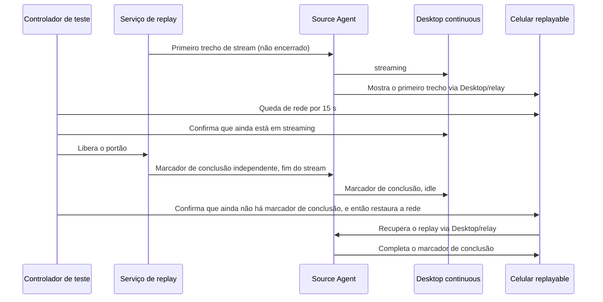

# R3 harness de servidor e2e remoto (simulação na mesma máquina)

O código de orquestração fica em `harness/remote/`; este documento é a descrição factual sobre ele. Objetivo: **todos os e2e case de conexão remota podem rodar em um único servidor Linux**, com o lado remoto simulado por contêineres Docker na mesma máquina, sem buscar validação entre máquinas.

Os comandos atuais, o ambiente de build, a verificação de autenticidade do código-fonte, o agendamento e as regras de limpeza estão unificados no [README do harness](../../harness/remote/README.md).
Este documento mantém a topologia, a fronteira entre real e simulado, as faixas dos case e a atribuição histórica; resultados de datas diferentes não podem ser concatenados em um PASS total atual.
Os resultados de escopo SSH de outubro estão no [guia de regressão](desktop-ssh-guide-regression.md).

A meta de 50 execuções / 2 horas da aceitação completa está no [plano de testes](r3-remote-automation-plan.md); as 10 rodadas / 10 minutos deste harness só provam a faixa mais curta correspondente.

## 2026-10-11 Resultado da reverificação completa

Status: done

O objetivo desta rodada foi concluído: **90 spec remotas, 109 tarefas todas executadas** sobre a mesma linha de base de negócio; consolidando pela evidência válida mais recente de cada tarefa, **80 PASS, 29 FAIL**, sem itens não executados, não triados ou bloqueados por ambiente. Os 29 falhas foram registrados na ocasião como comportamento de negócio, sem modificação de código de negócio. A revisão posterior de causa raiz retirou entre eles um erro de classificação do contrato antigo de recuperação; veja a seção abaixo.
As correções de teste foram reverificadas; as asserções posteriores bloqueadas por falhas de negócio estão listadas em cada registro de problema.
Foram retractados um PASS atribuído localmente de forma incorreta e um PASS produzido por um coletor de varredura que engolia exceções.
Este não é um lote único todo verde, nem uma promoção manual nem uma admissão em CI.

A lista completa de fontes do patch de teste final 10 tem SHA-256
`423980d542925b4f4b31a8fe00f02d23372d5b8c7a443974c41d0a34aa289c9c`, verificada em test / production, continuando a reutilizar a construção de negócio já definida. Linha única e múltiplas linhas com histórico antigo natural, reversão para o programa antigo real, Team/ZAPI/Docker reais, os dois cenários de celular, 10 rodadas de reconexão e estabilidade de 10 minutos em duas pontas já têm evidência de aprovação. O celular é um viewport touch de Chromium; as rodadas especiais nativas de Windows/macOS não são substituídas por esta execução em servidor Linux.

Lote do patch 09 `r3-server-20261011150809016-2aeaba`: 3 PASS, 4 FAIL;
lote do patch 10 `r3-server-20261011153818711-6d284c`: acessibilidade PASS (153.6 s), varredura FAIL (264.0 s).
A varredura manteve as 45 capturas de evidência com vídeo completo, e a única falha foi o cartão de progresso recolhido; após o container real parar e subir, a porta do backend mudou de 33089 para 33091, e a linha original do aplicativo foi restaurada por um proxy estável; os trechos de arrastar e de restauração foram concluídos. Após a isolamento de histórico de P0 em quatro turnos e a conclusão da telemetria, ainda falhou pela ausência do indicador de execução na linha B.

### 2026-10-12 Revisão de causa raiz

O problema 11 foi corrigido conforme a propriedade das credenciais; o problema 15, sobre "na nova versão o cold start deve restaurar todas as tabs da lista antiga", conflita com F5 de projeto virtual, de modo que essa classificação de negócio foi retractada. A nova versão só restaura `lastActiveWorkspace`; as demais entradas de projeto são mantidas e abertas sob demanda.
A falha original de `project-order` ocorreu na verdade ao esperar uma tab não ativada depois de uma conexão manual, e não na falha de restauração B do cold start.
As cinco aceitações de cold start do lote de revisão `r3-server-20261012012923737-60d156` passaram todas; 25 manteve FAIL de negócio na ocasião, e depois foi corrigido.
Os resultados direcionais desta rodada valem o que está nas novas evidências do [problema 11](../issues/remote-e2e-stability/11-ssh-credential-missing-after-restart.md) e do [problema 15](../issues/remote-e2e-stability/15-cold-start-open-workspace-siblings.md); a tabela abaixo mantém o mapeamento de tarefas do lote original e não indica mais que há 29 defeitos de negócio confirmados.
O problema 25, depois que o owner de inicialização completou o cwd app-owned, teve PASS tanto no cenário original de mudança de configurações quanto no cold start remoto no lote `r3-server-20261012013853643-f32109`; antes e depois do restart do Worker o exit=0 e o frame de conclusão de armazenamento foi emitido normalmente, com detalhes em[problema 25](../issues/remote-e2e-stability/25-data-directory-restart-startup-failure.md).

O problema 07 já corrigiu a passagem do assistente para o menu de projeto / tab não carregada, a ausência de códigos de erro de credenciais e a leitura incorreta de um estado terminal antigo em um novo ciclo de recuperação.
A linha de base `07c35ed00085b9bb105d07633488951ff02032c2` mais o patch final tem SHA-256 da lista de fontes
`3da756d09a6a91969782149c7f1d177124e49e5def287fcfde14ed11d56cd85d`.
Os lotes `r3-server-20261012042036306-3218d0` e `r3-server-20261012042909750-5eed5a`
usam o mesmo código-fonte e a mesma construção; os sete itens do problema 07 e os dois itens adjacentes de recuperação/cold start passaram todos.
A asserção antiga de "duas tabs" na atualização em segundo plano foi alterada para F5: o projeto ativo é restaurado automaticamente e os demais são abertos sob demanda; a atualização manual ainda verifica a restauração A/B.
Detalhes e limites de verificação no [problema 07](../issues/remote-e2e-stability/07-existing-project-upgrade-intent.md).
Estes nove resultados direcionais não representam uma reexecução das 109 itens completas, nem uma promoção de caso ou admissão em CI.

### Mapeamento das falhas do lote original

| Tarefa                                                                                                                                                                 | Registro de problema local                                                                                                                      |
| -------------------------------------------------------------------------------------------------------------------------------------------------------------------- | --------------------------------------------------------------------------------------------------------------------------------- |
| `serverupdate`, `serverupdate-force`, `uninstall`, `version-manual-required`, `version-snapshot-failure-required`, `version-automatic-required`, `projectnavigation` | [Ausência da passagem de autenticação, atualização e reinstalação na conexão de projeto original](../issues/remote-e2e-stability/07-existing-project-upgrade-intent.md)                    |
| `boundary`, `recov`, `project-order`                                                                                                                                 | [Conexão SSH já salva fica sem credenciais após um cold restart](../issues/remote-e2e-stability/11-ssh-credential-missing-after-restart.md)                     |
| `sourcelines`                                                                                                                                                        | [Projeto remoto criado a partir de symlink não converge para a identity de realpath](../issues/remote-e2e-stability/12-project-symlink-workspace-identity.md) |
| `renderer`                                                                                                                                                           | [Tarefa remota já pronta não pode ser trocada após reload do Renderer](../issues/remote-e2e-stability/14-renderer-reload-task-navigation.md)                   |
| `mixed`, `coldreconnect`, `rdux14`                                                                                                                                   | [Cold start não completa o outro workspace remoto já aberto](../issues/remote-e2e-stability/15-cold-start-open-workspace-siblings.md)                     |
| `settings-safeguards`                                                                                                                                                | ["Mostrar na barra lateral" na página de configurações não posiciona o foco no projeto](../issues/remote-e2e-stability/16-settings-show-project-focus.md)                          |
| `directory-missing`, `directory-file`, `directory-denied`                                                                                                            | [Histórico da tarefa original não abre quando o diretório remoto fica inválido](../issues/remote-e2e-stability/17-unavailable-root-history-navigation.md)                    |
| `history-conflict`, `history-conflict-sources`                                                                                                                       | [Conflito de histórico de um único workspace bloqueia toda a página de seleção de projeto remoto](../issues/remote-e2e-stability/19-history-conflict-blocks-project-picker.md)           |
| `retry-budget`                                                                                                                                                       | [A reconexão automática executa três vezes, mas a página do projeto não mostra o progresso de nova tentativa](../issues/remote-e2e-stability/20-retry-progress-not-visible.md)                       |
| `version-optional`                                                                                                                                                   | [Depois de conectar em uma versão compatível, o cartão do dispositivo lacks a atualização adiável](../issues/remote-e2e-stability/21-optional-update-notice-missing.md)             |
| `uipairwise`                                                                                                                                                         | [Depois de abrir o editor pelo menu de projeto, o foco continua no body da página](../issues/remote-e2e-stability/22-project-editor-focus-missing.md)                      |
| `version-controller-required`                                                                                                                                        | [Os detalhes do gate de versão não explicam que o desktop deve ser atualizado](../issues/remote-e2e-stability/23-desktop-upgrade-guidance-missing.md)                         |
| `p0-main`                                                                                                                                                            | [A sessão remota está gerando e a linha de tarefa da barra lateral não tem indicador de execução](../issues/remote-e2e-stability/24-remote-task-running-indicator-missing.md)            |
| `desktopauthority`                                                                                                                                                   | [Cold start falha depois de mudanças nas configurações e no diretório de dados do desktop](../issues/remote-e2e-stability/25-data-directory-restart-startup-failure.md)                 |
| `uiwalkthrough`, `three-screen`                                                                                                                                      | [Depois de recolher o assistente de conexão, a interface principal não mostra o cartão de progresso](../issues/remote-e2e-stability/26-minimized-connection-progress-missing.md)                      |

Há também a [descrição de reconexão na inicialização que ainda diz 7 dias](../issues/remote-e2e-stability/13-startup-reconnect-description.md), que não determina sozinha o estado final de uma tarefa.
A [suspeita de histórico antigo que não abre](../issues/remote-e2e-stability/18-upgraded-project-history-open.md) foi descartada com base em cliques reais e em evidência completa de reversão, e classificada como correção de teste.
Cada registro de problema descreve o passo alcançado, a evidência de execução e as asserções posteriores bloqueadas; nenhuma falha foi apagada nem convertida em skip.

### Tempo decorrido e confiabilidade dos testes

- A desinstalação formal removeu a espera fixa de 3 + 30 segundos, passando a digitar a entrada nos dois prompts de confirmação reais; o comando de desinstalação mediu 1527ms, preservando as asserções de dados e identidade.
- O conflito de histórico falha imediatamente quando a página do projeto já tem um erro claro: as duas variantes caíram de 880.0 / 865.2 s para 328.2 / 304.8 s; o conflito de negócio original continua FAIL.
- O estado de execução usa um portão de replay explícito, o arraste usa uma barreira de evento de ativação, e refresh e restart não esperam rascunhos padrão sem relação; a janela de observação de estabilidade de 10 minutos não foi encurtada.

Os lotes originais, gravações, logs, fixtures e listas de fontes de código ficam nos artefatos de batch/case do servidor; nesta máquina,
`packages/desktop/.e2e-artifacts/r3-full-20261011/` guarda o estado final dos lotes e o `latest-results.json`.
Problemas de negócio exigem alteração posterior do produto para serem verificados; esta rodada entrega apenas testes, fixtures e documentação.

### Histórico de execução e detalhes de verificação

O commit de negócio inicial é `d31e735905cf744e75a0a93548a80acabe871ae5`, e o workspace não tinha modificações não commitadas.
O primeiro lote foi `r3-server-20261011100322804-2c6d71`, construído e executado em novos despliegues de test / production, preservando o deploy original e a fixture de atualização da versão antiga `7a6e2eb3f1946aba9155155178e86cd947cee655`.
O plano original da primeira rodada tinha 108 itens, incluindo o item de estratégia de projeto offline pendente de execução; correções de teste e resultados de reexecução posteriores devem ser listados separadamente.
A revisão da lista de verificação encontrou que o `snapshot-failure-required` da política de versão já tinha especificação de aceitação e branch de case, mas não havia sido enfileirado; após incluí-lo o plano passou a 109 itens; a estratégia de projeto offline passou a ser um item de execução real, sem mais ser substituída por execução bloqueada por fixture dedicado.

Primeira execução completa e registros de cancelamento iniciais:

| Lote                                 | Escopo e resultado                                                                      | Ação posterior                                                                                |
| ------------------------------------ | ------------------------------------------------------------------------------- | --------------------------------------------------------------------------------------- |
| `r3-server-20261011100322804-2c6d71` | 108 itens originais: 6 FAIL, 101 NOT_RUN, 1 BLOCKED_ENV                                 | Após as primeiras falhas comuns, cancelamento normal; em execução confirmou-se que a área de projeto não fez hover e que o pai do botão tinha opacity 0, corrigindo-se o gesto de teste |
| `r3-server-20261011101534847-c8a52a` | 3 itens direcionais: projectpolicy PASS; boundary, version-snapshot-failure-required FAIL | Verificação completa do projeto offline em Linux passou; a regressão do ponto de entrada de atualização está registrada no problema 07, a descrição de boundary continua em triagem                 |
| `r3-server-20261011101924000-585080` | Fila corrigida com 109 itens: 3 FAIL, 106 NOT_RUN                                            | A gravação confirmou que o novo diálogo de seleção de projeto já estava aberto, e o laço antigo de preparação julgou errado o fechamento e clicou na barra lateral obstruída; após o cancelamento removeu-se a verificação duplicada    |
| `r3-server-20261011102357092-0ef726` | ackloss com PASS original, 148.6 s (a auditoria de atribuição posterior não passou)                               | O relatório original passou, mas depois se descobriu que a criação global pula para o local; não pode valer como cobertura remota válida, deve ser reverificada após a correção de atribuição      |

O lote de retomada completa foi `r3-server-20261011102656782-52518d`, e o serviço de processo independente
`r3-full-20261011-03` foi cancelado normalmente após a descoberta do erro de atribuição de tarefas públicas. O status original de ackloss desse lote era PASS,
mas o helper atual cria uma tarefa global depois de selecionar o modelo remoto; em execução confirmou-se que recov e renderer tinham a active identity
vazia e o cwd no diretório local não classificado, e soakrecon usou por engano o modelo local, o que provocou um replay de protocolo por re-tentativa. Os resultados desse lote que envolvem esta cadeia de preparação
devem ser reexecutados depois de remover a criação global extra e de adicionar asserções de identity/path antes do envio, e não podem usar o PASS original como prova de cobertura remota;
a diferença de entrada atual da descrição de boundary está no [problema 10](../issues/remote-e2e-stability/10-connection-wizard-test-entry.md).

Reverificação posterior válida de atribuição remota:

| Lote                                 | Escopo e resultado                                     | Limite de evidência                                                                       |
| ------------------------------------ | ---------------------------------------------- | ------------------------------------------------------------------------------ |
| `r3-server-20261011103719304-29be6d` | ackloss PASS, 148.7 s                         | Confirma-se a identity/path remota real antes do envio; substitui os resultados locais inválidos anteriores                   |
| `r3-server-20261011104332183-3a0c00` | boundary FAIL, 90.1 s; ackloss PASS, 146.5 s | As descrições de primeiro/segundo projeto passaram; a perda de credenciais no cold restart está registrada como problema 11. Uma única amostra de tempo não prova aceleração estável |
| `r3-server-20261011105317614-4a6780` | 109 itens todos executados: 37 PASS, 70 FAIL, 2 ERROR      | A versão de negócio não muda, patch de teste 05; correções locais posteriores feitas durante a execução não entraram no deploy em execução          |

O lote direcional do patch de teste 06 `r3-server-20261011123601821-eca14c`: 5 PASS, 5 FAIL.
Passaram entryattr, cancelretry, botidentity, mobileperm, live-team; o Team usa o material após novo login do usuário.
Entre as falhas, provisioning-failure já alcançou a falha real de sincronização e precisa desdobrar os detalhes colapsados para conferir o código técnico; sidebar-menus
completou as matrizes online/offline, zh/en/tema e reconexão, e no fim tratou um tooltip de hover normal como camada residual; history-single
gerou um novo projeto "(2)" no mesmo diretório, mas a tarefa antiga continua pertencendo ao projeto original, e foi alterado para reentrar no projeto original pelo projectId após a migração.
A troca de tarefa no Renderer continua em triagem, ver [problema 14](../issues/remote-e2e-stability/14-renderer-reload-task-navigation.md).

A fila direcional do patch 07 cobriu as 67 itens ainda não aprovados entre os FAIL/ERROR da primeira rodada, e todos terminaram: 29 PASS, 38 FAIL.
Os resultados aprovados mantêm suas próprias listas de fontes e lotes; dos 71 PASS acumulados originalmente, o item de varredura foi depois retractado, com número efetivo de 70.
Esta é a primeira execução completa e a reverificação item a item sobre a mesma linha de base de negócio; não se reivindica que um lote de código-fonte passou integralmente.

As 23 reverificações do lote do patch 08 `r3-server-20261011143037600-31012b` terminaram todas: resultado original 7 PASS, 16 FAIL.
A auditoria descobriu que uiwalkthrough engole falhas de trecho: as duas execuções tinham falhas no progresso em segundo plano, na restauração do container e no trecho de arraste, e o PASS original foi retractado das estatísticas efetivas.
Excluindo esse item, 76 tarefas acumulam PASS efetivo nesta etapa; a varredura continua coletando a evidência de todos os trechos, mas qualquer anomalia de trecho precisa fazer o veredito final falhar.
A amostragem quadro a quadro também precisa alcançar o estado alvo; esgotar o tempo sem satisfazer a condição não pode simplesmente retornar false e ser ignorado pela chamada.
Mediu-se que o mapeamento dinâmico de SSH do Docker muda de 33087 para 33088 depois do restart do container, e a porta antiga fica inacessível enquanto a nova funciona normalmente.
A varredura usa um proxy TCP mantido durante todo o percurso para manter estável a linha do lado do aplicativo, atualizando o backend conforme o mapeamento real do Docker após o restart; preservam-se a parada real do container, a queda de conexão e o novo handshake.
Os dois cenários de celular e a sincronização explícita de plugin passaram; depois, 7 itens de correção ou verificação complementar de teste receberam o patch 09, preservando as falhas de negócio.

O `soakdual` do lote do patch 07 `r3-server-20261011125749338-152f05` passou, com 686.3 s no total,
preservando a janela completa de observação de 10 minutos e completando 65 rodadas (rodadas acumuladas 603370ms, 21 recuperações após queda de rede no celular).
Perda de entrada, ausência de desktop, ausência de eco no celular e falhas de recuperação após queda de rede foram todas 0,
e o número máximo de Host / Agent foi 1 cada. As amostras de RSS no início e no fim foram 1220 / 1211 MB; isto é apenas desta amostra e não extrapola para uma prova de ausência de vazamento de longo prazo.

Verificação das correções de teste locais posteriores: o typecheck de root e de E2E passou, a arquitetura não tem violações; os testes unitários afetados
passaram 35 arquivos, 142 casos e 14 casos de scripts Node; o lint ficou em 0 errors e 207 warnings já existentes.
Das 51 conversation spec alteradas, 48 passaram no contrato de fixture de replay; `live-team`, `live-zapi` e
`dockertrn` usam requisições de conta reais, e a linha de base original não tinha fixture/manifest de replay configurado, de modo que o verificador genérico de fixtures reporta ausência para esses três.
Mantém-se essa limitação de verificação, usando a fila live real como evidência de execução, sem forjar respostas de replay para passar na checagem e sem promover por causa dela.

Correções de teste e limites de evidência:

- A nova tarefa global pertence ao local não classificado; o envio remoto usa o rascunho do projeto, esperando por Source identity + path.
  O Source B com o mesmo caminho não pode tomar emprestado o estado já ativado do Source A para passar antes da hora.
- O assistente de conexão específico é acessado pela página de configurações; depois de fechá-lo, a nova tentativa acontece na mesma página de configurações. A nova entrada de projeto e o assistente de três telas independente são verificados separadamente.
  O histórico de atualização da versão antiga usa de forma fixa a operação da UI antiga, sem aplicar o resumo de diretórios nem o editor de projeto da nova versão.
  Depois de reverter para o programa antigo, a conexão ao diretório original é refeita pela entrada de novo rascunho da versão antiga, sem usar o seletor de linha de projeto da nova versão como precondição.
  O atalho de diretórios recentes também abre o editor de projeto com o root pré-selecionado; o diretório precisa ser conferido e o salvamento concluído antes de seguir com as operações de configuração.
  Um erro explícito na página de seleção de projeto deve encerrar imediatamente a espera e trazer a causa original, e não tratar o botão "Novo projeto" desabilitado por erro como se ainda estivesse carregando.
  O gate de versão do desktop lê a razão de atualização visível pela entrada atual "Precisa de ação → Informações detalhadas", e verifica que o arquivo remoto não foi rebaixado, e não apenas varre a página inicial não expandida.
  Depois de recolher o assistente de conexão na página de configurações, deve-se voltar à interface principal e então conferir o cartão de progresso da área de projeto exigido pelo contrato; a própria página de configurações não é o local de exibição do cartão.
- A desconexão ativa espera a projeção offline real do projeto-alvo, e não o campo obsoleto de settings history failed.
  O reload do Renderer usa o ACK válido de Main ready de cada attachment original como evidência de recuperação, e o cache de navegação não substitui o owner do attachment.
  Nos cenários de acessibilidade e de configurações do desktop, o refresh/cold restart só espera a interface principal operável, sem exigir de volta o rascunho de projeto padrão, sem relação com a asserção.
  O retry-budget mantém a exigência de três visibles de progresso; essa asserção de exibição fica no fim do cenário, para que a ausência de progresso não impeça a recuperação silenciosa posterior nem a coleta de evidência de tomada manual.
- Sob a [especificação do projeto atual](../superpowers/specs/2026-10-10-session-manage-upstream-integration.md), os detalhes/edição do dispositivo ficam na página de configurações,
  e a barra lateral verifica o menu de projeto, o nome do dispositivo, o teclado, o tema e o viewport. Depois de remover a entrada local, reentra-se no projeto remoto original,
  sem tratar um novo projeto no mesmo diretório como recuperação do projeto original e sem exigir que a remoção de membership feche todo o Source attachment.
- A verificação de diretório inválido adota o [contrato de disponibilidade do root principal](../project-primary-root-availability.md):
  Source/B/C permanecem online, a criação/entradas de arquivo de A ficam desabilitadas e o histórico permanece legível; depois que o diretório é restaurado, o focus é atualizado e a conversa continua.
- O case original de provisioning-failure permanecia cerca de 10 minutos no prompt de confirmação de instalação; passou-se a confirmar de fato a primeira instalação e então observar a falha injetada.
  A finalização da falha restaura a chave de injeção apenas dentro do lock do arquivo de credenciais, preservando as credenciais SSH salvas durante a conexão.
- A desinstalação formal digita DELETE duas vezes, uma por prompt de confirmação real, removendo a espera fixa de 3 + 30 s do pipeline de shell antigo;
  preserva-se a conferência da CLI de desinstalação e do sentinela de dados, e registra-se o tempo real de desinstalação. A fase de desinstalação formal do lote direcional `r3-server-20261011123601821-eca14c`
  mediu 1527ms; o case completo ainda falha no ponto de entrada de reinstalação, e a execução otimizada não é contada como PASS.
- O primeiro envio/envio seguinte do SSH P0 usa o controlled replay existente: para na porta de saída do primeiro trecho e libera o frame final depois das asserções de active/running da barra lateral.
  A resposta fixa de 1200ms às vezes terminava antes da observação na barra lateral, e não pode ser resolvida alongando a espera fixa nem removendo as asserções de estado de execução; o diagnóstico de falha registra o estado booleano final.
  A ausência já confirmada do ícone de execução é adiada para o resumo final de falhas, continuando a conferir o histórico de quatro turnos e a telemetria; divergência de linha, de active ou de error ainda falha imediatamente.
- A fixture de identidade sintética do Bot diferencia o contexto antigo (sem hostId) da chave de autorização de projeto da nova versão. O probe real do serviço Bot recusava autorização antes da correção,
  e depois da correção as duas entregas entram no mesmo Source, com uma conexão e zero entregas locais; já passou na fila real.
- A home do celular já mostra projetos/tarefas compartilhados, e o texto antigo de pareamento não existe mais. A cadeia de prontidão é "URL de pareamento → projeto/tarefa especificado visível →
  status de conexão do celular no Desktop → operação de negócio"; não se julga sucesso por uma barra lateral vazia, e a janela longa de observação não é encurtada.
  Quando o cenário seguinte do mesmo arquivo reutiliza a página remota já autenticada, volta-se explicitamente ao projeto local padrão para a preparação; a cada substituição do handle do navegador, fecha-se a instância antiga.
- A sincronização explícita de plugin confere primeiro "sincronizado" e a materialização remota, depois fecha o diálogo de resultado e cria a sessão de verificação a partir do projeto original; não se clica na barra lateral atravessando a máscara do modal.
- A pré-visualização de imagens limita as miniaturas enviadas pelo pane principal e as abre por ponteiro real; o DOM de saída após a reconexão não é alvo de interação, e em caso de falha mantém-se um snapshot de diagnóstico independente.
- O arraste de projeto precisa cruzar o limiar de ativação e observar aria-pressed antes de enviar o deslocamento real; um evento de mousefundido pode ativar apenas o sensor e não pode ser tomado como arraste ocorrido. A acessibilidade e a varredura compartilham o mesmo gesto.
- O refresh das configurações de Provider volta ao workspace original e não espera o diretório local padrão que nunca foi trocado; o probe de tab com parâmetro vazio lê o projeto realmente ativado,
  e não pode tomar "nenhum caminho correspondido" como "não há remote session". Os testes unitários relacionados e este E2E real da rodada já foram verificados.

A lista completa de fontes de código dos patches de teste e o resumo dos patches são salvos de forma independente; o commit de negócio é sempre o inicial acima. As duas primeiras execuções canceladas não contam como execução completa, e NOT_RUN não é fundido em aprovação. As gravações de falha, os logs e os tempos por etapa ficam em cada lote original.

Esta rodada cobre a fila remota completa da linha de base de negócio escolhida, incluindo SSH de desktop, celular, Docker, contas reais e variantes de histórico da versão antiga.
A atribuição é feita pela lista real de fontes de código, pelo ambiente de build, pelo batchId e pelo resultado item a item, sem fundir contagens de aprovação de versões de negócio diferentes.
Os itens com fixture dedicado permanecem no denominador; depois de completar o ambiente independente eles são de fato executados, sem substituir o E2E por auditoria estática ou probe de ambiente.

- Problema de código de teste: salve primeiro os logs de falha, a interface e as evidências de estado, e confira a especificação de aceitação; modifique apenas o case, a fixture ou a orquestração,
  preservando as asserções e a cobertura originais, e registre o resultado da correção depois de reexecutar os itens afetados.
- Problema de código de negócio: salve a reprodução, o esperado e o real, a versão de execução e o impacto, e escreva no registro local de problemas; esta rodada não modifica a implementação de negócio.
- Otimização de tempo: registre primeiro os tempos de preparação, interação, replay e limpeza, e então elimine esperas ou preparações repetidas sem significado de negócio,
  usando a mesma linha de base de negócio para comparação antes/depois; não encurte a janela longa de observação, não engula falhas e não aumente a taxa de aprovação por retry automático.
- Condição de conclusão: cada item da lista completa tem um resultado real; os problemas de teste foram corrigidos e reverificados, os problemas de negócio têm evidência e registro,
  os problemas de tempo foram avaliados e receberam otimizações que preservam a semântica, e as checagens de código aplicáveis passaram. Bloqueio de ambiente não pode ser registrado como PASS.

```text
Linha de base de negócio fixa → verificar autenticidade de test / production → fila completa e tempo por item
                                        ├─ Problema de teste → corrigir → reverificar na mesma base
                                        ├─ Problema de negócio → Issue local e evidência original
                                        └─ Case lento → medir → otimizar mantendo a cobertura → comparar
```

## Topologia

### Isolamento paralelo e resultados confiáveis (2026-09-16)

A otimização é limitada pelas asserções de negócio existentes: não encurta os 10 minutos/10 rodadas do soak, não transforma fluxo de falha em resposta normal e não
transforma handshake, instalação, Provisioning ou execução remota em dublê de teste. Ações puramente preparatórias podem semear fixtures locais;
o teste de instalação continua usando um alvo novo. Casos antigos que conflitam com o contrato de layout de projetos devem ser migrados ou reportar explicitamente o bloqueio de contrato, e não
podem ser classificados como falha de produto por timeout nem filtrados para alegar aprovação total.

```text
Fonte/build fixos → agendador (único owner de recursos e resultados)
                 ├─ Slot 1: HOME/display/runId/container independentes → casos em série
                 ├─ Slot 2: HOME/display/runId/container independentes
                 └─ Slot 3: HOME/display/runId/container independentes
                         ↓
                  resultado por caso → resumo total (aguarda todos terminarem)
```

As regras de admissão de recursos, exclusividade do celular, exclusão mútua do live, lock de lote, evidências e saída por falha estão no README.
É obrigatório preservar HOME/display/alvo independentes, instalação e handshake reais, todos os denominadores planejados e a distinção entre FAIL/BLOCKED/ERROR/TIMEOUT; não se pode mascarar falhas com retry automático.

Aceitação: os testes unitários do agendador provam o limite de concorrência, a exclusão mútua do live, a sobreposição do soak de desktop puro com casos comuns, a exclusividade do item de celular durante toda a execução, a continuidade após falha e a completude dos resultados;
a verificação em nível de processo prova a coleta de timeout e a limpeza do serviço de display; escolha SSH comum, alvos duplos/falhas e um soak representativo para uma validação em lote pequeno.
A amostragem valida apenas o mecanismo de orquestração; a estabilidade dos casos continua comprovada pela execução real e independente da lista completa e das asserções finais. Falhas de negócio e bloqueios de ambiente não contam como aprovação.

O valor padrão de três slots se baseia na comparação de seis itens com o mesmo fonte em 2026-09-24 (todos aprovados, tempo de parede 493.35 s → 422.54 s) e na execução completa de 70 itens após a correção da exclusividade do celular: o lote `r3-server-20260924160231661-54c15b` levou 4029.12 s, com CPU médio de 71.21% e memória livre mínima de 3617.2 MiB. Essa rodada completa teve 64 PASS, 4 FAIL de negócio já registrados e 2 VPN BLOCKED_ENV; as três páginas de celular não tiveram erro de carregamento de recursos e o intervalo de execução não teve sobreposição. O código-fonte total difere do das rodadas iniciais de dois slots, de modo que a diferença de tempo de parede não pode ser atribuída inteiramente à concorrência; a comparação com o mesmo fonte sustenta apenas cerca de 14.4% de melhoria de tempo de parede nos seis itens medidos.

Registro de candidatos posterior em 2026-09-24: o cenário de recuperação de falha de escrita do Provisioning PRV-12, reforçado depois, já foi verificado de forma independente três vezes; o cenário PRV-13 de RPC real sem retorno expôs três vezes a [página de gerenciamento de dispositivos bloqueada por estatísticas remotas](../issues/remote-e2e-stability/04-management-blocked-by-remote-counts.md). O item como um todo continua FAIL, e o PASS da rodada completa com a versão antiga não pode ser reaproveitado. Esse candidato histórico mantém o denominador de 70 itens: 63 itens já têm evidência de pelo menos três aprovações válidas, 5 itens têm falha de negócio ou asserções posteriores não alcançadas e 2 itens estão bloqueados por VPN; o branch positivo do editor nativo também ainda não foi verificado em macOS/Windows.

```
┌────────────────────────────────────────────────────────────────────────────┐
│ e2e server (Ubuntu 24.04 / x86_64)                                         │
│ xvfb-wm-run: Xvfb dynamic display + openbox + dbus-session                 │
│   └─ wdio → Electron Desktop (separate HOME/profile per case)              │
│         │ Product SSH dialog: 127.0.0.1:<mapped port>, dev / random pw     │
│         ▼                                                                  │
│   docker: zcode-r3-server-a  [dev + tunnel user]                           │
││                          c / d / e / f / dt (other tiers)                 │
││                                                                           │
│   replay provider ──SSH forwardIn(tunnel user)──► container 127.0.0.1      │
│   docker exec ───────────────────────────────► fault injection / probe     │
│   mock-cdn/releases/<版本> ── local download/upload of zcode-server        │
└────────────────────────────────────────────────────────────────────────────┘
```

Pontos-chave: o protocolo SSH, o sshd remoto, o processo server/Agent remoto e o sistema de arquivos remoto são reais; apenas
"ser outra máquina" é simulado. A porta do container é vinculada apenas a `127.0.0.1`, portanto o Desktop precisa estar na mesma máquina que o container.

## Fronteira entre real e simulado

| Etapa              | Implementação                                                                                                                                                                    |
| ----------------- | ----------------------------------------------------------------------------------------------------------------------------------------------------------------------- |
| Conexão              | O popup SSH do produto preenche host/port/user/password de verdade, apenas com autenticação por senha                                                                                                                 |
| Host remoto          | Container Docker na mesma máquina (`zcode-remote-ssh:test`), reconstruído a cada case                                                                                                               |
| server/Agent remoto | Instalado e executado de verdade, o teste lê PID/startTicks/logs remotos para conferir                                                                                                                            |
| Artefato do server       | `mock-cdn/releases/<versão>` construído localmente, instalado por "download/upload local", sem CDN real                                                                                                |
| Requisições de modelo          | Padrão replay: `createSSHReplayTunnel` expõe via reverse port forwarding SSH o replay server local como `127.0.0.1:<porta>` dentro do container; o usuário `tunnel` é separado, para evitar ser arrastado pela falha de "matar o sshd do dev"     |
| Modelos reais          | Apenas os três cases `live-zapi`, `live-bigmodel-team` e `docker-transport`                                                                                                      |
| Injeção de falhas          | `docker exec` mata o sshd dentro do container / sonda somente leitura; proxy TCP local em loopback suspende a primeira conexão; proxy HTTP local valida o caminho de download; fonte de release falsificada                                                     |
| Lado celular            | chromium local (`R3_MOBILE_CHROME`) com viewport 390×844; por padrão hospeda a build Web v4 do mesmo código do lote, usando o relay externo padrão de teste (`wss://zcode.z.ai/ws`); a URL explícita de página continua válida |

## Mapeamento de Case e faixas

A fila `harness/remote/run-all-remote.sh` declara a lista completa, coordenada pelo `run-queue.mjs`. A lista precisa se consulta com `node harness/remote/run-queue.mjs --list`; as três variantes de instalação restrita contam como itens de execução separados. O `projectpolicy` usa o HOME independente do runner para semear a entrada offline e é executado na faixa sem alvo; não se substituem as asserções offline por um projeto SSH online. Os demais casos são agrupados pelas capacidades abaixo:

`SSH-P0-CONN-08` (`conversation-session-ssh-provisioning-failure.test.ts`) entra na lista remota como exceção de nomenclatura,
usando a chave de fila `provisioning-failure` e um alvo SSH único comum. Esse caso valida o diagnóstico seguro e a nova tentativa de recuperação para credenciais corrompidas,
não envia requisições de modelo e não precisa de conta live; mantém o status pending, e entrar na fila não representa promoção manual nem execução aprovada.

`R3A-DEV-06-hooks-local-scope` e a spec de reconexão do banner usam respectivamente as chaves de fila `hooks-local-scope` e
`banner-reconnect`, com alvo SSH único comum e o grupo `replay`. O primeiro valida o isolamento de armazenamento do escopo de Hooks local e remoto; o segundo cria um proxy TCP dentro do caso e injeta queda de conexão, e a spec inteira é executada em ordem, sem filtrar o cenário de queda antes do handshake.
Ambos mantêm o status pending; a checagem da lista precisa ainda conferir o plano de execução realmente gerado, para evitar registrar apenas a spec sem enfileirar a fila.

| Grupo                           | Faixa                                       | Descrição                                                                                                                                                         |
| ---------------------------- | ------------------------------------------ | ------------------------------------------------------------------------------------------------------------------------------------------------------------ |
| 1 Estrutura e recuperação                 | `a` (entry-attribution usa `a`+`c`)        | boundary / ack-loss / mixed / recovery / renderer / shared-waiters / source-lines / stale-gen / transport-loss                                               |
| 2 UI / dispositivo / configurações           | `a`, offline-icons e remote-dialog sem conexão | device-row / task-actions / ui-pairwise / settings-scopes / desktop-settings-authority / offline-icons / remote-dialog / settings-ui-polish(MP-UI-05-remote) |
| 3 Provider / modelo            | `a`                                        | project-entry / provisioning-gui / model-candidates / connectivity / model-switch / queue-selection / provisioning-ready                                     |
| 4 Tarefa / sessão                | `a`                                        | compact-goal / subagent / task-control / task-faults / task-lifecycle / settings-overlay                                                                     |
| 5 Desenvolvimento remoto                   | `a`                                        | attachments / media-preview / file-local-actions / remote-hooks / terminal                                                                                   |
| 6 Instalação / atualização / ciclo de vida da conexão | `a` (install-faults usa `a`+`c`)           | daemon-detached / install-faults / server-update / uninstall / cancel-retry / cold-reconnect / server-fault / download-proxy                                 |
| 7 P0 existente                     | `a`, development-p0 exige container com git        | ssh-remote-p0 / connection-p0 / development-p0                                                                                                               |
| 8 RDUX e escopo              | `a`                                        | rdux-13 / rdux-14 / project-conversation-scope / share-ssh-artifact                                                                                          |
| 9 Plugin de workspace remoto        | identity usa `a`+`c`, sync usa `a`           | WPL-010 / WPL-011                                                                                                                                            |
| 10 Workspace remoto de Bot        | Sem container                                     | BOT-E2E-RW-01（contrato de fixture sintética）                                                                                                                      |
| 11 Móvel                    | `a` + chromium + relay                     | mobile / mobile-permission                                                                                                                                   |
| 12 soak                      | `a`                                        | soak-reconnect(10 rodadas) / soak-dual(10 minutos)                                                                                                                   |
| 13 Instalação em ambiente restrito              | `d` / `e` / `f` / `g`                      | noexec-tmp / no-tar / no-forwarding / old-glibc（injeta getconf que retorna `glibc 2.17`）                                                                          |
| 14 live                      | `a`, docker transport usa `dt`              | live-zapi / live-bigmodel-team / docker-transport                                                                                                            |

Gate de cobertura: `packages/desktop/scripts/r3-remote-spec-inventory.mjs` é o ponto único da lista de spec remotas, e
`packages/desktop/test/r3RemoteSpecInventory.test.ts` valida que a fila cobre a lista. Casos cuja fixture não pode ser produzida na faixa atual precisam reportar o bloqueio explicitamente e não podem sumir do denominador planejado. O RDUX-16 já faz a primeira instalação real dentro do case e depois constrói, pelo archive staged deste run, uma atualização da mesma versão com SHA diferente; não exige mais pré-instalação manual. Após a atualização e a instalação, o hard link deste run é removido antes da escrita, e o pacote de build compartilhado permanece somente leitura.

### Migração da navegação de projetos e valor dos casos

O contrato de layout de projetos de 16 de setembro substituiu o cabeçalho de grupo de dispositivos / connect-and-chat. O nome de arquivo foi mantido para rastreabilidade, e as asserções passaram a refletir o comportamento vigente:

| Caso                                     | Comportamento de aceitação vigente                                                                     |
| ---------------------------------------- | -------------------------------------------------------------------------------- |
| RDUX-13, device-row                      | A reconexão do projeto preserva o diretório, cliques repetidos abrem só um assistente; depois de conectar pela página de configurações, o diretório é escolhido explicitamente; restauração do mesmo Source A/B |
| Antes CWP13/CWP15 project/conversation      | RPN-03/07: sessão de projeto A/B independente, não pode sair para o chat remoto sem projeto                       |
| entry-attribution                        | Atribuição da criação de projetos de mesmo caminho em dois Sources; o segundo projeto não repete o primeiro Provisioning                |
| settings-scopes                          | User vai para a máquina local, projetos remotos A/B são gravados separadamente por identity                                   |
| mixed-entries, provisioning-gui          | Restauração local e remota A/B; mudanças de configuração durante a queda são sincronizadas na reconexão, sessão de projeto independente               |
| recovery-guards, cold-reconnect, RDUX-14 | Projetos offline preservados; guardas de inicialização/desconexão explícita e asserções de histórico e de troca de geração preservadas; uso da página de configurações/linha de projeto           |
| offline-icons, ui-pairwise               | Botão de conexão da página de configurações acessível por teclado; detalhes de projeto e reconexão disponíveis em inglês/tema escuro/janela estreita e em chinês/tema claro/desktop          |

`--audit` apenas impede o retorno de entradas conhecidas e aposentadas, e não representa execução aprovada; o caminho real do produto continua provado pelo E2E.
Os passos dentro do case mantêm a ordem, e as asserções de recuperação de desktop continuous e de mobile replayable não são fundidas.

O slow fixture de `model-switch` e `queue-selection` é liberado explicitamente depois de concluídas as operações críticas, sem esperar em vazio 45 segundos.
O caso de fila verifica, pelo contrato de admissão, que o `model` da requisição única é A, e não espera simultaneamente as duas requisições mutuamente exclusivas A/B até
que uma delas esgote os 90 segundos. Stream recorded/fault não pode usar o mecanismo de liberação, e a evidência de replay registra o tempo real de liberação.
A preparação de Provider semeia apenas a Personal Config local e atualiza o Registry pelo botão de refresh real; o remoto continua passando pelo Provisioning do produto.
Os casos que validam o salvamento/remoção de Provider continuam usando a UI real de configurações.

## Admissão no ambiente VPN Feilian

### Preparação automática antes do teste e espera por autenticação manual

O `vpn.mjs` é responsável pela verificação de pré-requisitos de VPN da implantação e da fila. Se já estiver pronto, segue direto; se não estiver, chama uma única vez um helper de permissão fixa,
iniciando o serviço de forma idempotente e restaurando a proteção de rotas do Docker. Quando o cliente já está em execução, não o reinicia por tempo de atividade: em 2026-10-11
a máquina real já chegou automaticamente à janela de senha de uso único, e a regra antiga de reinício a cada cinco minutos interromperia uma autenticação não concluída.

A preparação espera no máximo 600 segundos por padrão, e `R3_VPN_WAIT_SECONDS` permite definir de 1 a 3600 segundos. O limite de espera controla apenas esta preparação,
e não a validade da autenticação; tanto o timeout quanto o cancelamento preservam o cenário Feilian. Só cada checagem real aprovada libera a passagem, e não o fim da espera ou a existência do processo
no lugar da verificação do túnel, das rotas e do HTTPS. O cancelamento deve encerrar a espera imediatamente, sem fechar o VPN compartilhado.

O progresso é emitido no início da preparação e no sucesso da recuperação; se após 30 segundos ainda não estiver pronto, apenas uma vez é exibida a camada de bloqueio atual: serviço, conexão VPN,
rota do Docker ou endpoint da rede interna. Somente o aviso da camada de conexão pede para ver a janela do Feilian e completar o login/MFA exigido; sem evidência do estado de autenticação do cliente,
não se classifica toda queda de conexão como MFA. Depois que a autenticação é concluída manualmente, a mesma preparação continua automaticamente, e o timeout continua seguindo
a regra existente de registrar a dependência como `BLOCKED_ENV`, sem reexecutar automaticamente testes que já falharam.

```text
Verificação prévia → pronto → executar os testes
    └─ não pronto → iniciar uma vez de forma idempotente → checar continuamente o estado real de prontidão
                              ├─ pronto → continuar automaticamente
                              ├─ 30 s sem prontidão → um aviso de diagnóstico, preservando a janela de autenticação
                              └─ limite de espera / cancelamento → bloqueio / NOT_RUN, preservando a conexão compartilhada
```

O "iniciar conexão VPN automática" do cliente continua sendo um pré-requisito único. Quando não é possível confirmar o estado de autenticação, não se liga o botão de conexão às cegas nem se envia senha de uso único automaticamente; se o próprio cliente travar ou o usuário desativar a conexão automática, é preciso primeiro diagnosticar o cliente, sem mascarar o problema com reinícios em ciclo.

Verificação em máquina real (2026-10-11): com um novo helper implantado sobre a janela de senha de uso único já existente, foram feitas duas chamadas consecutivas e depois uma checagem de preparação de 35 s,
com o PID do cliente inalterado durante todo o tempo; durante a espera houve apenas um aviso de diagnóstico da camada de conexão, e o timeout retornou não zero preservando o cenário de autenticação.
Nesta rodada não foi enviada a senha, e a recuperação real pela rede interna após a autenticação não foi verificada; a continuação após a prontidão, a revisão de estado da última espera e o cancelamento são cobertos por
teste de regressão focado. O deploy do teste antigo precisa da nova versão do `vpn.mjs` para usar o novo orçamento de espera e os novos avisos de diagnóstico.

O VPN é infraestrutura compartilhada do host, gerenciada pelo systemd em `corplink.service`, `feilian-client.service` e
`feilian-local-routing.service`. O primeiro login e o MFA corporativo são feitos por usuário autorizado, com "iniciar conexão VPN automática" habilitado nas configurações do Feilian.
Os testes não salvam material de autenticação, não trocam de conta, não ligam e desligam o VPN a cada case e não fecham o VPN ao final.

```text
Boot do host → systemd inicia o Feilian → conexão automática oficial (MFA manual quando necessário)
Lote de testes → verificação prévia de VPN → uma inicialização/recuperação de serviço quando necessário → utun + rota Docker + sondagem HTTPS
                                            ├─ pronto → build → revisão somente leitura de cada dependência → case
                                            └─ não pronto → dependência BLOCKED_ENV; o restante replay pode continuar
```

`live-zapi` e `dockertrn` declaram explicitamente `R3_REQUIRE_VPN=1`; `--list`, `--audit` e execuções direcionais puramente replay não iniciam o VPN. A preparação da implantação também executa a admissão de VPN. A verificação exige serviço active, `utun` do Feilian com IPv4 global,
sub-rede do Docker ainda pelo bridge local, e resposta HTTPS válida e não 5xx do GitLab; 401/403 provam apenas que a rede está acessível,
e não se passam por autenticação bem-sucedida no repositório. Serviços internos extras podem ser configurados por `R3_VPN_PROBE_URLS` com endereços HTTPS sem credenciais e sem query params.
O lote salva um `vpn-preflight.json` anonimizado; a falha na revisão antes do início do case gera relatório de bloqueio de ambiente, sem iniciar o Electron.

A recuperação é executada por um helper fixo, instalado uma única vez e pertencente ao root, e apenas o usuário e2e autorizado pode chamar esse comando sem argumentos.
Não são concedidas permissões arbitrárias de systemctl/shell. O helper usa o lock do host; inicia de forma idempotente a instância ausente, sempre preservando o cenário de autenticação do cliente já em execução e sem reiniciar por tempo de atividade. Se ultrapassar o orçamento de prontidão, falha explicitamente, aguardando a verificação do usuário.
A aceitação cobre: o estado de saúde não altera serviços, a falta de conexão dispara a recuperação, falhas de MFA/rede/rota não podem dar aprovação falsa, o replay não relacionado não depende de VPN, e a alcançabilidade do GitLab após a conexão real.
A E2E completa ainda não é executada.

Registro de verificação em máquina real (2026-09-17): o "iniciar conexão VPN automática" do Feilian 3.2.16 foi habilitado, e reiniciar
`feilian-client.service` disparou o fluxo de conexão oficial. Com o MFA não concluído, a verificação retornou
`servicesActive=true`, `dockerRouteSafe=true`, `tunnelReady=false`, `ready=false`,
bloqueando corretamente; depois que o usuário autorizado completou a autenticação de uso único, o `utun` foi estabelecido, a rota do GitLab passou para o túnel e o Docker
continuou por `docker0 / table 10144`. Executando a preparação e a verificação como usuário e2e, ambas retornaram `ready=true`, e a página de login do GitLab e a home do ZAPI retornaram HTTP 200; a preparação levou cerca de 0.23 s, a chamada repetida do helper fixo cerca de 0.05 s, o
PID do cliente não mudou e a conexão saudável não foi reiniciada. Chamadas sudo com parâmetros adicionais foram rejeitadas.

O `git ls-remote` do GitLab passou de timeout de conexão para falta de usuário/credencial, o que indica recuperação de rede e não significa que a permissão de leitura do repositório
foi obtida; o checkout de CI ainda precisa das credenciais de acesso correspondentes. A interface do Feilian informa que a conexão atual é desligada automaticamente após 16 horas.
A conexão automática não pode contornar as políticas de expiração/MFA; execuções sem supervisão exigem que o administrador corporativo confirme a política de acesso automático permitida,
caso contrário a verificação prévia manterá o resultado de bloqueio de ambiente. Os scripts de teste não salvam material de autenticação nem fecham automaticamente o VPN compartilhado.

## Contrato de injeção de ambiente

O runner injeta a partir de `resources-<suffix>.json`:

```
ZCODE_E2E_SSH_HOST / PORT / USERNAME / PASSWORD     senha aleatória por rodada, escrita via docker exec chpasswd
ZCODE_E2E_SSH_WORKSPACE_PATHS                        dois diretórios, para isolar os workspaces A/B
ZCODE_E2E_SSH_WORKSPACE_PATH                         forma de workspace único (WPL-011)
ZCODE_E2E_SSH_CONTAINER                              plano de controle do container (docker exec para injeção de falhas)
ZCODE_E2E_SSH_{A,B}_{HOST,PORT,USERNAME,PASSWORD}    dois Sources (quando R3_RESOURCES_B existe)
ZCODE_E2E_SSH_SHARED_WORKSPACE_PATH                  o mesmo caminho POSIX compartilhado pelos dois Sources
DEEPSEEK_E2E_HTTP_MODE=replay + fixture correspondente ao nome da spec
LANG/LC_ALL/LANGUAGE=zh_CN                           fixa a interface em chinês (veja abaixo)
ZCODE_DEV_REMOTE_ASSET_USE_CDN / _CDN_BASE_URL / _CACHE_DIR
                                                     apenas local-download-proxy; o env do Electron é criado
                                                     pelo chromedriver antes do worker, e um export dentro do case
                                                     acontece tarde demais, só a orquestração pode injetar
ZCODE_E2E_MOCHA_GREP                                 roda apenas um caso de dentro da spec (settings-ui-polish
                                                     tem apenas MP-UI-05-remote como caso remoto)
```

## Limite de verificação com conta real no live-team (correção de 2026-09-15)

A `conversation-session-r3-live-bigmodel-team.test.ts` importa o material de login de produção do BigModel, precisa rodar de forma independente,
e o WDIO deve escolher de forma unificada o plano de controle ZCode de produção antes de iniciar launcher / worker / Electron;
ao mesmo tempo define explicitamente `ZCODE_ENV=production` e `BIGMODEL_API_BASE_URL=https://bigmodel.cn`,
porque o domínio de validação de organização/projeto do Team é independente do plano de controle do ZCode. A lista branca de ambiente do SSH repassa `ZCODE_ENV`,
mas não repassa a sobrescrita do endereço BigModel; ao sobrescrever apenas o endereço local, o remoto continuará requisitando `bigmodel.cn`.
Os casos com conta real também precisam usar `R3_BUILD_ENV=production` no build: o `buildHostProcessEnv` do Desktop
reinjeta o ambiente de compilação, e a configuração embutida de Provider também muda conforme a faixa do build, então só alterar variáveis de runtime não substitui um build de produção.
É possível rodar em um diretório de deploy separado `R3_BUILD_ENV=production R3_LIVE_HOME=<HOME importado> node harness/remote/run-queue.mjs live-team share`,
preservando o build de test do deploy de replay comum. Os dois ambientes entram em dígitos de build e relatórios de resumo distintos, e as credenciais de build não podem ser reaproveitadas entre ambientes.
A execução completa pode, a partir do diretório principal de test, apontar `R3_PRODUCTION_SERVER_BASE` para o deploy de produção do mesmo código-fonte,
deixando uma única fila executar todos os 70 itens. Os dois tipos de build são preparados antes do agendamento, compartilham o limite de concorrência e cada um detém seu próprio lock de diretório.
Se o commit ou a lista completa de fontes da cópia diferirem, as tarefas dela são bloqueadas, e resultados de versões diferentes não podem ser fundidos em cobertura completa.
A chave explícita de E2E store bridge continua preservada.
O caso de SSH share com conta real usa a mesma sobrescrita, e o replay comum e a capture assinada não sobrescrevem o domínio BigModel adicionalmente.
A limpeza de mock do `beforeSession` precisa preservar essa escolha. Não se pode enviar um JWT de produção ao domínio de teste padrão,
nem depender de a barra final da URL evitar a limpeza de ambiente. O E2E comum continua usando o ambiente existente; o preset de capture assinado existente mantém o comportamento original. Quando live-team roda junto com outras specs, a fase de configuração recusa explicitamente, para evitar a propagação do ambiente de produção.

```text
Caminho original: JWT de produção + domínio de teste padrão -> HTTP 401 -> limpar BigModel OAuth / popup de expiração -> caso falha
Após a correção: live-team independente -> WDIO escolhe e restaura unicamente o plano de controle de produção -> SSH Provisioning -> requisição real ao Team
```

O probe de credenciais remotas não exige `node` global, e ao enumerar nomes de chave JSON é preciso preservar os dois-pontos dentro do nome da chave;
as asserções de seleção de modelo e de requisição remota usam o ID de especificação vigente `GLM-5.3-Flash`. O teste ainda precisa provar que o OAuth do BigModel
e a Team key foram sincronizados, que a resposta real contém `TEAM1`, que a contagem de requisições de replay não mudou e que o provider/model/endpoint da requisição remota está correto. A saída por 401 de negócio, o popup de login, o protocolo SSH e a semântica dos fluxos de desktop/celular permanecem inalterados.
O timeout de requisição também precisa salvar a fase de rede do modelo remoto antes da limpeza do container-alvo; só se coletam campos de lista branca como identidade do modelo, endereço e status,
sem salvar credenciais, cabeçalhos de requisição nem prompt nos facts do caso.

Escopo de verificação: uma regressão focada na seleção de endpoint e um único E2E live-team no servidor; a fila completa não é reexecutada.

## Lista de atribuição (2026-09-15, reexecução individual com evidências)

Conclusão em uma frase: **nesta rodada de FAIL não há defeito de produto**. Todos se distribuem em três categorias, ordenadas pela frequência de ocorrência.

### 1. Código de teste desacoplado da refatoração do produto

| Fenômeno                                                                     | Causa real                                                                                                                                                | Fato do lado do produto                                                                                                           |
| ------------------------------------------------------------------------ | --------------------------------------------------------------------------------------------------------------------------------------------------- | -------------------------------------------------------------------------------------------------------------------- |
| "Não encontrei a entrada da árvore de arquivos remota / não apareceu a entrada do menu 'mostrar mais'" (p0-dev, tasklifecycle) | A action na linha do workspace passou a ser montada só em hover/focus a partir de `da065a17cb`, e uma consulta pura ao DOM não a enxerga                                                                    | Os outros quatro cases que usam a mesma entrada (incluindo dois não remotos) também fizeram hover na ocasião                                                            |
| WPL-011 "remote task header não tem o menu 'mais'"                                | `d7b1d8a2a5` moveu o contexto do header para dentro do `ControlHintTooltip`, e `TID_WORKSPACE_PATH` ficou só com o `aria-label` (nome de exibição + host, **sem o caminho absoluto**), e o `title` do DOM desapareceu | Foi adicionado o anchor `data-workspace-abs-path` e travado com teste unitário de UI                                                                  |
| WPL-011 "não existe a entrada 'Sincronizar Plugin'"                                          | O texto do item de menu é `remote.syncPlugins`＝"同步插件"                                                                                                       | O menu estava de fato aberto (`moreState:"open"`)                                                                               |
| cancelretry "não há botão de retorno utilizável"                                         | O texto do botão é `remote.backToConnection`＝"返回配置"                                                                                                    | Botões presentes no local: recolher／fechar／tentar de novo／voltar à configuração／feedback／log de conexão                                                               |
| SSH-P0-LIFE-02 daemon com lista de sonda vazia                                         | O daemon já era `server-cli.js serve --supervisor` + `server-core.js`, e a regex antiga procurava `zcode-server.cjs`                                                    | A injeção de falha precisa parar também o core, senão o core continua servindo e a UI não desconecta                                                          |
| serverfault "não entrou no estado preservado disconnected"                               | O produto faz **autocura**: sobe um novo server e troca o `remoteSessionId`                                                                                               | No local, `sessionsBeforeFault.A=9effdcc2…` → lê-se `9dcde31a…`, e o `status.json` remoto é um pid novo + `state:"ready"`             |
| devicerow "o botão de voltar da página de configurações não apareceu"                                       | O "conectar" da página de configurações dispara `connect-device` + `effect:"open-conversation"`, e no sucesso o próprio produto sai da página de configurações                                                      | O passo anterior de verificação de online caía para `document.body` quando a página de configurações não tinha o item (o cabeçalho de grupo da barra lateral também traz `data-remote-connection-status`), e por isso passava do mesmo jeito |

### 2. Bugs do próprio teste

| Fenômeno                                           | Causa real                                                                                                                                                                                                         |
| ---------------------------------------------- | ------------------------------------------------------------------------------------------------------------------------------------------------------------------------------------------------------------ |
| p0-dev / share "o diretório pai não mostra o diretório alvo"        | `pathInput.setValue()` não tem efeito em um input React controlado, e `addValue` anexa ao home remoto pré-preenchido de forma assíncrona pelo produto → `/home/dev/home/dev/...`; o pré-preenchimento é assíncrono, então funciona às vezes e parece oscilação de ambiente. Passou-se a usar o native value setter para sobrescrever |
| Os fatos do local na diagnóstica estão todos vazios (`()`, `visible=[]`) | `timeoutMsg` é uma template string, avaliada **no momento da chamada** de `waitUntil`, e por isso devolve o valor inicial antes da sondagem. **Mais de 20 lugares do repositório usam a mesma forma**, e os fatos do local precisam ser concatenados depois do timeout                                                                      |
| devicerow travou em posições diferentes em cada uma das quatro rodadas                   | "Clique uma vez em cada e espere" pode falhar em cada passo em uma máquina lenta; depois de fundir em um laço de autocura focado no que é preciso, passou                                                                                                                                       |
| mediapreview não abre a gallery 45s após a reconexão         | Depois da reconexão, a tab remota não se torna automaticamente o pane principal e a área principal fica na página de boas-vindas; a leitura offline já dependia de `activateTab` manual, e após a reconexão também precisa                                                                                               |
| O botão de compartilhamento do share não é clicável em 5s                     | `$().waitForClickable()` tem 5s por padrão; dentro do container, o Chromium posiciona o elemento em coordenadas enormes e julga errado, e o caminho correto é `clickTestIdByDom`                                                                                                          |

### 3. Lacunas de orquestração

| Fenômeno                                                                          | Causa real                                                                                                                                                                                                                                                                                                                                                                                                                                                                                                 |
| ----------------------------------------------------------------------------- | ---------------------------------------------------------------------------------------------------------------------------------------------------------------------------------------------------------------------------------------------------------------------------------------------------------------------------------------------------------------------------------------------------------------------------------------------------------------------------------------------------- |
| 8 cases não encontraram `aria-label="更多"`, e offline-icons esperava "重连" e recebeu "Reconnect" | O usuário e2e usa `LANG=en_US.UTF-8`, e o Electron sobe com interface em inglês. O runner fixa zh-CN                                                                                                                                                                                                                                                                                                                                                                                                                                  |
| A primeira asserção do downloadproxy recebe `undefined`                                 | As três env de CDN/cache **nunca tiveram ponto de entrada injetado no repositório**, de modo que esse case não roda em nenhuma máquina                                                                                                                                                                                                                                                                                                                                                                                                                     |
| share não chega a `share-ssh-ready`                                                | Falta o túnel de replay reverso: o `127.0.0.1` dentro do container é o próprio container. Esse case usa o provider de replay padrão, e `mirrorLocalPort` faz o remoto escutar o mesmo número de porta (já corrigido, e a resposta chega)                                                                                                                                                                                                                                                                                                                                           |
| A entrada de compartilhamento do share `conversation-share-trigger` fica sempre ausente                      | A condição de entrada contém `user &&`, e `user` é um produto do OAuth (o `oauth:<provider>:user_info` das credentials), que o login por API Key não gera. Já foram excluídos `remoteTarget.kind` (medido como `"ssh"`), header ausente e estado de rascunho. **Ainda não roda**: para obter credenciais OAuth é preciso primeiro levar o aplicativo a um estado operável, e o helper de conversation antigo que esse case usa (`prepareConversationE2E` → `ensureDeepSeekProviderForE2E`) usa por dentro clique via WebDriver, que é exatamente o caminho que julga errado dentro do container (`chat-model-select-trigger still not clickable`). Para rodar é preciso antes migrá-lo para o sistema `prepareV4ConversationE2E` |
| settings-ui-polish FAIL                                                       | O caso remoto MP-UI-05-remote passa por si só e foi arrastado pelo caso local MP-UI-06 da mesma spec; usou-se `ZCODE_E2E_MOCHA_GREP` para rodar só o caso remoto                                                                                                                                                                                                                                                                                                                                                                                      |
| Uma rodada inteira com 8 cases cada um falhando em 1 segundo com FAIL(1)                                          | O prefixo de runId passado pelo script de reexecução não satisfaz a validação do runner, e a fila descarta a saída do runner em `/dev/null` — a falha de orquestração não pode ser distinguida da falha de negócio. Agora se escreve `run-logs/<runId>.launcher.log`                                                                                                                                                                                                                                                                                                                                                |
| live-zapi / dockertrn                                                         | `zapi.z.ai` é inacessível a partir do host e do container, e depende do Feilian (configurado manualmente pelo usuário)                                                                                                                                                                                                                                                                                                                                                                                                                                       |
| live-team                                                                     | O mesmo, e após injetar credenciais live o aplicativo para em `root-startup-loading` (`bodyText:""`, `localStorageKeys:[]`), e as requisições de conta da fase de inicialização não passam                                                                                                                                                                                                                                                                                                                                                                              |

### Resultado (commit `7573244112`, execução completa)

**PASS 60 / FAIL 3** (na rodada anterior, com a mesma fila, PASS 49 / FAIL 15). Restam 3: `share` (ver acima, precisa migrar para o sistema de helper v4), `live-zapi` e `live-team` (ambos esperando saída para a internet). `dockertrn` passou nesta rodada.

### Metodologia (encontrada repetidamente nesta rodada)

1. **O "timeout" em si não qualifica nada**; é preciso saber "se eu esperar mais, vai aparecer?". Ao trocar o snapshot único por espera, muitos "defeitos" desaparecem.
2. A mensagem de timeout de um julgamento multi-condição **deve imprimir os fatos do local**, senão há erro garantido — mas atenção à armadilha da avaliação antecipada de `timeoutMsg`; os fatos precisam ser concatenados no catch.
3. O mesmo case travando em **posições diferentes** a cada rodada ⇒ sensível a timing, e não um defeito fixo; só vale suspeitar do produto quando trava sempre no mesmo ponto.
4. A correção precisa ser autocurável: clicar no menu só uma vez e fazer hover só uma vez falham de forma estável em máquinas lentas.

## Disciplina de reexecução

### Verificação da otimização desta rodada (2026-09-16—17)

- Diretório independente: `/home/e2e/z-code-perf-validation-20260916`, e o `/home/e2e/z-code` original não foi alterado.
- O commit de linha de base é `f2707534a169e9fd004aace4ed1ac140945b1293`; os patches do workspace são verificados arquivo a arquivo,
  e cada lote salva o `sourceRevision` completo. A seguir estão amostras representativas, não a execução completa nem uma conclusão de desempenho A/B.
- O primeiro lote representativo válido `r3-server-20260916141026678-b89a82`: conexão por senha PASS (134.1 s),
  troca de modelo PASS (154.4 s), limite offline do Bot PASS (36.7 s).
- As evidências do lote de perda de conexão `r3-server-20260916150349801-6fa9e1` foram recuperadas depois da recuperação: o helper do botão de dispositivo
  casou repetidamente com a section ancestral da página de configurações, causando timeout de localização; o probe do Host abriu o explorador de arquivos e ficou em primeiro plano, e o frame original da falha
  gravou a janela do probe. O soak não entrou no ciclo de dez minutos e não pode contar como verificação de estabilidade. queuesel reportou TIMEOUT,
  install-progress não teve estado final, e o registro original e a nota de recuperação foram preservados, sem contar itens não fechados como aprovação. Não se obteve evidência de OOM,
  e por isso a perda de conexão SSH não é qualificada como problema de memória.
- O lote após a correção `r3-server-20260916210607724-9bf65d`: device-row PASS (101.6 s),
  queuesel PASS (147.8 s), com sobreposição real de dois slots. A evidência da fila confirma que, em execução, a troca para B ocorre, a requisição enfileirada continua usando A e
  a próxima requisição nova usa B. install-progress falhou porque, após a primeira instalação, ainda chamava o menu de rascunho vazio; agora usa a reconexão do dispositivo pela página de configurações,
  preservando as asserções reais da fase de atualização.
- Lote `r3-server-20260916211525213-932f31`: soak-dual PASS (702.9 s, incluindo preparação/limpeza),
  preservando o ciclo completo de dez minutos, com 100 rodadas e perda de entrada/ausência de mensagem nas duas pontas/falhas de recuperação após queda de rede todas em 0, e Host/Agent máximos
  de 1; a memória disponível na rodada foi de cerca de 6.6 GiB, e o soak ocupou o orçamento reservado em exclusividade, com os itens comuns em dois slots depois; o build de negócio correspondente foi reutilizado.
- O mesmo lote expôs em offline-icons / project-navigation o problema do fluxo antigo de cold restart não reconstruir o CDP bridge.
  Os casos remotos reutilizam de forma unificada o reinício seguro existente: barreira de saída do processo antigo, Profile preservado e novo probe de bridge; a troca de janela
  confere a interseção real de handle/target e espera a interface principal ficar pronta, sem usar targetId nu ou sleep fixo no lugar.
- Lote direcional final `r3-server-20260916213247432-cd08ff`: offline-icons PASS (63.7 s),
  project-navigation PASS (69.2 s), queuesel PASS (145.1 s). A falha na operação de troca de modelo disponível na fila não é mais engolida; apenas a desativação explícita permite trocar depois do drain.
- O probe do host passou a ler apenas o `app.getAppMetrics()` do Main, sem mais roubar o foco da janela de negócio; o cartão de configurações passou a pegar a section pelo título exato.
  A rodada comum de preparação verifica requisições, respostas e o idle final reais, e não exige que o probe capture o streaming instantâneo; a janela de running de negócio continua verificada por controlled-stream.
- O typecheck local, o typecheck:e2e, o lint (61 warnings já existentes, 0 error) e a arquitetura (0 violações) passaram;
  23 arquivos de teste unitário focados, 118 casos aprovados e 1 caso de plataforma pulado. A checagem de contrato de fixtures das 12 fixtures afetadas passou.
  Não foi executado o conjunto completo; não se pode alegar, a partir de amostras representativas, que todos os cases estão estáveis ou foram promovidos.

1. A máquina de desenvolvimento envia o código com `sync-server-tree.mjs <commit> --base <commit antigo>`; o servidor não acessa
   `git.example.invalid` (443 com timeout de 135 s), então não pode fazer clone, e após a sincronização é preciso ver a saída de verificação
   `mismatched: 0` (recalculando o sha do blob do git arquivo a arquivo, com symlink calculado pelo caminho de destino).
2. O `deploy-server.sh` do servidor confere as dependências e as credenciais de deploy (sem ffmpeg / sem `.deployed-commit` ele recusa direto).
3. O `run-queue.mjs` verifica arquivo a arquivo a lista completa do deploy, e então constrói de forma unificada conforme a impressão digital do build ou reutiliza, só então paraleliza. A impressão digital do build exclui os testes de desktop, o harness remoto, os documentos de teste e os scripts de inventory remoto, e todo o restante do código/configuração, mais o commit, Node/plataforma e as flags de build, participa; mudanças só de teste não recompilam os artefatos de release das quatro plataformas. Por padrão reutiliza credenciais correspondentes, `R3_REUSE_BUILD=0` força a reconstrução e `=1` exige credencial válida; não se pode reutilizar apenas pela existência do arquivo ou pelo número de versão.
4. Execução completa `run-all-remote.sh`; direcional `node harness/remote/run-queue.mjs <caseKey...>`. O `recheck-run.sh <rótulo> <caseKey...>` também passa pelo mesmo agendador, e o novo lote preserva o resultado da primeira rodada, sem retry automático.
5. A conclusão precisa trazer o commit: PASS/FAIL de commits diferentes não podem ser somados. Cada lote do novo agendador salva um summary próprio; **não use `cp -al` para snapshot** — hard link com o mesmo inode é sobrescrito junto e muda junto (na prática isso impediu a comparação das duas rodadas); use `cp -a`.
6. A falha no nível da orquestração precisa deixar rastro: tanto a fila quanto o script de reexecução gravam o stdout/stderr do runner em
   `batches/<batchId>/<case>.launcher.log`, e a ausência de estado final ou uma saída com exceção do runner é registrada como ERROR.

## Restrições de evidência dos casos de recuperação e permissão do celular (2026-09-24)

O marcador de conclusão do `mobile` é controlado por um portão explícito da fixture, e a janela de observação de 15 s com o celular offline é preservada.
O desktop precisa completar o turno enquanto o celular ainda está offline, e o celular só pode ver o marcador final depois de recuperar o replay:



O FIFO entre pontas também usa portão: quando o turno do celular está em running, a entrada do desktop precisa entrar na mesma fila; depois de liberar o turno do celular,
a entrada do desktop é que vai para a requisição ao modelo. As duas pontas conferem contagem e ordem pelas linhas de mensagem de usuário, e não por contagem de palavras no texto da página inteira.
Cada um dos dois turnos tem uma resposta independente, exigindo uma requisição ao modelo cada; o título da barra lateral, as citações do assistente e as respostas antigas não constituem evidência de sucesso.

O `mobileperm` e o `transportloss` do desktop leem do log formal do Agent remoto o `tool.call.started` / `tool.call.completed` correspondente ao Write,
limitados por tarefa e Write, permitindo zero antes e exigindo uma execução de início e uma de conclusão depois. Se o replay tiver gerado outro ID de chamada, ele também precisa contar, e não se pode filtrar apenas o ID esperado e deixar passar execuções duplicadas.
O conteúdo do arquivo ainda precisa ser conferido, mas cobrir a mesma linha não prova que a ferramenta executou apenas uma vez.

A coleta de evidências de mensagem, a análise dos eventos de execução e o uso real da fixture HTTP são verificados por uma checagem de regressão focada.
Os casos de celular da linha de base atual passaram: no lote do patch 08 `r3-server-20261011143037600-31012b`, os dois cenários do `mobile`
tiveram sucesso, cobrindo relay real, replay independente, desktop continuous, FIFO, reconexão no lugar e rascunho sem modelo.
O [problema mais antigo de onboarding da home do celular](../issues/remote-e2e-stability/01-mobile-home-onboarding.md) preserva o registro da linha de base antiga
e não é mais um bloqueio da rodada atual. A evidência de celular aqui é um viewport touch de Chromium e não pode ser estendida para verificação em aparelho físico.

## Editor nativo e exportação de mídia remota

O resultado de `filelocal` no Linux cobre apenas a leitura de arquivos remotos, a cópia e a desativação das operações locais. O Main não enumera editores no Linux,
e por isso, mesmo que esse branch passe, ainda falta evidência positiva do Remote-SSH URI. O caso de macOS exige VS Code realmente instalado,
criando um executável `code` gravador de fixture no diretório de artefatos desta rodada, e modificando apenas o PATH do Electron Main de teste; ao final, restaura-se.
A fixture preserva a contagem de argumentos e o SHA-256 de cada argumento, com correspondência completa do `--file-uri` e de authority/path esperados, evitando registrar em texto claro
credenciais que possam estar anexadas em argumentos errados. Não encontrar o VS Code ou não chamar a CLI faz falhar explicitamente, sem pular em silêncio.
No Windows, o ambiente de teste nativo precisa fornecer `R3_CODE_STUB_DIR/code.exe`; ele acrescenta a cada chamada uma linha `{argumentCount, argumentHashes}` em `code-calls.jsonl` no mesmo diretório, com argumentos em SHA-256 UTF-8, sem sobrescrever nem deduplicar chamadas.

O download e o cancelamento do DEV-10 são complementados por `mediapreview`: a imagem remota passa primeiro por upload/leitura real e os bytes da origem são conferidos; após a reconexão,
o download é feito pela gallery e o native Save As grava num caminho local controlado; no cancelamento, o arquivo existente permanece inalterado.
O caminho de seleção do SO pode usar fixture, mas a leitura pelo Source, a escrita pelo Main e a validação do conteúdo da imagem precisam passar pela implementação real.
