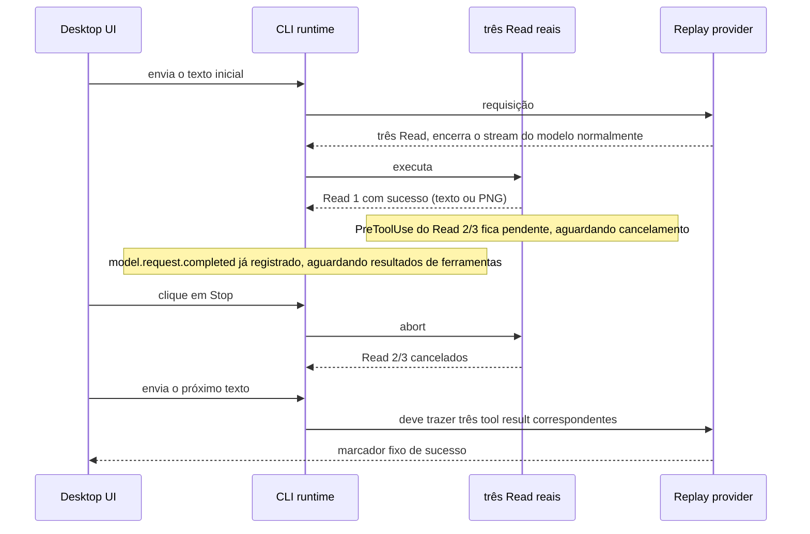
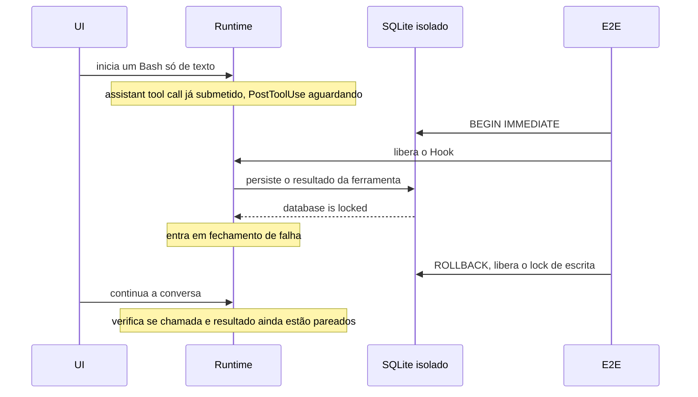
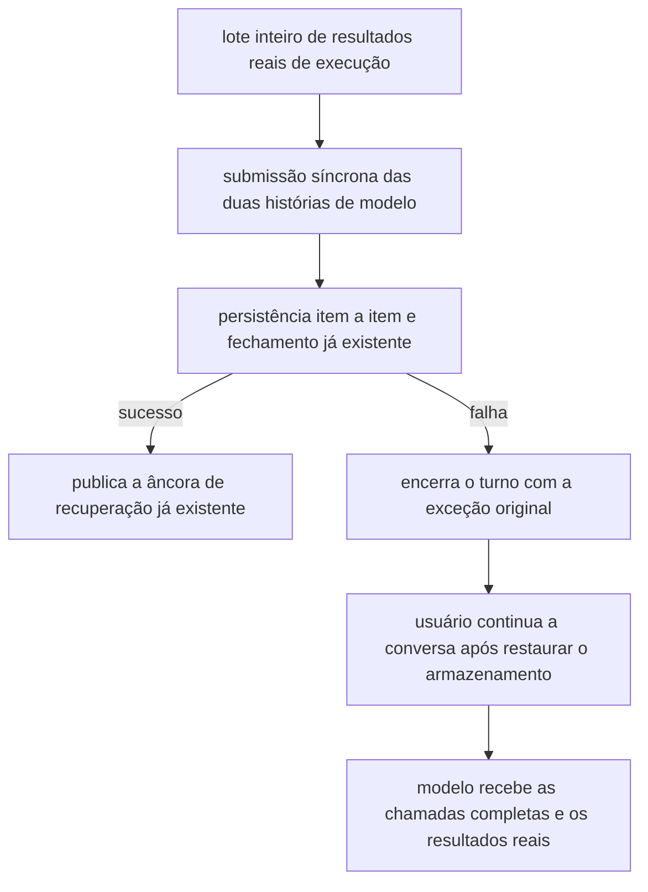

# Desktop E2E de resultados de ferramenta ausentes: Stop e falha de armazenamento

Status: correção implementada; o Desktop E2E permanece em manual-review/pending, aguardando revisão humana.

Objetivo: depois que o lote inteiro de resultados reais de ferramentas foi obtido, o Stop ou uma falha de armazenamento não pode corromper o histórico de modelo do próximo turno no processo atual; a origem do lock de banco e a reescrita entre processos estão fora de escopo.
O feedback `ZCT-2102451151499956224` confirmou um Read com sucesso, dois cancelados e, em seguida, três resultados ausentes, mas o log não preservou o conteúdo lido.
Este experimento faz um controle causal sobre a hipótese de persistência de imagens, sem tratar a entrada de imagem como fato conhecido desse feedback.



- Os dois grupos usam a mesma ordem de declaração dos três Read, os mesmos Hooks, o mesmo Stop barrier e as mesmas requisições seguintes; apenas o tipo do primeiro arquivo difere.
- O provider sintético apenas decide a chamada de ferramenta válida e a resposta de sucesso; os resultados vêm das ferramentas de arquivo reais, e o cancelamento vem do Stop da UI.
- Os Hooks ficam na configuração de usuário de um HOME E2E isolado; apenas o PreToolUse deste exemplo, para `blocked-*.txt`, fica pendente. O teste lê o log de runtime para confirmar que a primeira ferramenta teve sucesso, que o modelo foi concluído e que duas continuam sem liquidar; só então aciona o Stop, sem usar atraso fixo para decidir o momento do disparo.
- As asserções de comportamento correto mantêm semântica verde: a próxima requisição real de rede contém resultados pareados de forma única, os resultados cancelados são marcados como falha, e a resposta é concluída. Se a validação local do SDK falhar, o teste preserva as evidências de log/requisição/UI e falha, sem tratar a ausência de resultados como sucesso esperado.
- O escopo em máquina real é o Desktop continuous local; não cobre o celular replayable, o workspace remoto nem uma máquina Windows real. Os Hooks usam arrays de argumentos de processo Node e caminhos de workspace isolados, evitando meios de bloqueio exclusivos de POSIX.

Execução:

```sh
ZCODE_E2E_MANUAL_REVIEW=1 ZCODE_E2E_DEEPSEEK_CONTEXT_WINDOW=128000 \
pnpm --filter @zcode/desktop test:e2e -- --spec \
'./test/e2e/conversation-session/manual-review/pending/conversation-session-stop-tool-results.test.ts'
```

## Caminho não-mídia: falha de escrita no SQLite

O feedback 3.14.3 `ZCT-2102596858952212480` descreve `database locked` aparecendo primeiro, seguido de o modelo não conseguir usar ferramentas e reportar MissingToolResults; esse item não tem anexo de log, portanto é apenas um causa candidata independente e não permite atribuir o feedback dos três Read a ele.

Foi adicionado um terceiro grupo: sem ler imagens e sem clicar em Stop, executa um Bash real que retorna apenas texto curto. O Hook PostToolUse da configuração de usuário isolada cria um barrier após a execução da ferramenta; o teste confirma que o modelo foi concluído, então segura um lock de escrita `BEGIN IMMEDIATE` no banco CLI isolado e libera o Hook. Observou-se que o runtime entra em fechamento de falha e o lock de escrita é liberado imediatamente em seguida, e então a conversa continua pela UI.



O lock serve apenas para produzir uma falha real de armazenamento, sem modificar diretamente linhas de sessão, histórico de modelo, resultados de ferramenta ou o SDK. Lock e Hooks são limpos no finally. A aceitação continua exigindo que, após restaurar o armazenamento, o próximo envio funcione normalmente e com resultados completos; a ocorrência de MissingToolResults acende o vermelho, preservando logs e a captura do provider. Este experimento valida um mecanismo candidato e não substitui as evidências de campo do feedback original.

## Reprodução antes da correção

Desktop run de 2026-09-24 `desktop-e2e-20260924064058170-p71167-286d64339dbaed74`: o controle de Stop com texto passou, e o grupo de Stop com imagem reportou `AI_MissingToolResultsError` no turno seguinte, faltando os três resultados de Read. Este último apenas reproduz o problema de imagem já conhecido e não prova que `ZCT-2102451151499956224` tenha lido imagens.

Run completo complementar: `desktop-e2e-20260924070659985-p94983-c3e14a5ec032c9c8`, Electron local em macOS, com 2 dos 4 grupos passando e 2 reproducindo a falha. Reutiliza o mesmo código de produção construído anteriormente de forma oficial, com `ZCODE_E2E_SKIP_BUILD=1 ZCODE_E2E_SKIP_AGENT_BUILD=1`; sem pular o teste real do Electron.

| Entrada / falha                          | Resultado                                                   | Próxima requisição real de rede  |
| ---------------------------------- | ---------------------------------------------------- | ---------------------------- |
| Três Read de texto + Stop                | Passou                                                 | contém 3 chamadas e 3 resultados únicos |
| Primeiro Read PNG + Stop                  | Falhou: MissingToolResults, faltam 3 resultados       | nenhuma; o SDK rejeita antes do HTTP |
| Bash só de texto, sem lock, sem Stop      | Passou                                                 | resultado do Bash pareado, resposta normal |
| Mesmo Bash, com lock ao gravar o resultado, sem Stop | Falhou: primeiro database is locked, depois MissingToolResults | nenhuma; o SDK rejeita antes do HTTP |

Tempos reais do grupo de banco (UTC):

- `07:07:26.362` o teste obtém o lock de escrita do banco isolado.
- `07:07:31.488` `tool.call.completed`, indicando que o Bash terminou e produziu texto curto.
- `07:07:41.626` `turn.failed`, cause=`database is locked` / `ERR_SQLITE_ERROR`.
- `07:07:41.669` o teste libera o lock de escrita.
- `07:07:42.202` a continuação `turn.failed`, cause=`AI_MissingToolResultsError`, faltando `toolu_stop_results_db_bash`.

Session correspondente: `sess_40468255-d05f-41ca-9550-deea4b93688f`. A cauda da requisição que falhou salva em `database-locked-model-io.jsonl` é `user → assistant(tool-call Bash) → user`, sem o tool-result correspondente no meio. A captura desse grupo contém apenas a declaração legítima de ferramenta da primeira rodada, sem injeção de qualquer erro de resultados ausentes; as três requisições do controle sem lock acertaram todas a fixture de ferramenta / conclusão da primeira rodada / continuação.

Diretório de evidências: `packages/desktop/.e2e-artifacts/desktop-e2e-20260924070659985-p94983-c3e14a5ec032c9c8/`. `summary.md` é o relatório oficial da execução, e `conversation-session-stop-tool-results/` guarda por grupo logs, requisições, screenshots e model-io.

## Limite da causa raiz

Mecanismo não-mídia confirmado antes da correção: `turn-model-step.ts` primeiro submete a chamada do assistant por `commitAssistantToTurnRequest`; ao processar os resultados, o antigo `turn-tools.ts` fazia `persistPart` primeiro e só depois `commitTurnRequestEntries` para adicionar os resultados. Quando `sessionStore.savePart` em `message-persistence.ts` lança a exceção de escrita do SQLite, o turno termina, mas a chamada já submetida permanece no histórico em memória. Restaurar o armazenamento não completa esse resultado, então o próximo turno falha na conversão da requisição pelo SDK. Essa ordem de código é a mesma no `turn-tools.ts` da versão afetada `ab4d5e6b` e na baseline anterior à correção.

Isso compartilha uma lacuna com o cancelamento por imagem: a chamada é submetida primeiro e ainda há persistência assíncrona capaz de lançar erro antes de o resultado ser submetido; o fechamento de falha não garante o pareamento chamada/resultado. A escrita de imagem falhando por abort e o resultado de ferramenta de texto puro falhando por SQLite são duas condições de disparo já reproduzidas; não é possível atribuir todo MissingToolResults a imagens.

- `ZCT-2102596858952212480` (3.14.3/Linux) tem a descrição do usuário de "primeiro database locked, depois o modelo inutilizável", sem anexo de log. O experimento validou o mecanismo consistente com essa descrição, mas ainda não prova que o campo tenha como origem a contenção de SQLite deste experimento.
- `ZCT-2102451151499956224` (3.14.3/Windows) só confirma o Stop explícito, um Read com sucesso entre três, dois cancelados e quatro ausências consecutivas de resultados; não há argumentos do Read, conteúdo retornado nem model-io. Não é possível confirmar se eram imagens, nem atribuir a elas a falha de banco deste trabalho.
- `ZCT-2102757550488236032` (3.14.3/Windows) mostra no log um Read com sucesso, um Bash cancelado e depois a ausência do resultado do Read; falta igualmente o conteúdo do Read, o que não basta para distinguir persistência de mídia de outras falhas de fechamento.

## Implementação da correção e limites

`tool-result-settlement.ts` recebe os resultados reais já coletados pela camada de execução e ordenados pela ordem de declaração, e por meio de uma única chamada síncrona
`commitTurnRequestEntries` grava ao mesmo tempo no histórico canônico e no histórico de requisição do turno; só então executa
nested usage, mídia, ToolPart, checkpoint, âncora de recuperação e tratamento de entradas subsequentes. A submissão de histórico item a item foi removida,
sem novo cache de resultados, fila de reescrita ou fonte de estado. `turn-tools.ts` mantém as responsabilidades de agendamento e execução.



O salvamento de mídia de resultados já concluídos não recebe mais o AbortSignal do turno; ferramentas ainda incompletas continuam respondendo ao Stop e não reexecutam o modelo automaticamente.
Erros reais de escrita continuam sendo lançados, sem conversão em falha de execução de ferramenta. Itens com falha e itens não salvos não publicam committed/anchor,
e resultados já salvos com sucesso não são revertidos. O cancelamento de checkpoint ainda lança de forma adiada, permitindo que os siblings concluam o fechamento.

Após a saída do processo, os resultados brutos não salvos ainda podem ser perdidos, e a recuperação fria continua usando o resultado pending/running → interrupted.
Nenhuma alteração em lock de banco, tempos de espera, política de retry, estrutura de armazenamento ou protocolo; o limite de entrega de eventos entre Desktop continuous e celular replayable permanece igual.

## Aceitação após a correção (2026-09-24)

Esta aceitação se baseia no diff de workspace sobre `0e40230d34`.
Run oficial em Electron no macOS `desktop-e2e-20260924081102510-p55865-08e6cb00c4a7ad50`, com **4/4 aprovados**.
A build de produção veio do run de mesmo workspace `desktop-e2e-20260924080555672-p50144-04be77cd4f3ebe33`;
o run final reutilizou essa build com `ZCODE_E2E_SKIP_BUILD=1 ZCODE_E2E_SKIP_AGENT_BUILD=1`; nesse intervalo apenas a configuração de teste e as asserções foram modificadas,
sem alteração de código de produção. Typecheck da raiz e build/execução do Electron foram feitos em sequência.

Na primeira execução após a correção, 3/4 passaram: a continuação com imagem funcionou, mas a nova asserção de wire de imagem falhou, porque o modelo de replay suporta por padrão apenas texto,
e as imagens foram rebaixadas a aviso conforme as regras existentes de capacidade de modelo. Finalmente, apenas para o modelo de replay deste spec foi declarada a capacidade de entrada de imagem, para aceitar diretamente o
conteúdo real de imagem do provider; as capacidades de modelo de produção não foram modificadas, nem as asserções de imagem relaxadas.

| Cenário             | Fatos finais de entrada e execução do provider                                                                |
| ---------------- | ------------------------------------------------------------------------------------------- |
| Read de texto + Stop | 3 chamadas e 3 resultados únicos, o primeiro com texto real, outros dois cancelados; sem rerun automático do modelo após o Stop                  |
| Read de imagem + Stop | 3 pares de chamadas/resultados únicos; o primeiro com `is_error=false`, contendo 67 bytes `image/png`, e os outros dois com `is_error=true` |
| Bash sem lock        | turno inicial e continuação bem-sucedidos, com o `E2E_STOP_RESULTS_DB_OUTPUT` original, executado uma vez                               |
| Lock real de escrita do SQLite | o primeiro turno mantém `database is locked`; após liberar o lock a continuação funciona, preservando a saída original do Bash e o marcador de sucesso, executado uma vez       |

Session de imagem: `sess_7c4a78f6-0613-49c1-858c-afca02ac3e4b`; SHA-256 da imagem em rede:
`f19fe636a57e6c5076413efab51d1c36e87686c79f461b7ad8913fe7de4c964e`.
Session do grupo de banco: `sess_02fe91d4-b4a8-4834-9e8b-60ed497f4d2f`, lock em UTC `08:11:24.543`,
`turn.failed` em `08:11:39.741` pela exceção original do banco, liberação do lock em `08:11:39.750`;
esse grupo tem apenas duas requisições principais, a declaração de ferramenta e a continuação do usuário, com um único `tool.call.started` do Bash. Nenhum dos quatro grupos apresentou MissingToolResults.

As 4 novas regressões de Core falharam primeiro na implementação antiga e passaram depois da correção; nos **12 arquivos afetados, 278 testes passaram**:

- Falha ao salvar o ToolPart do segundo item do lote de três resultados: a continuação no processo atual ainda recebe todos os resultados reais exatamente uma vez; apenas o primeiro item mantém committed/anchor.
- Falha no salvamento de mídia e no evento de nested usage: a exceção original é preservada, o turno atual não reroda o modelo; após a restauração os resultados ficam completos, sem reexecutar as ferramentas e sem reenviar a âncora de persistência.
- Recuperação fria de Stop com imagem: o conteúdo de mídia bem-sucedido e os dois resultados cancelados são recuperados por completo; na recuperação fria com falha de salvamento, o primeiro item já salvo mantém a saída original e os dois não salvos continuam como interrupted.
- As regressões existentes de identidade de streaming part, multimodal, provider request, continuação de output-token, cancelamento de checkpoint e ordem do goal reminder passaram.

A revisão posterior de ponta a ponta (upstream/downstream) executou novamente 6 suítes de Core, com 99 casos no total passando: runtime persistence, command queue,
guide model selection / refresh, browser screenshot e stream recovery.
Somando esses aos 12 suítes acima, são 18 suítes e 377 casos passando; os logs estão em `verification/boundary-audit.log` e
`verification/stream-audit.log`. A verificação de arquitetura hoje cobre apenas os módulos managed, e a CLI ainda não está no seu escopo;
os limites internos da CLI nesta rodada foram confirmados por revisão da cadeia real de chamadas e por testes de regressão.

Outras verificações: typecheck da raiz, typecheck da CLI, lint da raiz (61 warnings / 0 errors),
lint isolado do código Core alterado e dos novos testes, verificação de arquitetura, typecheck do Desktop E2E e verificação de fixtures deste exemplo — todas passaram.
O lint completo da CLI não passou: 85 erros de `max-lines`, e a conferência item a item mostrou que todos os arquivos apontados são idênticos ao HEAD; os dois módulos separados ao final deste trabalho estão,
respectivamente, com 289 / 283 linhas. A auditoria de cobertura de conversas de todo o repositório continua bloqueada por duas inconsistências `syntheticReason` de manifest / fixture já existentes em `conversation-session-highspeed-card`, cujos arquivos não foram modificados.

Diretório de evidências: `packages/desktop/.e2e-artifacts/desktop-e2e-20260924081102510-p55865-08e6cb00c4a7ad50/`.
`summary.md` é o relatório oficial da execução; `conversation-session-stop-tool-results/` guarda os logs de runtime, as requisições reais, os screenshots e o
model-io dos quatro grupos; `verification/` guarda os registros das regressões vermelha/verde de Core e das verificações de tipo/lint/arquitetura/fixture, além da comparação de baseline de lint.

Ainda não verificados: o celular replayable em máquina real, o workspace remoto, máquinas reais Windows / Linux e o campo completo do feedback original.
A aprovação dos casos só indica que os dois caminhos de reprodução acima foram corrigidos, sem converter a causa de disparo desconhecida dos feedbacks originais 3.14.3 em atribuição confirmada.
O E2E não é promovido automaticamente; commit e push são executados conforme a autorização do usuário. Não há migração de armazenamento, então as mudanças de Core desta rodada podem ser revertidas.