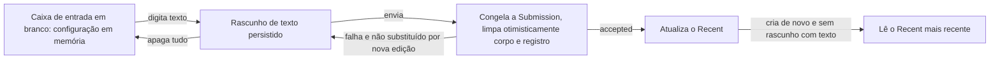
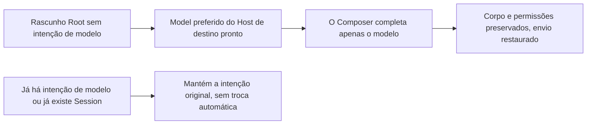

# O Composer persiste apenas o rascunho de texto

> Implementação atual em 2026-10-16: rascunhos novos e Recent pertencem ao projeto/tarefa não classificada; tarefas não enviadas reutilizam o diretório de execução; ver [ciclo de vida unificado](project-task-draft-lifecycle.md). As cláusulas de 2026-10-14 sobre o Root/Recent da workspace e a adiamento para o celular abaixo registram a implementação original; o comportamento atual segue a nova especificação e seus registros de verificação; as regras de restauração de Session oficial e de texto não vazio continuam valendo.

## Regras e escopo

2026-10-14: o usuário confirmou que "sem texto digitado não conta como rascunho, não há persistência". Este documento substitui a regra do Todo71 sobre manter a configuração com corpo vazio.
O corpo é determinado por `text.trim().length > 0`; digitação, colagem e pré-preenchimento por template são equivalentes, e espaços, quebras de linha, JSON vazio do editor, ou apenas mudanças de modelo/permissão não formam um rascunho persistível. O corpo exibido do chip de citação segue a serialização de texto já existente no editor, sem nova serialização de anexos.

Quando há texto, são salvos o corpo, o estado do editor, as permissões, o Plan e o `ModelSelection` completo; ao apagar tudo, o registro é removido. O envio segue o emptying otimista já existente: primeiro congela a Submission, depois limpa o corpo e o registro; em caso de falha, e se não foi substituído por uma edição posterior, restaura, e após a aceitação atualiza o Recent. Ao ler rascunhos vazios de versões antigas, apenas filtra; na escrita explícita, limpa, para que a configuração antiga não continue bloqueando o valor padrão.

A configuração atual da caixa de entrada continua sendo mantida de forma única pelo estado em memória de `useDraftConfigControl`; por não ser gravada em disco, não há fallback em render comum, na atualização de diretório ou na chegada de Snapshot. Ao entrar novamente na página de criação em branco, usa o Recent atual da workspace; Sessions existentes sempre restauram permissões e Plan a partir do Snapshot atual; quando há rascunho com texto, apenas o corpo e o modelo são restaurados. Mesmo que o New Task explícito reutilize o pane atual, ele abre um novo ciclo de vida de edição em branco; rascunhos com texto continuam sendo restaurados.

## Complemento de modelo após o primeiro Provider ficar pronto

2026-10-16: um rascunho Root novo pode já ter inicializado as permissões e o corpo digitado com uma configuração de Provider vazia. Se ele não tiver nenhuma intenção original de `modelSelection`, assim que o primeiro `preferredSelection` válido do Host de destino chegar, o owner atual do Composer completa automaticamente a seleção com esse model completo. O complemento escreve apenas o modelo e preserva o corpo, o estado do editor, as permissões e o Plan; não atualiza o Recent, não envia requisição de modelo e não inicia um segundo Agent. Nenhum novo timer de sincronização ou segunda cópia de estado é adicionada.

Seleções já existentes (inclusive modelos inválidos ou reasoning inválido) não são complementadas; Sessions existentes e importações por compartilhamento não aplicam esta regra de Root. Mudanças posteriores no diretório não podem sobrescrever um modelo já completado ou escolhido explicitamente pelo usuário. O isolamento continua por workspace identity, o desktop e o celular usam o mesmo Hook, e a fronteira de transmissão continuous/replayable não muda.

Verificação: I23/I24 do E2E de desktop cobrem a configuração vazia, a leitura do histórico, o salvamento do primeiro Provider, a preservação do texto original, a restauração no envio e o Agent único; os testes unitários do Hook cobrem identity local/remota, a preservação de permissões/Plan, as escolhas já feitas/inválidas e a exclusão de Sessions existentes.

## Posse do estado e superfície de impacto

| Cenário / entrada                  | Único owner / caminho de submissão                        | Persistência e inicialização                                                      | Nível de impacto   |
| ---------------------------------- | --------------------------------------------------------- | --------------------------------------------------------------------------------- | ----------------- |
| Nova / caixa de entrada da Session atual | useDraftConfigControl → Submission → CLI admission     | `composerDraftStore` guarda apenas o texto; o Recent só é atualizado no accepted      | must-inspect      |
| New Task / menu de projetos e grupos | `draftProjectId` / `draftTaskGroupId` do workspace UI store | A intenção de criação atual fica em memória; é salva junto com o rascunho quando há texto; a recuperação a frio no celular só lê rascunhos com texto | must-inspect      |
| Primeira importação por compartilhamento | Parâmetro de navegação → owner do Composer             | A configuração de inicialização única fica apenas em memória; não forja rascunho em disco nem altera o Recent | must-inspect      |
| Página offline e atualização         | Resultado somente leitura do `composerDraftStore`        | Restaura apenas rascunhos com texto; não cria fila offline                             | should-inspect    |
| Automação, subagentes, fila já aceita | record / CLI owner já existentes                        | Não consome rascunhos do Composer nem altera a Submission congelada                  | invariant-only    |

O comportamento compartilhado é a leitura/escrita de rascunhos e a resolução do modelo efetivo; a criação lê o Recent, enquanto Sessions existentes leem o próprio Snapshot, e os dois não são unificados como uma configuração global. A restauração de permissões/Plan segue o Snapshot da Session atual; as autorizações históricas servem apenas para identificar novas mudanças dentro do ciclo de abertura atual e não são guardadas no rascunho.
O isolamento por workspace continua usando `workspaceIdentity?.trim() || workspacePath`; a transmissão, o shared-host, o owner/lease e o protocolo de fila do continuous de desktop e do replayable do celular permanecem inalterados. Nenhum novo estado de Host/Agent ou timer de sincronização foi criado.

O escopo do Recent não muda: uma criação dentro do mesmo projeto/workspace herda a configuração aceita mais recentemente; a criação global não classificada atual recebe um novo diretório de trabalho e não copia automaticamente o Recent de outro workspace. A regressão do desktop cria explicitamente a partir da mesma entrada de projeto, para evitar confundir troca de workspace com restauração de rascunho em branco.

## Ordem de implementação

1. Atualizar spec, catálogo e coverage; escrever primeiro as regressões de storage e Hook e observar a falha da implementação antiga.
2. Convergir a intenção atual de criação de projeto/grupo no workspace UI store existente, migrando os chamadores que antes a liam a partir do rascunho vazio; a primeira importação por compartilhamento passa a ser uma entrega temporária.
3. Unificar o filtro de corpo vazio e a limpeza de registros antigos na entrada de storage; o Hook reinicializa a caixa de entrada em branco na fronteira do ciclo de vida do New Task, mantendo a proteção de scope da edição atual e do ACK tardio.
4. Atualizar os testes existentes de rascunho vazio e estender o E2E de pending do desktop; rodar os gates necessários e então submeter.

## Casos e podas

| ID   | Pré-condição e operação                                                            | Asserção                                                                                 | Camada / estado                                  |
| ---- | ---------------------------------------------------------------------------------- | --------------------------------------------------------------------------------------- | ------------------------------------------------- |
| TD01 | Caixa de entrada nova seleciona apenas yolo + A e depois sai/atualiza               | A seleção atual em memória está disponível; o localStorage não tem rascunho e a reabertura inicializa pela fonte padrão | storage + Hook / accepted                        |
| TD02 | Primeira envio com yolo + A; abre uma página em branco uma vez; volta à Session original, muda para build + B e envia; depois cria de novo | O Recent é build + B; a nova página tem o mesmo valor, sem registro persistente em branco; botões reais e troca de modelo | Desktop E2E / accepted pending                   |
| TD03 | Digita texto e muda permissões/modelo, troca de Session e depois volta/atualiza    | Restaura texto e modelo; as permissões/Plan da Session existente seguem o Snapshot atual; o Recent não muda | Hook + Desktop E2E / accepted pending            |
| TD04 | O texto é apagado ou sobra apenas espaço e então se cria de novo                   | O registro persistente antigo é removido; a nova página usa o Recent mais recente; o New Task repetido no mesmo pane não mantém configuração vazia | storage + Hook + Desktop E2E / accepted pending  |
| TD05 | Envio com sucesso, com falha, ACK tardio e o usuário já digitou a próxima           | Sucesso limpa apenas a submissão original; falha preserva corpo e configuração; ACK antigo não sobrescreve o novo scope/texto | existing submission tests + Hook / accepted      |
| TD06 | Registros vazios legados e registros com texto de um remoto de mesmo caminho        | Apenas os registros são limpos; a identidade remota fica isolada e o modelo ruim com texto é preservado para correção | storage / accepted                               |
| TD07 | Seleciona projeto/grupo sem digitar e depois digita e faz o primeiro envio          | A página em branco não grava em disco; o primeiro envio ainda entra no projeto/grupo escolhido; com texto é possível recuperar a frio | store + navigation tests / accepted              |
| TD08 | Primeira importação por compartilhamento, atraso do View, Session existente reutilizada | A inicialização por navegação não grava rascunho vazio e a importação segue a inicialização de criação; a escolha do usuário tem precedência e a reutilização não reseta | Hook / accepted                                  |

Estilos puros, tema e internacionalização não mudam, e os controles compartilhados são reutilizados, sem enumerar o cruzamento completo de aparências. O modelo usa dois modelos válidos do mesmo provider como representativo; as permissões usam yolo/build. O admission de fila e a configuração de execução permanecem congelados, validando apenas a fronteira de envio do rascunho, sem estender a funcionalidade da fila. Anexos hoje não têm persistência de rascunho entre reinícios, e essa capacidade não é adicionada.

## Evidências de varredura e verificação posterior

A ferramenta codegraph não está disponível; foi usada busca precisa de chamadores para rastrear storage → Hook → SessionPane/Root e, em um salto, o menu de projetos e a entrada de compartilhamento, sem afirmar que a varredura por codegraph foi concluída. O mapa funcional existente `conversation-model-control` não tinha a relação entre persistência apenas de texto e o ciclo de vida de criação, e esta versão acrescenta os nós semânticos correspondentes. Não há fronteiras de produto pendentes de decisão do usuário; a não persistência do texto em branco já foi confirmada.

Registro de verificação (2026-10-14, baseline `7d60f53393`):

- Rodaram-se primeiro as regressões de storage e Hook TD01/02/04/06 para observar a falha; após a alteração passaram. O `pnpm test:unit:affected` final teve 301 arquivos e 3.885 casos, todos passando. Inclui recuperação de falha, ACK tardio, herança de configuração de nova tarefa, importação por compartilhamento e inicialização de projeto no celular.
- `pnpm typecheck`, `pnpm lint`, `pnpm architecture:check --changed` e a verificação de fixture local do caso passaram; o Lint ficou com 0 errors (210 warnings já existentes no repositório). Os novos nós/arestas do mapa funcional e a checagem de seeds do código-fonte não apontaram novos problemas; as 4 arestas pendentes já existentes no mapa não foram expandidas nem tratadas; o codegraph não foi executado.
- Electron no Linux com Xvfb, reproduzindo `common.json` e a fixture deste caso. `desktop-e2e-20261014-093656-755`: os casos isolados TD01/03/04 passaram (branco não salva, restauração de corpo/permissões após atualização, apagar tudo, criação repetida no mesmo projeto); screenshots e JSON são os de `conversation-session-composer-recent-mode/00-text-only-draft.*` desse run.
- O encadeamento completo de envio I74/I75 + TD02 não passou: a primeira digitação já acusou a mensagem de UI "草稿会话已切换，请重新发送" ("a sessão de rascunho foi trocada, envie novamente"), sem chegar à asserção da troca A→B. Restaurando temporariamente todo o código-fonte de produto modificado para o baseline e reconstruindo, o run de controle `desktop-e2e-20261014-093347-523` acusou o mesmo erro no primeiro envio; o log do Agent registrou simultaneamente `loadPersistedEvents / Session not found` da session de prewarm. O código-fonte de produto foi depois totalmente restaurado. Nesta rodada não se modifica o ciclo de vida de prewarm/Host/CLI, e a regressão de Hook do TD02 não substitui este E2E.
- No celular foram concluídos apenas os testes unitários da lógica compartilhada e de navegação, sem verificação em aparelho real nem em GUI de macOS ou Windows. O E2E permanece pending e não é promovido automaticamente a formal/CI; o fluxo completo de envio precisa ser refeito depois que o problema de prewarm do baseline for corrigido.

Complemento de integração do MR: após sincronizar o fluxo mais recente de confirmação de diretório remoto do staging, a entrada comum de projeto e a confirmação de diretório remoto passam unificadas a ler o `draftTaskGroupId` do workspace UI store por `createProjectTask`. A seleção de grupo em uma caixa de entrada em branco também precisa ser transmitida com a confirmação do diretório remoto; tarefas existentes continuam não herdando o grupo do rascunho de criação.

Após sincronizar o baseline `f67f7570ba` e reverificar: 38 casos do menu de projeto passaram; os testes unitários afetados passaram com 304 arquivos / 3.948 casos; typecheck, lint (0 errors, 210 warnings já existentes) e architecture passaram. O run de Electron no Linux reconstruído `desktop-e2e-20261014-111418-638` seleciona apenas TD01/03/04 e passou 1/1. O caso completo de envio não foi reexecutado nesta rodada e mantém o registro de falha acima.

## Regras simplificadas após o Review (2026-10-14)

O usuário confirmou: ao reabrir um rascunho de texto de uma Session existente, restaura-se o corpo e a seleção de modelo, enquanto as permissões e o Plan usam o Snapshot mais recente dessa Session. As escolhas de menu feitas durante a abertura atual continuam pertencendo ao Composer; um Snapshot comum não pode sobrescrevê-las, e mudanças reais de novas autorizações/ferramentas de Plan atualizam os campos correspondentes conforme o Snapshot mais recente. O primeiro Snapshot correspondente apenas estabelece o estado atual e a linha de base de observação, sem reproduzir as autorizações históricas contidas nele. A ausência temporária de Snapshot não reseta a linha de base de observação; apenas a troca de scope ou o desmonte a encerra.

Removem-se `lastPermissionGrantId`, `lastPlanTransitionId` e `initializeFromNewTask` do rascunho persistido; os campos antigos são ignorados na leitura. O rascunho de texto de um Root novo continua restaurando sua seleção completa (ainda não existe uma Session real). A primeira importação é entregue explicitamente pelo owner de navegação com a configuração de inicialização de criação; Sessions existentes/reutilizadas não passam pela inicialização de importação. Vincular o primeiro envio a uma Session real é uma migração dentro do mesmo ciclo de edição do Composer, preservando o que foi digitado durante o envio; só ao sair e reabrir se aplicam as regras de restauração de Session.

O primeiro envio deixa de usar o seed Map global: o pane atual só permite a migração de resultados aceitos com o mesmo `workspaceKey` e a mesma geração de rascunho; New Task, troca de página e desmonte invalidam o callback antigo. A inicialização por importação de compartilhamento é anexada a uma ação de navegação de workspace já existente, é consumida ao ser recebida e é descartada ao trocar de tarefa ou criar uma nova; não é salva como rascunho vazio. A configuração de submissão continua congelada no envio, sem mudar por causa de edições posteriores.

A leitura de rascunhos apenas faz parse/filtragem, sem escrever no localStorage; registros vazios antigos são limpos na escrita explícita. Sem texto não há salvamento; a criação usa o Recent da workspace, e o Recent só é atualizado no accepted.

Esta rodada não altera de forma explícita a restauração de projeto/navegação no celular; a lógica compartilhada do Composer continua sendo usada ao mesmo tempo pelo continuous de desktop e pelo replayable do celular, sem mudar a semântica de Host, CLI, fila ou restauração de transmissão. O plano de implementação está em [planejamento de simplificação de estado](../plans/composer-state-simplification.md).

Novas regressões CS01–08 e CS10: as autorizações/Plan históricos não são reproduzidos; a restauração com texto traz as permissões e o Plan mais recentes; novas mudanças ao vivo atualizam apenas o campo correspondente; projeções repetidas ou tardias não sobrescrevem a edição; a migração no primeiro envio preserva a nova digitação e o callback antigo não limpa a página nova; a inicialização por importação é consumida/invalidada com a navegação; a leitura em render não escreve nada. CS09, a restauração de projeto no celular, foi excluído de forma explícita pelo usuário.

Verificação (2026-10-14): as novas regressões falharam primeiro na implementação antiga; no final, os testes unitários afetados passaram com 305 arquivos / 3.956 casos. Os 50 casos direcionados de Hook/storage passaram. No navegador, `share-import-selection.test.mjs` passou com 14 conjuntos (10 de importação e 4 de restauração de Session; 390/1200px, claro em chinês/escuro em inglês), usando o Hook real e a barra de ferramentas, com Snapshot controlado, cobrindo voltar/atualizar, o histórico não ser reproduzido, as autorizações/Plan ao vivo e as projeções duplicadas. Essa fixture de navegador não representa o CLI real nem a cadeia remota do celular.

Após reconstruir o Electron no Linux, o run `desktop-e2e-20261014-120739-442` passou em 1/1 para TD01/03/04: o branco não salva, o texto é restaurado após atualização e o New Task após apagar tudo usa o padrão. `pnpm typecheck`, `pnpm lint` (0 errors, 210 warnings já existentes) e `pnpm architecture:check --changed` passaram. O E2E completo de envio A→B mantém o bloqueio anterior de prewarm do baseline e não foi reexecutado nesta rodada; o código de projeto no celular não foi alterado mais adiante e não houve verificação em aparelho real do celular nem em GUI de macOS/Windows. Os casos continuam em manual-review/pending.
