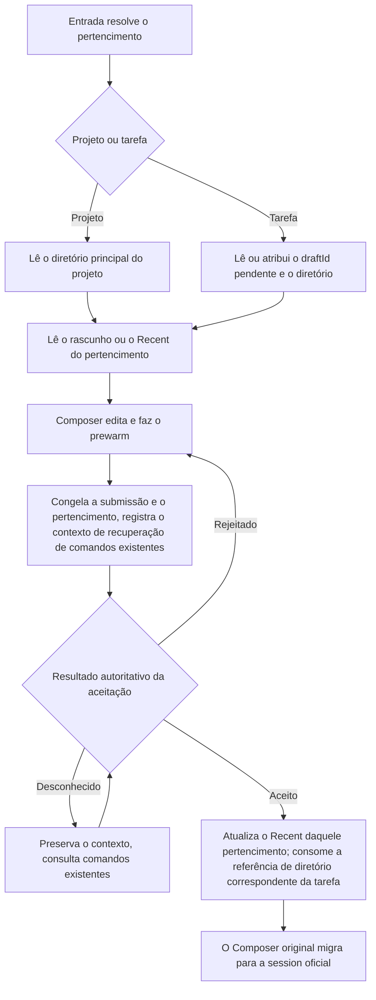

# Ciclo de vida de rascunhos, configurações padrão e diretórios de projetos e tarefas não categorizadas

Status: 2026-10-16 confirmado pelo usuário; implementação e regressões necessárias desta rodada concluídas; pacote de instalação não publicado.

## Termos e limites

- Project (projeto) é o contêiner lógico que organiza sessions, identificado pela identidade do host de destino e pelo ID do projeto.
- root (diretório do projeto) é uma pasta real; primary root (diretório principal) é o diretório escolhido quando o projeto cria uma nova session.
- workspace carrega a execução e o isolamento de dados; workspaceKey = workspaceIdentity?.trim() || workspacePath.
- workspacePath é o caminho real; o diretório de execução da session (cwd) é fixado após a criação da session. Mover o pertencimento do projeto não o altera.
- A entrada de tarefa cria uma tarefa não categorizada. Ela tem seu próprio rascunho novo e sua própria configuração padrão; não é um Project falsificado.
- O armazenamento local do cliente isola desktop e celular; o host de destino de uma conexão de controle remoto também precisa ser isolado. Uma reconexão não pode gerar um novo pertencimento a partir de um bridge ID temporário.

## Estado unificado e escritor único

| Estado                                     | Pertencimento / escritor único                     | Persistência e uso                                                              |
| ------------------------------------------ | ------------------------------------------------- | ------------------------------------------------------------------------------- |
| Rascunho novo                              | Owner do Composer, com escopo por projeto ou por tarefa não categorizada | Só salva text, editorState, mention, ModelSelection completo, mode e Plan quando há texto não em branco |
| Campo de entrada atual                     | useDraftConfigControl                             | A edição do usuário tem prioridade; um render comum ou a resposta de View/Snapshot não pode resetar a edição atual |
| Configuração padrão nova (Recent)          | Caminho único que aceita a Submission real do usuário | Provider/model/options do modelo são salvos junto das permissões; uma cópia por projeto e uma por tarefa não categorizada |
| Referência de diretório pendente de envio da tarefa não categorizada | Owner do ciclo de vida da navegação de criação | Salva o draftId e o resultado da preparação; mesmo com texto vazio a referência de diretório pode ser mantida, sem forjar um rascunho de texto |
| Rascunhos posteriores de uma session oficial | Composer da session original                       | Identidade do workspace + session ID; não passa a ser armazenado por projeto    |
| Fatos da session e diretório de execução    | CLI; o Host só mantém o estado organizacional e o espelho dos fatos | O armazenamento de rascunhos, a varredura de diretórios ou o snapshot de UI não criam fatos de session |

Os projetos P e Q, mesmo com o mesmo diretório principal, salvam rascunhos novos e Recent separadamente. Renomear o projeto não afeta o pertencimento; trocar o diretório principal do projeto ainda preserva o rascunho de texto e o Recent dele.
O agrupamento expressa apenas a intenção organizacional e não cria outro escopo de configuração padrão.

## Comportamento do usuário

### Projeto comum

A criação lê o rascunho do projeto; com texto, restaura a seleção completa; sem texto, lê o Recent desse projeto, com Plan desligado por padrão.
O diretório principal do projeto é usado para preparar o prewarm da session. Depois que a primeira entrada é aceita, ela se torna uma session oficial; as criações seguintes continuam usando o diretório principal que o projeto tinha naquele momento.
Projetos sem root seguem o fluxo existente de prepareSession para inicializar o diretório principal.
O diretório de execução de uma session antiga não muda com a alteração do diretório principal do projeto nem com a movimentação da session.

### Tarefa não categorizada

A primeira criação gera um draftId, prepara o diretório real e salva a referência. Trocar de contexto e criar de novo reutiliza o mesmo diretório e o mesmo rascunho.
Depois que a primeira entrada é aceita, a referência é consumida; a criação seguinte gera um novo draftId e um novo diretório.
Cliques repetidos e preparações concorrentes reutilizam o mesmo resultado de preparação; não é possível bloquear apenas a navegação e ainda criar vários diretórios.
Não se deve mudar globalmente a semântica de prepareSession sem argumentos; Bots, automações e outros chamadores mantêm suas próprias semânticas de preparação de diretório.

### Configuração padrão

O Recent só é atualizado quando o envio real do usuário é aceito; a conclusão da resposta do modelo não é um limite. Alterar o menu, o prewarm, a confirmação de permissões, ler o histórico, abrir as configurações ou um envio com falha não atualizam o Recent.
O envio real de uma session já existente também atualiza o escopo do projeto ou da tarefa não categorizada a que ela pertencia no momento do envio; o pertencimento é lido do estado organizacional autoritativo, não inferido do cwd.
Conversas auxiliares não estão no índice de tarefas principal; a continuação usa a sessão principal registrada na barra lateral para consultar o Recent e o pertencimento do projeto, mas o comando continua sendo enviado ao child auxiliar; sessões comuns e forks continuam consultando a própria tarefa.
Antes do envio, o pertencimento e a configuração completa são congelados; um recibo tardio atualiza apenas aquele pertencimento e não reescreve outros projetos por causa de mudanças na navegação atual.
Entre Panes, as submissões aceitas mais recentes são mantidas pela ordem de início; um recibo antigo não pode sobrescrever uma configuração aceita mais recentemente.
Quando outro envio atualiza o Recent, ele não sobrescreve o rascunho em edição.
ModelSelection salva providerId/modelId/options conforme o schema atual; hoje options é reasoningLevel. Configurações do app como followup não são incorporadas ao Recent.
Plan continua sendo um estado de rascunho/execução, e não uma chave herdada por novas tasks. Sem um modelo válido, valem as regras existentes de validação da ModelSelection View, e o primeiro item do menu não é salvo como valor padrão.

### Regras existentes de rascunho de texto

Só um corpo de texto não em branco constitui um rascunho de texto persistente. Alterar apenas as opções não salva; apagar o texto remove o registro de texto, mas a referência de diretório não desaparece por isso.
Voltar a uma criação com texto restaura sua seleção completa; entrar de novo em uma página de criação em branco usa o Recent do escopo de pertencimento.
Ao reabrir uma session oficial, o corpo e o modelo do rascunho são restaurados; permissões e Plan vêm do Snapshot mais recente da session. Escolhas explícitas durante a montagem seguem as regras de observação existentes.
Uma nova entrada digitada durante o primeiro envio pertence ao mesmo ciclo de edição; após migrar para a session oficial, ela é preservada e não é sobrescrita pela limpeza do rascunho de criação.
Anexos seguem o fluxo existente de preparação e upload; esta rodada não adiciona persistência de anexos entre reinicializações.

## Ciclo de vida e sequenciamento

- O consumo da referência de diretório se baseia no accepted do primeiro envio ou em um duplicate verificável, e não no ACK de criação do prewarm, na linha reservada pelo Host, na projeção da lista ou no sucesso da navegação.
- Usa o contexto de comandos persistentes já existente, pendingCommandRegistry, para guardar o pertencimento e a identidade do rascunho; não é criada uma segunda fila de accepted.
- O efeito local do primeiro envio precisa ser reentrante: recibos repetidos e consultas de recuperação não podem consumir duas vezes nem sobrescrever um Recent mais novo.
- O consumo é casado pelo draftId; um ACK antigo não pode limpar a referência da próxima rascunho. Conclui-se primeiro a entrega local recuperável e só então se remove a evidência de recuperação do comando.
- Um resultado desconhecido não equivale a falha; desconexão, timeout, registro expirado ou ausência temporária na lista não provam que o diretório pode ser usado de novo para uma nova task. Reutiliza-se o mecanismo de consulta existente, sem sincronizar por adivinhação temporizada.
- A troca de navegação pode invalidar os vínculos de UI, mas não pode revogar um envio já aceito nem pular a entrega persistida.
- Ao voltar para um rascunho, o prewarm da geração anterior ainda encerrando não significa que este envio falhou. Aguarda-se a conclusão da criação existente e então valida-se a geração-alvo no momento do clique; não se cria uma session paralela e não se adivinha por timeout.
- Se a aceitação ocorrer enquanto o primeiro envio ainda não está montado, o novo corpo digitado durante a espera é entregue à session oficial; a reconciliação da recuperação usa o corpo original anterior à submissão, evitando que o texto do protocolo com contexto anexado traga de volta um corpo já enviado.
- O isolamento dos rascunhos deve atravessar a storage key, o escopo do Hook, a intenção organizacional em memória, o owner do prewarm, os anexos e os callbacks, e não apenas modificar o localStorage.
- O continuous do desktop e o replayable do celular continuam usando as fronteiras existentes de transporte e recuperação de comandos; ao trocar de workspace no celular, o pertencimento precisa ser entregue explicitamente por bridge/navigation.

## Mudanças de diretório, importações e compatibilidade

Depois que o projeto troca o diretório principal, o texto e o Recent permanecem no projeto; o prewarm precisa ser preparado de novo no diretório de destino, as referências a arquivos e os anexos são reconferidos pelas validações existentes, e não se troca o cwd da instância de execução antiga.
Quando o diretório está ausente ou indisponível, o rascunho é preservado e o erro de diretório existente é reportado, sem ressuscitar silenciosamente o diretório nem escolher outro root.
Mover uma session oficial altera apenas o pertencimento organizacional, sem mover o rascunho de criação do projeto nem o Recent; os envios seguintes registram a configuração padrão conforme o pertencimento no momento da submissão.
A primeira importação por compartilhamento, o pré-preenchimento por modelo e a troca explícita de projeto seguem as ações de entrega explícita já existentes; a navegação comum não move automaticamente o corpo de um projeto para outro e não sobrescreve o rascunho já existente no destino.
Os registros de texto antigos são preservados. Um registro antigo só pode ser reivindicado quando o projectId salvo no rascunho corresponde ao destino; um rascunho antigo não categorizado exige um contexto atual explícito e não pode ser adivinhado varrendo o diretório mais recente.
Os Recent antigos não têm pertencimento de projeto; não são copiados em lote para todos os projetos do mesmo diretório nem mesclados com o histórico. Quando um escopo novo não tem registro, vale a resolução padrão normal.
As leituras de migração não escrevem em disco; após um salvamento ou limpeza explícito, o dado antigo é marcado como reivindicado, evitando reler um rascunho antigo depois que o projeto troca de diretório ou que o corpo é apagado. Os dados legíveis da versão antiga são preservados e os diretórios históricos não são removidos em lote.
A navegação lembra ainda, por workspace, o escopo de criação aberto por último, usado apenas para restaurar o ponto de entrada após um refresh; o corpo e o Recent continuam tendo como única fonte de dados o escopo de projeto/tarefa.

## Resumo do impacto funcional

Camadas de alteração: draft-default, persistence, commit-effect, recovery. Modo: implementation-handoff.

| Cenário de UI                     | Caminho compartilhado e owner                             | Origem padrão / validação                              | Submissão e destino                                                  | Fronteira e nível                        |
| --------------------------------- | ---------------------------------------------------------- | ------------------------------------------------------- | ------------------------------------------------------------------- | ---------------------------------------- |
| Botão de adicionar na seção de tarefas | useRootWorkspaceActions → Composer                           | Recent do escopo de tasks / View                        | prepareSession → Submission do usuário → CLI; rascunho e Recent do cliente | desktop/celular must-inspect               |
| Nova criação por linha de projeto/atalho | Mesma navegação e Composer; projectId/hostId explícitos   | Recent do escopo de project / disponibilidade do diretório principal | prepareSession do projeto; mesma cadeia de envio          | Projetos de mesmo diretório must-inspect  |
| Session existente                 | SessionPane/useDraftConfigControl                          | Snapshot atual + rascunho de texto da session           | CLI admission; Recent do escopo de pertencimento                     | Movimentação de pertencimento, ACK tardio must-inspect |
| Criação/recuperação no celular    | Web openProjectDraft, Root compartilhado                   | Host de destino + escopo de projeto/tarefa              | project-workspace-navigation, recuperação replayable original        | conditional                              |
| Compartilhamento/modelo/grupo     | Entrega por navegação explícita, intenção de criação original | Mesma regra de inicialização, edição do usuário com prioridade | Caminho original de primeiro envio e de pertencimento organizacional | should-inspect                           |
| Automação/Bots/Subagent           | Seus respectivos record/CLI owner                          | Origem de configuração original                         | Comando/armazenamento originais                                     | invariant-only, não consome rascunhos do Composer |
| Configurações de Provider/candidatos de modelo | ModelSelection View original                  | Validação de disponibilidade original                   | Serviço de provider original                                        | invariant-only                           |

Compartilhado: leitura e escrita de rascunhos, Recent, validação de modelo, congelamento da submissão e callbacks de aceitação. Diferenças: identificação de pertencimento e estratégia de preparação de diretório.
Fronteiras autoritativas mantidas: o Host cuida da organização, o CLI cuida das sessions e o cliente cuida dos rascunhos; o caminho de execução não usa project ID nem workspaceIdentity como substitutos.

Sementes de código-fonte exatas e atuais: composerDraftStore/useDraftConfigControl/newTaskDraft/composerRecent, useRootWorkspaceActions, SessionPane/pendingCommandRegistry, project.prepareSession, project-workspace-navigation, Web openProjectDraft.
Os caminhos diretos foram conferidos por busca no código-fonte; a ferramenta codegraph não está disponível, portanto não se reivindica uma varredura do grafo. O escopo é a cadeia principal acima mais importações de um salto, agrupamento e anexos; não foi varrida toda funcionalidade estaticamente alcançável.
Graph drift: o nó existente de rascunho de texto expressa apenas o Recent do workspace; o new-task-model-resolution-chain histórico ainda contém a antiga regra last-selected. Com a implementação, o índice e o ponto de entrada das regras atuais são atualizados, e o código antigo não é restaurado com base em documentos antigos.

## Decisões, dimensões e poda

Confirmado pelo usuário: reaproveitar o diretório quando o envio não ocorreu; independência por cliente; lembrar apenas após envio bem-sucedido; unificar modelo e permissões; isolar por projeto os rascunhos e os Recent do projeto.
Dimensões principais: projeto/tarefa, rascunho não vazio/vazio, mesmo/diretório diferente, primeiro/envio posterior, accepted/rejected/unknown/late, desktop/celular, identidade de host, mudança de diretório/movimentação de pertencimento.
Poda: não se adicionam regras de produto para múltiplas janelas do desktop, sincronização de rascunhos entre clientes, salvamento de anexos entre reinicializações nem herança de padrões para automação; não se alteram o cwd de sessões oficiais, a fila de execução nem as regras de permissão.
Casos representativos para hosts múltiplos no mesmo caminho, dois projetos no mesmo diretório, ACK tardio e recuperação por refresh devem ser mantidos; temas e idiomas são verificados por interfaces representativas, sem todas as combinações.

## Casos de aceite e handoff de E2E

| ID   | Pré-condição → Ação                                                     | Asserções obrigatórias                                                  | Evidência                        |
| ---- | ----------------------------------------------------------------------- | ----------------------------------------------------------------------- | --------------------------------- |
| PD01 | Digitar texto na tarefa e definir modelo/permissões → trocar de session → clicar no botão de adicionar da tarefa | Diretório, corpo e seleção restaurados; nenhum mkdir extra              | UT + E2E de desktop/celular, arquivos e logs |
| PD02 | Envio da tarefa aceito → criar de novo                                  | Novo diretório, corpo vazio, Recent completo herdado                    | E2E + ACK/diretório do CLI        |
| PD03 | Dois projetos no mesmo diretório escrevem corpos e seleções diferentes → criar várias vezes | Isolamento dos rascunhos e do pertencimento em memória/prewarm; não sobrescrever o projectId | UT + E2E                          |
| PD04 | P/Q/tarefa enviam com sucesso configurações diferentes → criar de novo  | Os três Recent ficam isolados; um envio posterior no mesmo projeto atualiza | UT + E2E                          |
| PD05 | Alterar apenas as opções/apagar o corpo → sair e voltar                | Nenhum rascunho de texto gerado; inicialização pelo Recent; a referência de diretório da tarefa permanece | UT + E2E                          |
| PD06 | Primeiro envio rejeitado, desconhecido ou reconexão com duplicate      | Nenhuma entrada perdida, nenhuma liberação indevida de diretório; entrega final exatamente uma vez | UT + E2E de falha                 |
| PD07 | Cliques repetidos em criar, retorno tardio da preparação, troca rápida de projeto após o envio | Preparação não repetida; callback antigo não escreve no novo scope; a aceitação ainda conclui a entrega do pertencimento original | UT + E2E                          |
| PD08 | Digitar a próxima mensagem durante o primeiro envio → ACK/projeção tardia | A próxima mensagem permanece na session oficial; o Root de criação não é ressuscitado | UT + E2E                          |
| PD09 | Renomear o projeto/trocar o diretório principal/mover a session         | Rascunho e Recent do projeto preservados; o cwd da session antiga não muda | UT + E2E                          |
| PD10 | Refresh, reinício, mesmo caminho com hosts diferentes, edições separadas em desktop e celular | Identidade estável e independência por cliente; envios desconhecidos podem ser recuperados por consulta | UT + E2E de desktop/celular        |
| PD11 | Rascunho com projectId antigo válido, registro antigo ambíguo, falha de armazenamento | Reivindicação apenas quando o pertencimento é provável; dados antigos preservados; uma falha de escrita não limpa a origem | UT                                |
| PD12 | Anexos de arquivo/captura, importação por compartilhamento, modelos, agrupamento, modelo indisponível | Fluxo original funcional; Recent não atualizado indevidamente; pertencimentos não misturados | UT afetadas + E2E representativa   |

Todos os casos PD têm semântica de produto accepted. A automação é verificada pelas evidências em camadas abaixo; a aprovação de uma interação representativa não é generalizada para todas as combinações.
O E2E usa manual-review/pending; botões reais da barra lateral, Provider fast-text controlado e fixtures de falha/atraso; o sucesso não é inferido por sleep.
A asserção principal verifica simultaneamente a UI, a identidade do workspace, o diretório, o CLI admission e a persistência do cliente. A cobertura inclui desktop e celular shared-host/replayable.
Reutilizam-se preferencialmente os helpers e as fixtures case-local de composer-recent-mode e virtual-project-mobile; sem promoção automática nem inclusão no CI.
Nesta rodada o problema de espera da geração de prewarm foi localizado e corrigido em runtime; a verificação usa o envio real após voltar à task, e não se apoia apenas em testes unitários do Hook.

## Ordem de implementação e condições de conclusão

1. Gravar em disco o design, o catalog, o coverage e o grafo de funcionalidades; registrar a baseline e a reprodução em runtime.
2. Escrever primeiro as regressões de scope/armazenamento/Recent/idempotência de diretório/recuperação, além dos casos de interação de desktop e celular, confirmando que a implementação antiga falha.
3. Unificar a resolução de pertencimento nos owners existentes, substituir a key de criação do workspace e a origem da configuração padrão, evitando criar outra cópia de estado.
4. Concluir a reutilização de diretório da tarefa, a entrega do primeiro envio e a recuperação de comandos; conectar projeto, atalho, compartilhamento, navegação no celular e anexos.
5. Executar as UT afetadas, typecheck, lint, architecture, os tipos de E2E e a verificação das interações-alvo; revisar o diff.
6. Após a aprovação das verificações necessárias, fazer commit local. Itens não verificados são registrados explicitamente; sem push/MR automático e sem declarar como aprovados itens não verificados.

## Registro de verificação desta rodada (2026-10-16)

A baseline `dd10b6e7bf36f7073f6edfc1b9305ddb25d34c4f`. Execução independente em contêiner Linux do Electron desktop-continuous e do navegador replayable do celular, compartilhando o Host/Agent reais, com a saída do modelo usando synthetic case-local replay.

| Verificação                  | Resultado e cobertura real                                                                                                       |
| --------------------------- | --------------------------------------------------------------------------------------------------------------------------------- |
| Grupo completo do ciclo de vida do Composer | `desktop-e2e-20261016-095920-188`, 5/5; PD01–05, renomear/trocar o diretório principal em PD07 e PD09, refresh de PD10; inclui trocar de contexto com o primeiro envio em trânsito e a entrega do recibo |
| Envio único do primeiro disparo e próxima entrada | `desktop-e2e-20261016-093955-345`, 1/1; PD08 aguarda a preservação da nova entrada durante o primeiro envio; nenhuma session duplicada                |
| Alternância entre rascunhos de texto e anexos | `desktop-e2e-20261016-100030-743`, 1/1; a alternância entre completed/running/rascunho novo preserva o corpo e a referência de anexo em memória  |
| Fluxo completo de projeto no celular | `desktop-e2e-20261016-100100-797`, 1/1; PD01/02/10 com volta, refresh, reutilização de diretório e troca de diretório após a aceitação; também cobre projetos existentes, agrupamento e navegação de arquivos |
| UT afetadas                  | A seleção oficial affected escolheu 1.444 arquivos, idêntica à lista real em lotes; 16.503 aprovadas, 28 ignoradas; a suíte completa não foi executada |
| Tipos, Lint, arquitetura      | O typecheck da raiz e o typecheck do E2E do desktop passaram; Lint com 0 error e 210 warnings preexistentes; arquitetura com 0 violation     |
| Contrato de replay e formatação | Contrato de replay 5/5; a formatação dos arquivos alterados, os espaços em branco do diff e a verificação dos novos links de especificação passaram   |

O rejected/unknown/duplicate de PD06, a reconstrução do razão por refresh, o TTL e o ACK antigo, a concorrência de preparação de diretório de PD07, a resolução de pertencimento de session de PD09, o mesmo caminho com hosts diferentes e o isolamento entre clientes de PD10, e a reivindicação e a falha de armazenamento de PD11 são cobertos por testes unitários; o E2E de atraso em trânsito não é descrito como verificação em aparelho real de todas as combinações de rede. PD12 usa as regressões afetadas e a alternância de UI representativa, não adiciona persistência de anexos entre reinicializações e não revalida todas as combinações de seleção de arquivo, captura de tela e importação.

O helper de teste agora aguarda o avanço do draftFocusVersion desta rodada, evitando que o DOM de um rascunho já existente no mesmo projeto satisfaça cedo a condição de espera de criação. Os casos de permissão antigos foram adaptados aos modos disponíveis atuais e à regra existente de "reabertura de sessão oficial obtém o Snapshot"; o replay foi completado com o resultado da ferramenta Write e com a resposta comprimida após a troca de modelo. Os registros da primeira falha são preservados, sem atribuir falhas de produto a fixtures ausentes ou premissas erradas de casos antigos.

Limitações de ambiente: a execução inicial de grandes lotes de testes em paralelo com o navegador provocou OOM no contêiner de 8 GB; passou-se a executar em lotes conforme a seleção oficial, com dois fork workers; dois testes de empacotamento passaram após instalar o zip ausente, e um mock de Root passou após completar o namespace do cliente. O file URL do Electron apresentou falha de carregamento de módulo nesse ambiente e, por fim, foi-se usar a URL de renderer em localhost suportada; o refresh chegou a mostrar uma página vazia, mas o refresh do grupo completo do desktop e o do celular passaram ao final. Esta rodada não teve pacote de instalação em MacBook Air, GUI no Windows, aparelho físico ou verificação de sincronização de texto entre clientes.

No grafo de funcionalidades, os seis seeds de código-fonte desta rodada existem e não há nós duplicados; o grafo completo ainda tem quatro referências pendentes da baseline e um seed de código-fonte antigo ausente; a correção não foi ampliada para fora do escopo desta rodada e não se pode declarar a integridade completa do grafo como aprovada. Os casos permanecem manual-review/pending, sem promoção automática nem inclusão no CI.

As oito ocorrências da checagem de palavras de open source vêm todas do design histórico original do projeto virtual, idênticas à baseline item a item; nesta rodada apenas foi adicionado o ponto de entrada da especificação atual nesse documento. A nova especificação não tem ocorrências, e as descobertas preexistentes não são reportadas como uma verificação completa aprovada.

## Verificação de integração do MR

Na preparação do MR, migrou-se para o staging `f05db3e645`, excluindo os commits de Provider ainda não mesclados na origem. Preservaram-se a validação de identidade da assinatura de prewarm e a localização do campo de entrada principal do trunk. A entrega de rascunhos de um projeto novo e o fechamento de rascunhos de grupo usam o mesmo escopo cliente/projeto; um projeto novo no mesmo diretório também recebe explicitamente a entrega de anexos, consumida uma vez pelo draftFocusVersion de destino. O registro do editor e o consumo da entrega identificam um Root scope com identidade de projeto.

Três testes unitários reproduziram primeiro a leitura e escrita pela key de diretório antiga e o salto de anexo no mesmo diretório, e só então foram corrigidos; o caso de fechamento de grupo ganhou asserções de corpo e de refresh. A conferência dos chamadores diretos inclui ProjectCreation, TaskGroupedView, Root actions e ConversationComposer, e o grafo de funcionalidades recebeu os seeds de entrega e de limpeza de grupo. As evidências da seção anterior correspondem à baseline de desenvolvimento original; os resultados da reverificação após a integração são registrados separadamente.

| Verificação de integração | Resultado                                                                                                                                                                                                                                    |
| ------------------------ | --------------------------------------------------------------------------------------------------------------------------------------------------------------------------------------------------------------------------------------- |
| Composer do desktop       | `desktop-e2e-20261016-103617-676`, 5/5, execução completa dos casos de rascunho e Recent de projeto/tarefa                                                                                                                                                             |
| Fechamento de grupo e refresh | `desktop-e2e-20261016-104001-042`, GRP02/03/11 1/1; combinações representativas de chinês/inglês e de temas claro/escuro                                                                                                                                                              |
| Celular e entrega da criação de projeto | `desktop-e2e-20261016-104236-866`, VP13 1/1; executa simultaneamente PCD01/02 nos dois pontos de entrada do desktop × temas claro/escuro, e PCD03 com corpo no celular e anexo ready preservados                                                                           |
| UT                        | affected selecionou 1.417 arquivos; primeira rodada com 15.832 aprovadas, 3 falhas e 28 ignoradas. Inclui a falha de anexo no mesmo diretório antes da correção; após a correção, armazenamento/entrega de rascunhos 26/26; outras duas falhas de backoff de rede no Node 24.19 do sistema foram resolvidas com o Node 24.14.0 especificado no repositório, com 22/22 nos dois arquivos. O resultado final do gate de push consta na coluna de verificação do MR |
| Tipos e gates             | Checagem de tipos da raiz e do E2E, Lint (0 error), arquitetura (0 violation), testes de schema de banco e de script de arquitetura passaram                                                                                                                                               |

A primeira execução no celular teve timeout de espera no menu de long-press do grupo recém-adicionado no trunk; a amostragem de eventos de toque em runtime verificou que o menu abre normalmente. Antes da entrada de coordenadas via CDP foi acrescentada uma checagem de interatividade com Playwright, mantendo o long-press de toque real, e o fluxo completo passou ao final. A primeira build de integração faltava com o pacote de fontes por causa das dependências não atualizadas após o rebase e foi concluída após reinstalar conforme o lockfile atual. Os registros de falha são preservados, sem encobrir problemas de ambiente e de preparação de casos com uma repetição bem-sucedida. As capturas de tela foram conferidas quanto à herança de permissões no desktop, à entrega do projeto e ao corpo/anexo no celular; as limitações de plataforma desta rodada são as mesmas da seção anterior.
