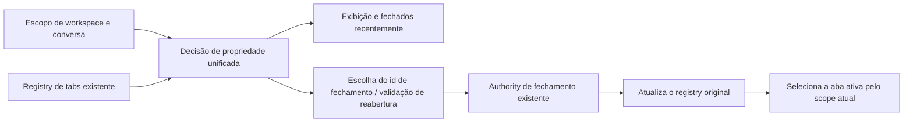

# Tabs do Painel Lateral

## Objetivo

O side pane direito evolui do modelo de slot único para um modelo de múltiplas tabs, permitindo manter Browser, Diff e Code Viewer ao mesmo tempo e alternando entre eles dentro do pane.

## Design-chave

- O estado do side pane passa a ser `tabs + activeTabId`, em vez de um único `type`
- Diff usa tab singleton; cliques repetidos apenas ativam ou fecham a tab atual
- Browser suporta tabs de múltiplas instâncias; o fallback de Browser da entrada principal prioriza alternar para um Browser já existente, enquanto o Browser na nova aba cria uma tab independente
- Code Viewer reutiliza tabs por `sourceKey` estável, evitando o acúmulo do mesmo arquivo
- O tab registry de cada workspace é guardado em cache em memória separadamente; na troca, o registry correspondente é restaurado, sem mover tabs entre workspaces.

## Contrato de propriedade e operação

Exibir, fechar a atual/outras/todas, os fechados recentemente e reabrir compartilham o scope `workspaceKey + ownerTaskId`:

- Primeiro casa o workspace (`workspaceIdentity?.trim() || workspacePath`); tabs antigas de workspace não marcado seguem o registry em que estão.
- No envio de uma nova tab, o workspace e o owner ausentes são preenchidos de forma independente; um owner existente não pode ser sobrescrito, mas a presença de um owner não pode fazer o workspace ser omitido.
- Git, Developer Tools e Treemapping são tabs públicas do workspace; as demais tabs pertencem à conversa/rascunho no momento da abertura.
- browser-use usa `sessionId`; Subagent/Bash usam `rootSessionId`; chat lateral, Plan, Workflow e painéis de plugin usam `parentSessionId`; as demais usam o `ownerTaskId` congelado. Owner não marcado e null mantêm a semântica de rascunho.
- O menu de fechar seleciona apenas as tabs visíveis do momento. Após fechar, apenas as tabs restantes do scope atual são ativadas; ao expandir sem tab visível, cria-se uma nova aba do scope atual, mantendo o painel expandido; o recolhimento manual permanece inalterado. Tabs ocultas são preservadas.
- Fechados recentemente mostra apenas as tabs recuperáveis do scope atual; reabrir também valida o mesmo scope e mantém a atribuição original. Tabs públicas do workspace podem ser recuperadas em conversas diferentes daquele workspace.
- O Browser continua tendo o fechamento confirmado pelo main antes de remover a casca de UI. O fechamento assíncrono trata apenas o tab id selecionado no clique; tabs abertas durante a espera não entram no escopo do fechamento. Ao concluir, o workspace original é atualizado, e o estado de ativação/recolhimento da conversa atual é resolvido pelo scope no momento da conclusão, sem ser sobrescrito por operações antigas.
- Não se adiciona fonte de estado de tabs, fila de permissões, timeout, formato de persistência ou protocolo entre processos; desktop e celular compartilham a lógica de propriedade da UI, e a autoridade do main sobre o Browser e os limites de mensagens continuous/replayable permanecem inalterados.

## Comportamento da UI

- O «+» da tab strip cria e ativa diretamente uma «Nova aba» (New tab), sem mais abrir um menu de aplicativos. Cada clique gera um id próprio, permitindo manter várias novas abas ao mesmo tempo.
- A nova aba é do tipo `new-tab` no registry unificado, pertencendo ao workspace e à conversa no momento da criação; foco, reordenação por arrasto, fechamento e fechar outras/todas seguem as operações de tab existentes (a nova aba não entra em fechados recentemente), sem manter um segundo estado local de tabs.
- A nova aba reaproveita o tab trigger padrão, usando o ícone de arquivo em branco e o botão de fechamento, com a largura das demais tabs (mínimo 60px, máximo 156px); o título não se estica para preencher o espaço restante.
- O conteúdo reaproveita a entrada de nova aba do estado vazio e os plugins de aplicativos recomendados; escolher uma ferramenta ou aplicativo segue a ação de abertura existente e substitui a nova aba atual no mesmo lugar; um singleton já aberto apenas ativa a tab existente e remove a nova aba atual. «Ver todos os plugins» mantém a nova aba de origem para o retorno. Os limites de suporte de host de plugin e as regras de deduplicação permanecem inalterados.
- Durante a instalação, restauração ou habilitação de um plugin recomendado, apenas a entrada do plugin atual exibe um ícone giratório ao lado do texto de carregamento e é marcada com `aria-busy`; os outros plugins mantêm seu próprio texto de instalação, habilitação ou abertura. Múltiplas surfaces do mesmo plugin compartilham o progresso. A lista de recomendados continua desabilitada até o fim da operação atual; após sucesso ou falha, o ícone e o estado de carregamento são removidos e a lista volta a ser operável; após o sucesso, o usuário ainda precisa clicar para abrir. O estado vazio e a nova aba, e os layouts de desktop e celular, seguem a mesma regra; quando o sistema pede redução de animação, o ícone de carregamento e o texto permanecem estáticos.

- O topo do painel direito usa o componente `Tabs` já existente no projeto para renderizar a tab strip
- Ao alternar de tab, a instância do pane já aberto é preservada, evitando que a webview do Browser seja destruída
- A tab de Browser acompanha os eventos `page-title-updated` / `page-favicon-updated` da webview para exibir o título e o favicon da página; quando o evento não retorna nada, há fallback para o título padrão do Browser e o ícone Globe
- Os botões separados de Browser / Diff no Header foram removidos e unificados no botão do side pane na extremidade direita
- O botão do side pane é sempre clicável; ao expandir, se o scope atual não tiver tag visível, cria e ativa uma new-tab; não cria automaticamente tabs de ferramentas como Browser / Review / Terminal
- As atualizações de abertura/fechamento do painel e de exibição/ocultação por animação afetam apenas o lado direito e o layout de sessão; quando os dados de projeto à esquerda e as props de navegação não mudam, a árvore de projetos pula a re-renderização. O desktop passa callbacks de controle remoto estáveis, e a navegação do celular segue as regras originais de mesmo workspace / workspace diferente. Mudanças no diretório de projetos, não lidas, status de tarefa, tema e idioma continuam atualizando normalmente, sem congelar a barra lateral com comparadores que ignoram props.
- A criação de rascunho e suas configurações seguintes, bem como as atualizações de recolhimento do painel, seguem a mesma fronteira de renderização: a criação não perde a estabilidade de referência porque o Root remonteia o callback de navegação remota, e a chamada usa a implementação já submetida mais recente; a navegação remota depende de objetos de serviço estáveis, e não usa como dependência de renderização métodos RPC que criam uma nova instância a cada leitura; quando a leitura repetida do diretório devolve projetos equivalentes, lista de tarefas vazia, status de conexão e entradas equivalentes, as referências originais são reaproveitadas. A barra lateral assina apenas o status da tarefa atual que afeta a exibição, e a herança de grupo lê a tarefa atual no momento do clique. Mudanças reais nos dados de projeto, na identidade ou no destino de navegação continuam atualizando normalmente, sem adicionar atraso, fila de navegação ou cópia de estado de negócio. O SPT03 cobre a criação e as operações seguintes nos layouts de desktop e celular, e valida a fronteira por contagem de renderizações, resultado da navegação e atualização de dados.
- O Cmd/Ctrl+N entra em rascunho pelo caminho real menu → platform → Root → App → WorkspaceShell. Um `addTab` equivalente no mesmo workspace preserva as referências de tab e de lista; o callback de seleção de tarefa lê a sessão atual no momento da operação, sem re-renderizar todos os projetos por causa da entrada em rascunho. Mudanças reais em metadados de conexão, identidade e classificação continuam publicando atualizações. A leitura de projetos do `prepareSession` do Host e a re-verificação de exclusão após a checagem de diretório carregam apenas projetos/roots, sem ler tarefas alheias; preservam-se as validações originais de diretório, exclusão concorrente e diretório único remoto. O SPT04 verifica esse caminho em um Dev App com múltiplos projetos, usando teclas e eventos de menu reais, e registra a contagem de renderizações das linhas de projeto, o primeiro frame do rascunho e o trace; não se pode substituir App/WorkspaceShell/tab store por noop. Dados em milissegundos servem para comparação nas mesmas condições, e o gate de regressão usa comportamento e contagem de renderizações.
- Mudanças no tempo de atividade de tarefas em execução atualizam apenas as linhas de projeto e de tarefa relacionadas. A montagem das linhas de projeto é isolada por projeto: quando as referências de elementos de tarefa, os dados de menu e a semântica dos callbacks de projetos sem relação não mudam, o conteúdo é pulado; o array de tarefas é comparado por identidade de elemento e por ordem, e todos os demais atributos participam da comparação. Mudanças reais em execução/conclusão, não lidas, título, atribuição, fixação, conexão remota, idioma e callbacks de operação continuam propagando. Reutilizam-se a projeção de diretório e o owner de tarefas existentes, sem filtrar campos de atividade e sem adicionar atraso ou cache de negócio. O SPT06 dirige atualizações de atividade em fixtures multiprojeto de desktop/celular e temas claro/escuro, e verifica que o fim da execução e as operações de projeto continuam funcionando.
- O loading da área de tarefas e mensagens da barra lateral mantém o ícone, o tamanho, a cor e a semântica de estado originais; a rotação atua sobre o contêiner HTML existente, deixando o Chromium compor a animação. Durante a espera parada, a rotação de SVG não pode recalcular o estilo a cada quadro. O SPT06 verifica também que o ícone continua girando, é removido ao final e que a contagem de recálculos de estilo durante a animação ociosa é a esperada.
- Quando o layout completo da barra de ferramentas já coube, a notificação de tamanho apenas lê a geometria existente, sem clonar nós de medição. Em caso de overflow ou de estado comprimido existente, continua-se medindo com uma cópia invisível, preservando a ordem original de recolhimento, a ordem de restauração, o foco e o seletor em aberto. O resultado da medição continua sendo apenas uma projeção do layout do DOM, sem novo estado de negócio nem sincronização por atraso.
- O estado de rascunho de New Task e uma Task já existente reutilizam o mesmo esqueleto `WorkspaceHeader`; `variant="draft"` oculta o contexto e os menus específicos da task e preserva Help / Terminal / Side Pane e a área de caption de plataforma. Ao entrar em um novo rascunho, o side pane continua recolhido por padrão, e ao clicar no botão as tabs existentes são restauradas conforme o owner do rascunho; sem tab visível, cria-se uma tag real `New tab` (nova aba) e exibe-se a barra de abas unificada. O Web remoto do celular continua reutilizando o overlay de side pane existente, sem novo runtime ou cadeia de restauração. As restrições completas estão em `docs/ui/workspace-header-variants.md`.
- Quando o usuário expande o side pane ativamente e a tarefa atual não tem tab visível, cria-se a tag `New tab`; a verificação usa o conjunto de tabs visíveis filtrado pela active task, e não todas as tabs do workspace registry. Mesmo que o registry ainda mantenha tabs ocultas de session-scoped de outras tasks, é preciso criar a nova aba do scope atual e exibir a tab strip e o `+`. A página de estado vazio independente deixa de ser renderizada. O topo da página de estado vazio é alinhado e rolável, com o título «Nova aba» alinhado à esquerda e sem subtítulo. Os aplicativos internos ficam em cima e os plugins de UI embaixo, separados por uma linha divisória curta e centralizada. Os itens das duas áreas são linhas horizontais: bloco de ícone `surface` de 48px + nome e descrição de uma linha + cápsula `secondary` «Abrir» no fim; a linha inteira é clicável, com `hover:bg-hover` e sem borda. Quando o contêiner chega a 36rem, o layout passa a duas colunas; em painel estreito, uma coluna. À direita do título da área de plugins de UI fica a entrada «Ver todos os plugins», que abre o mercado completo de plugins. Quando ainda não há sessão criada (activeTaskId vazio), toda a área de plugins de aplicativos, a divisória e a entrada de ver todos os plugins ficam ocultas. Quando uma sessão existente entra pelo marketplace a partir da nova aba, o título da página de navegação do marketplace exibe uma seta de retorno à esquerda; o retorno fecha a tab do marketplace e ativa a nova aba de origem, e, quando a tab de origem já foi fechada, cria-se uma nova nova aba. As demais entradas não exibem essa seta de retorno. A entrada de retorno é visível apenas para a tarefa de origem e não aparece ao trocar para outra tarefa. Esse contexto da entrada é mantido apenas durante o ciclo de vida do painel atual e não é restaurado entre recarregamentos. As descrições dos aplicativos internos seguem o texto do protótipo: conversa auxiliar «Continue a conversa no painel lateral.», revisão «Veja as alterações de código e o diff.», terminal «Execute comandos e veja a saída.», navegador «Navegue na web e pré-visualize o aplicativo.», ferramentas de desenvolvedor «Inspecione e depure o aplicativo.»
- Fechar a última tab visível (inclusive a nova aba) ou executar fechar todas recolhe o painel, sem criar tabs de reposição; a nova aba só é criada quando o usuário expande novamente um painel vazio. A nova aba não entra na lista de fechados recentemente; depois de o Cmd/Ctrl+W fechar a última tab, o próximo acionamento usa o fallback de fechar a janela. Um fechamento em background de um painel já recolhido não pode expandir o painel
- Quando Browser / Diff / Code Viewer são reativados, o estado recolhido é limpo automaticamente, evitando que o conteúdo à direita exista mas continue oculto
- Tabs de nível de conversa são ocultas conforme o scope de pertencimento, sem serem destruídas; ao mudar para uma conversa sem tabs o painel recolhe, mas o Browser comum e a `<webview>` do browser-use
  continuam montados em segundo plano para manter a página viva. Ao voltar a uma conversa com tabs, a tab preferred/current/latest daquela conversa é reselecionada,
  e o painel é expandido ativamente, sem herdar o estado recolhido das conversas intermediárias
- O Code Viewer continua usando pré-visualização com realce de sintaxe para arquivos de código; para arquivos `.md/.markdown` e para sources de texto markdown passa a renderizar o corpo, permitindo inspecionar diretamente no side pane títulos, listas, links de arquivos do workspace e saltos para links externos
- O topo do Code Viewer mostra um breadcrumb compacto de caminho: por preferência `workspace -> diretório -> arquivo` conforme o workspace atual, com o nó final de arquivo tendo ícone do tipo de arquivo; caminhos muito longos são vistos por rolagem horizontal
- O canto superior direito do Code Viewer passa a ter dois botões, `更多 + 打开`; o fechamento continua passando pela entrada de fechamento da própria tab, e o menu `更多` hospeda apenas a troca de visualização relacionada ao tipo de arquivo, com suporte atual a preview/código-fonte de markdown, preview/código de SVG e o interruptor de quebra de linha automática para arquivos de código comuns
- A tab strip suporta reordenação por arrasto horizontal; a ordenação altera apenas a ordem do array `tabs`, sem mudar o `activeTabId` atual
- Cada tab tem largura padrão de 156px (`w-39`); quando a largura disponível da tab strip é insuficiente para manter a largura padrão, todas as tabs encolhem em partes iguais, com largura mínima de 60px (`min-w-15`). Somente quando todas as tabs encolheram até 60px e ainda assim não couberem é que a tab strip permite rolagem horizontal. O título usa o espaço restante dentro da tab além do ícone e do badge; o botão de fechamento é posicionado de forma absoluta e não ocupa espaço; ícone e texto formam o item-content, e conteúdo muito longo usa máscara com esmaecimento em vez de reticências; quando o botão de fechamento aparece, a área com esmaecimento se desloca para a esquerda, sem deslocamento ou reformatação do conteúdo
- A visão geral de tabs não participa da divisão igual das larguras. O botão de adicionar fica logo após a última tab enquanto não houver overflow; quando todas as tabs encolheram até 60px e ainda assim não couberem, com a tab strip em rolagem horizontal, o botão de adicionar se move para fora da área de rolagem e fica fixo à direita
- O botão de fechamento de cada tab é posicionado de forma absoluta, não ocupa espaço no título e só aparece quando selecionado, sob hover ou em focus-within; quando oculto, não responde a clique do mouse, e o foco por teclado pode fazê-lo aparecer. Em toque, seleciona-se primeiro e fecha-se depois; a operação de fechamento continua impedindo a ativação da tab ou o arrasto
- As abas suportam fechamento pelo botão do meio do mouse: quando o botão do meio é pressionado em qualquer área não interativa da tab, ela fecha diretamente, sem antes ativá-la; o comportamento padrão de rolagem automática do navegador com o botão do meio também precisa ser bloqueado. Essa interação é reutilizada por todos os tipos de tab do Side Pane (incluindo chat lateral, Browser, Terminal etc.); o toque na Web móvel não tem botão do meio e não depende dessa interação
- Cada tab reutiliza o Tooltip encapsulado pelo projeto para exibir o título completo sem truncamento. A exibição só ocorre após 1500ms de entrada do ponteiro; ao sair ou mover para outra tab, a dica atual é cancelada imediatamente, e a nova tab precisa esperar os 1500ms completos novamente, sem aproveitar a janela de troca rápida do grupo de Tooltip. Ao arrastar uma tab a dica é forçadamente fechada, e no toque não se depende dessa interação de hover
- O arrasto usa um limiar de distância, e o clique simples continua responsável apenas por alternar a tab; a área do ícone de fechamento não dispara arrasto
- A tab strip suporta menu de contexto com o clique direito, oferecendo atualmente fechar a tab atual e fechar as outras tabs; ao fechar as outras, a tab sobre a qual foi feito o clique direito é mantida e ativada
- Ao lado do botão de adição da tab strip há uma entrada de visão geral de abas, que permite buscar por múltiplas palavras em título, caminho/URL e tipo das abas abertas, ver o horário de abertura, alternar para a aba alvo e ainda fechar as outras abas ou todas
- O rodapé da visão geral de abas exibe as abas fechadas recentemente; clicar em um item fechado recentemente reabre e ativa a tab correspondente
- A busca da visão geral de abas filtra simultaneamente abas abertas e abas fechadas recentemente; os resultados são ordenados priorizando casamento de título e depois por caminho/URL e tipo
- As tabs, o estado recolhido, a seleção de source do Git e a URL atual do Browser do side pane são mantidas em memória com a chave `workspaceIdentity?.trim() || workspacePath`, sendo restauradas após troca de workspace; não sobrevivem a refresh ou reinício do aplicativo
- A URL de múltiplas tabs de Browser é registrada por `browser tab id -> URL`, evitando que múltiplas webviews compartilhem o mesmo endereço de restauração
- No desktop, `Cmd/Ctrl+W` segue a semântica de «fechar o contexto atual»: se o side pane direito estiver expandido e houver tab ativa, fecha-se primeiro essa tab; caso contrário, faz fallback para fechar a janela atual. O atalho é encaminhado pelo processo main ao renderer para a decisão, evitando que o role `close` nativo do Electron feche a janela diretamente e contorne o estado do side pane
- O canto superior direito do painel do desktop oferece «Entrar em visão completa» (`⇧⌘F` / `Ctrl+Shift+F`); o painel ocupa a janela inteira, a conversa passa a ser a primeira tab e há uma janela de entrada flutuante. O contrato completo está em `docs/ui/side-pane-full-view.md`.

### Exibição da nova aba

O título da página inicial é uniformemente «Nova aba» (New tab). O recuo mínimo esquerdo e direito da página é de 28px e o espaçamento entre colunas é de 32px; o título da seção e o quadrado de logo do item alinham as bordas esquerda. Os plugins de aplicativos reutilizam, via PluginStoreAvatar, a origem real dos ícones e as regras de tamanho do marketplace, mostrando um placeholder de puzzle quando a imagem falta ou falha ao carregar; as ferramentas internas mantêm seus próprios ícones. A ordem de recomendação, a instalação e o comportamento de abertura permanecem inalterados.

Na primeira carga da lista de aplicativos recomendados são exibidos 8 itens de esqueleto: ícone arredondado de 48px, placeholders de título e descrição em duas linhas e placeholder de ação em cápsula com 24px de altura. O espaçamento interno e o padding da linha são iguais aos dos itens reais; mantém-se o breakpoint de uma ou duas colunas em 36rem e o espaçamento de 32px entre colunas, respeitando a preferência do sistema por menos animação.
