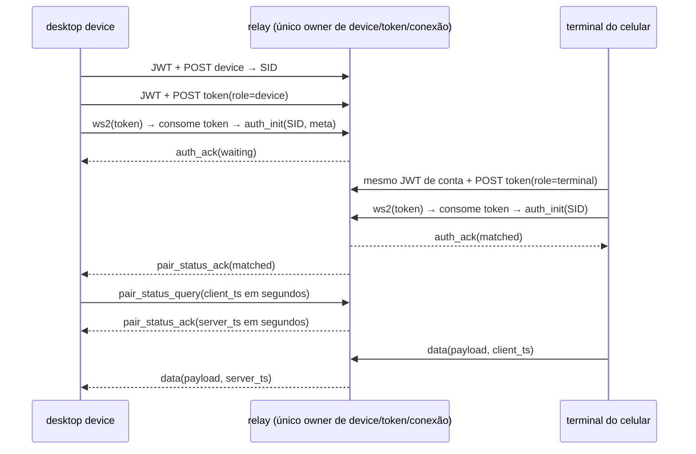
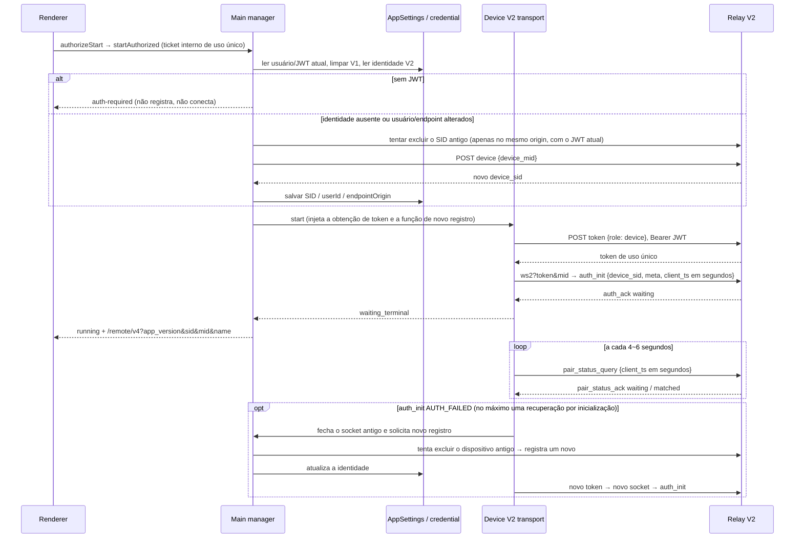
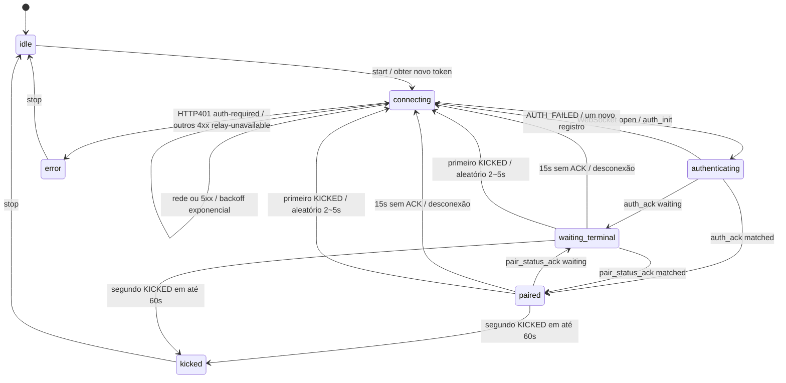
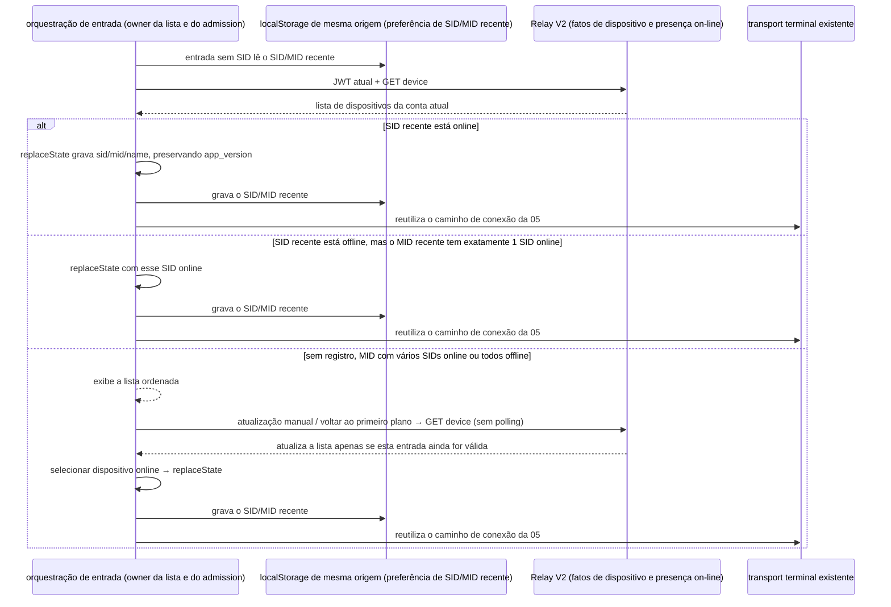

# Relay V2 — Contrato compartilhado e pareamento

Esta página define o contrato compartilhado final, o comportamento de conexão e os limites de aceitação de [Relay V2](../issues/web-remote-control-relay-v2/01-relay-v2-login-pairing.md). Desktop device, terminal do celular e shared usam apenas a V2.

Base do contrato: zcode-server, commit `5a947caea3a022b12b5d051ef25c807952feefa7` da `origin/staging`, com `docs/remote-relay.md`, `internal/domain/relay_v2/proto.go`, `service.go` e `internal/interfaces/web/{dto,controller}/remote_v2.go`. Requisições HTTP e mensagens WebSocket usam validação estrita de campos; é proibido enviar campos da V1 por acidente para a V2; as respostas HTTP seguem a validação de compatibilidade descrita abaixo. A decodificação JSON do Go no servidor pode, por si só, ignorar campos extras.

## Contrato HTTP

Todas as interfaces usam `Authorization: Bearer <jwt>` e o usuário vem do contexto de login. O envelope de sucesso é `{code: 0, msg: string, data: T}`; o envelope de falha é `{code: inteiro diferente de zero, msg: string, data?: null}`, e respostas HTTP fora do 2xx também podem não ter corpo JSON.

A resposta HTTP permite que o servidor acrescente campos: nos envelopes de sucesso/falha de registro, listagem, exclusão e token, bem como em campos desconhecidos do registro de dispositivo, do `meta` do dispositivo e do objeto de dados do token, esses campos são ignorados na análise e removidos do valor de retorno. Metadados que o cliente não usa, como `logid`, não são listados separadamente no schema e seu tipo não é restringido; não é preciso publicar o cliente junto com novos campos do servidor. A obrigatoriedade, o tipo e as restrições de valor dos campos já declarados continuam sendo validados, e `code !== 0` continua sendo tratado como falha. A compatibilidade com novos campos não significa que a ausência do SID do dispositivo, um token inválido ou um estado de negócio incorreto possam ser aceitos.

Aceitação: quando a resposta ganha campos de rastreamento de primeiro nível, atributos de dispositivo, atributos de `meta` ou atributos de token, o registro/token no desktop e a listagem/token no celular continuam tendo sucesso e retornam apenas os campos declarados; quando um campo de negócio existente está ausente ou tem tipo errado, ainda falha. A validação de campos das requisições HTTP e do WebSocket não é afetada por essa política.

| Método e caminho                     | Requisição                                         | data de sucesso                                    |
| ----------------------------------- | -------------------------------------------------- | -------------------------------------------------- |
| POST `/api/v1/remote/device`        | `{device_mid: string}`, não vazio, até 128 caracteres | registro do dispositivo                            |
| GET `/api/v1/remote/device`         | sem body, sem parâmetros de query                  | array com os registros de dispositivo do usuário atual |
| POST `/api/v1/remote/device/delete` | `{device_sid: string}`, não vazio, até 128 caracteres | `null` ou o campo data omitido                     |
| POST `/api/v1/remote/token`         | `{role: "device" \| "terminal"}`                   | `{token: string, expires_in: segundos inteiros positivos}` |

O registro de dispositivo é `{device_sid, device_mid, online: boolean, created_at: Unix em segundos, meta}`. O `meta` é `{name?: string, platform?: string, version?: string}`; offline é `{}`. O registro não recebe `meta`, e cada registro com o mesmo MID produz um novo SID. Só é possível excluir o próprio dispositivo offline; após a exclusão, o SID não consegue mais autenticar. Excluir um SID inexistente tem sucesso idempotente; excluir o dispositivo de outra conta devolve HTTP 200, `code: 1006`, `msg: "no permission"`; excluir um dispositivo online devolve HTTP 400, `code: 3005`, `msg: "wrong status"`. O chamador precisa verificar simultaneamente o status HTTP e o `code` de negócio. Parâmetros de requisição inválidos devolvem HTTP 400, `code: 3001`, `msg: "parameter error"`.

O token é a codificação Base64URL sem padding de 16 bytes aleatórios, com 22 caracteres, vinculado ao usuário e ao papel, sem vínculo com o SID; é emitido com `Cache-Control: no-store` e vale por 60 segundos. É consumido atomicamente antes do WS Upgrade; em caso de falha não é restaurado, e uma reconexão exige solicitar um novo token. A expiração não afeta conexões já estabelecidas. JWT/token não entram no QR code nem nas mensagens de negócio.

## Contrato WebSocket

Entrada `/api/v1/remote/ws2?token=...`, que pode carregar a dica de roteamento do gateway `mid`. Token ausente, inválido, expirado ou duplicado devolve 401 antes do upgrade. Só aceita texto JSON, com mensagem de no máximo 1 MiB.

| Direção           | Mensagem            | Campos                                                                                |
| ----------------- | ------------------- | ------------------------------------------------------------------------------------- |
| cliente → relay   | `auth_init`         | `device_sid` (não vazio, até 128 bytes UTF-8), `meta` opcional, `client_ts` opcional; sem `role` |
| cliente → relay   | `pair_status_query` | `client_ts` opcional; sem `device_sid`                                               |
| cliente → relay   | `data`              | `payload` obrigatório (JSON qualquer), `client_ts` opcional                          |
| relay → cliente   | `auth_ack`          | `device_sid`, `terminal_sid`, `pair_status`, `server_ts` opcional                    |
| relay → cliente   | `pair_status_ack`   | `terminal_sid`, `pair_status`, `server_ts` opcional                                  |
| relay → cliente   | `data`              | `payload`, `server_ts` opcional; sem `client_ts`                                      |
| relay → cliente   | `error`             | `code`, `message` opcional, `server_ts` opcional                                     |

`terminal_sid` permite string vazia ou ausência: no auth ACK do device é vazio, no auth ACK do terminal é o SID atribuído; o ACK de consulta é o SID do terminal do par, e o ACK de push é vazio. `pair_status` é apenas `waiting | matched`. Os códigos de erro são apenas `AUTH_FAILED | WRONG_PARAM | KICKED | INTERNAL | DEVICE_OFFLINE`.

Os timestamps são segundos Unix inteiros não negativos (até o fim do ano 9999 da era comum, valores em milissegundos são rejeitados) e não participam da autorização. A referência de heartbeat da V2 é 5,000ms, jitter ±1,000ms, deadline de ACK 15,000ms; o helper de delay do heartbeat já tem por padrão as constantes da V2, e os padrões da V1 não são mais mantidos.



Posse do estado: o relay falso possui sozinho o dispositivo, o token não consumido, a conexão e o owner atual de `(SID, role)`. Primeiro verifica a posse, depois substitui o owner antigo do mesmo papel, envia `KICKED` e fecha a conexão antiga; o close assíncrono da conexão antiga não pode remover o novo owner. Sem autenticação não se pode enviar data/query; autenticação repetida ou campos inválidos fecham a conexão. Quando o dispositivo desconecta, o terminal é notificado com `waiting`, `DEVICE_OFFLINE` e a conexão é fechada; quando o terminal desconecta, apenas o device é notificado com `waiting`. Os dados só são enviados ao outro papel do mesmo SID, sem ler informações de usuário/dispositivo dentro do payload.

O Relay não mantém task, workspace, stream nem entradas já submetidas; os limites de owner e de recuperação por snapshot/gap do `desktop-continuous` do desktop e do `web-remote-replayable` do celular permanecem inalterados.

## Contrato final do QR code

`buildWebRemoteControlExternalQrUrl` aceita apenas as dicas de roteamento da V2 `sid`, `mid`, `name`, `app_version`, todas opcionais; a saída limpa da URL base o `hash`/`t` residual.

`parseWebRemoteControlExternalQrParams(params)` retorna apenas os parâmetros da V2; parâmetros em branco são tratados como ausentes, e a ausência de parâmetros permite entrar na lista de dispositivos. Links antigos com `hash` ou `t` retornam null; não existe overload V1 nem fallback de análise. Os tipos de mensagem compartilhados da V1, os vetores de proof e as constantes de heartbeat são removidos; o helper de heartbeat passa a usar 5 segundos ±1 segundo da V2.

## Relay falso compartilhado

Local: `packages/shared/test/fixtures/fake-relay-v2.ts`, subcaminho de teste independente `@zcode/shared/testing/fake-relay-v2`. Importado apenas em processos de teste Node, não exportado pela entrada raiz shared de produção, e não introduz HTTP do Node nem `ws` no bundle do navegador. HTTP/WS reais de loopback podem atender clientes compatíveis com o pacote Node `ws` e com a API WebSocket do navegador.

`createFakeRelayV2({users: {JWT de teste: ID de usuário}, now?, onHttp?, onMessage?})` retorna `httpUrl`, `wsUrl`, `httpCalls`, `messages`, `sendError(target, code)`, `disconnect(target)` e o `close()` assíncrono. `now` retorna milissegundos; o target pode ser filtrado por `connectionId`, `deviceSid`, `role`. `onHttp(call)` retorna `{status, body?}` ou `{networkError: true}`; `onMessage(record)` retorna `{pairStatus}`, `{error}`, `{disconnect: true}` ou `{drop: true}` (ignora aquela requisição, sem alterar o estado da conexão e sem enviar ACK); um retorno vazio segue o comportamento normal. Os testes devem fazer `await relay.close()` na fase de limpeza.

O plano de controle de teste permite injetar HTTP 401/5xx/queda de rede por requisição, orquestrar estados de ACK de auth/pair por papel de conexão e SID (inclusive descartando ACKs para testes de watchdog), injetar erros de protocolo arbitrários e fechar ativamente. Cada chamada HTTP e cada mensagem WS ficam retidas em memória para asserção (inclusive mensagens inválidas), e as credenciais de teste não são registradas em log.

Limites de capacidade: oferece registro/listagem/exclusão offline, isolamento de usuário, token de uso único/expiração, autenticação/pareamento/substituição, passagem de dados, injeção de erros e limpeza. Usa o mapeamento JWT de teste → usuário, não valida JWT/OAuth reais e não simula Redis, TTL de owner multi-instância, bloqueio por IP, TLS, roteamento de mid do gateway, Ping automático/timeout de autenticação ou política de reconexão do cliente; esses ainda exigem testes de transporte posteriores e integração em produção. A cobertura de estado de ACK só altera a resposta, não falsifica a conexão ou o estado de negócio do par.

## Costuras de aceitação

- Funções públicas de parsing do shared: amostras válidas de wire/HTTP, campos/tipos/unidades de tempo inválidos, rejeição do QR code da V2 e de parâmetros de credencial antigos, parâmetros de heartbeat da V2.
- HTTP/WS reais do relay falso: registro/listagem/exclusão, rejeição entre usuários, token de uso único e validade, close antigo após substituição do mesmo papel, roteamento transparente bidirecional, ACK de heartbeat, todos os códigos de erro/queda de rede/falhas HTTP e os registros de chamadas.
- Node `ws` e o WebSocket padrão global fazem uma passagem cada pelo transporte de pareamento; não substitui o transporte de produção desktop/celular nem o E2E em aparelho real.

## Ciclo de vida do desktop device (03)

O Main manager é o owner único da identidade do dispositivo e do runtime da janela; o `webRemoteControlRelayV2Device` do AppSettings guarda apenas `{deviceSid, userId, endpointOrigin}`. Na primeira inicialização, limpa a V1 `webRemoteControlExternalRelayDevice` e a credential `web-remote-control:external-relay:pass_hash`; a V2 não grava credential. O JWT é carregado, somente leitura, pela entrada de leitura de credential já existente do main, para a conta atual, sem passar pela camada de rede do processo de services e sem disparar logout.



O endpoint de registro aceita apenas `device_mid`; o hostname é reportado por `auth_init.meta.name` (vale o contrato do servidor verificado em 02). Em caso de troca de endpoint, o JWT do novo domínio não é enviado ao domínio antigo, então a exclusão do registro antigo é pulada; a exclusão sem permissão ao trocar de conta no mesmo domínio falha sem bloquear o registro.

Quando o registro tem sucesso mas o salvamento da identidade local falha, o manager tenta excluir o novo SID recém-registrado, registra o erro real de salvamento e encerra esta inicialização com `relay-unavailable` irrecuperável, mantendo o estado `error`. Se a exclusão compensatória falhar, apenas se registra um aviso, e a inicialização ainda encerra, sem entrar em re-registro com backoff de rede; a identidade local antiga e a intenção de ativação não são sobrescritas por uma escrita falha. Falhas de rede/5xx continuam com backoff, e a convenção de no máximo uma recuperação por inicialização no `AUTH_FAILED` permanece inalterada.

```text
Antes da correção: relay registra novo SID → falha no salvamento local → transport faz backoff de rede → registra outro novo SID
Depois da correção: relay registra novo SID → falha no salvamento local → tenta excluir o novo SID → error irrecuperável
```

Essa fronteira fica antes do registro do device e da conexão no main, mantém apenas a identidade do dispositivo e não altera a semântica de stream/snapshot/queue do attachment do shared-host, do `desktop-continuous` do desktop ou do `web-remote-replayable` do celular.



O transport é dono exclusivo do socket, da contagem de retentativas e dos timers; o helper compartilhado cuida do agendamento do heartbeat, do mapeamento waiting/matched e das retentativas limitadas. A obtenção inicial do SID e o re-registro forçado após o AUTH_FAILED são executados uniformemente pelo callback de resolução de identidade do manager, e o registro serial e a persistência da identidade continuam exclusivos do manager; o primeiro registro também entra no backoff, no cancelamento e no prazo de espera inicial de 30 segundos do transport. Cada rodada de heartbeat reamostra 5s ±1s, o watchdog de ACK de 15s tem contagem independente; o handshake também tem deadline de 15 segundos. Desconexões e falhas de rede/5xx em HTTP partem de 1 segundo com backoff exponencial, jitter ±20%, máximo de 30 segundos, e `auth_ack` zera o contador. Após o primeiro KICKED, reconecta em 2~5 segundos aleatórios; o segundo KICKED em até 60 segundos leva a `kicked`, e o manager mantém externamente `error/session-conflict`. Depois da janela, uma nova recuperação limitada é permitida. Qualquer reconexão fecha a conexão antiga antes de solicitar um novo token; generation e AbortSignal descartam resultados assíncronos obsoletos após stop/restart.

HTTP401 coloca `auth-required` e interrompe a reconexão automática; outros 4xx, respostas inválidas ou AUTH_FAILED repetido colocam `error/relay-unavailable`. A última intenção de ativação é preservada, sem logout global e sem limpar o registro de ativação; a notificação de login é usada na seção seguinte. O QR code fica disponível após o auth_ack e o SID é atualizado após um novo registro; JWT/token não entram no estado nem nos logs. Após o timeout de espera da primeira chamada de 30 segundos, a falha é reportada e um runtime recuperável é mantido, com o backoff em segundo plano continuando, e só um stop do usuário revoga a intenção de ativação.

A superfície de dependências alcançável pelo Renderer é apenas `authorizeStart/startAuthorized/stop/getStatus`; o botão de atualização do QR code, o diálogo de confirmação, os métodos de plataforma e a remoção via IPC não adicionam novo texto de UI. O owner de negócio do continuous do desktop e do replayable do celular, o isolamento por workspaceIdentity, o snapshot/gap e o replay reconhecido permanecem inalterados.

## Portão de login do desktop e recuperação (04)

`auth-required` significa que o controle remoto aguarda o login do app: não mostra QR code nem link de cópia, não registra dispositivo, não solicita token, não conecta no relay e não cria host, sessão remota ou runtime de Agent. O botão de login do diálogo fecha o diálogo de controle remoto e reutiliza o `requestLoginEntry` existente. Não é um comando de logout OAuth global; um HTTP 401 apenas para o controle remoto.

| Conteúdo  | zh-CN                                                  | en-US                                                                                   |
| -------- | ------------------------------------------------------ | --------------------------------------------------------------------------------------- |
| Título    | 需要先登录                                             | Sign in required                                                                        |
| Descrição | 登录后即可使用手机远程控制。手机和电脑需登录同一账号。 | Sign in to control this computer from your phone. Use the same account on both devices. |
| Botão de login | 登录                                             | Sign in                                                                                 |

Acima está o texto de implementação e de aceitação visual desta ticket. O manager do processo principal é o owner único do estado de execução do controle remoto e da admissão de recuperação; a credential OAuth continua sendo a fonte de verdade do login. O OAuthService, na fila serial de sessão, publica `signed-in | signed-out` via `onDidChangeSession` depois de concluir a escrita das credenciais de login ou a limpeza do logout, antes da limpeza dos providers derivados, da atualização das configurações e da atualização da projeção de usuário na UI. Logins cancelados ou revertidos, e logouts cuja limpeza não teve sucesso, não publicam o evento de conclusão; a reautenticação da mesma conta também publica. O renderer assina esse evento e envia, pelo IPC unidirecional existente, estritamente `{state: "signed-in" | "signed-out"}`, sem JWT, usuário ou workspace; na restauração local de sessão ainda sincroniza uma vez o estado inicial. O main valida o payload e a janela de envio; a notificação de login apenas dispara a releitura da credential e não autoriza o registro de dispositivo.

```text
Antes da correção: credencial limpa → falha na atualização de provider/configurações → usuário não limpo na UI → logout perdido → controle remoto antigo ainda conectado
Depois da correção: credencial do OAuthService limpa → evento de sessão → IPC do renderer → Main revoga conexões/attachments
                           └→ pós-processamento de provider/configurações (mesmo com falha, o evento de sessão não é revogado)
Login na mesma conta: credencial escrita → evento de sessão → Main relê a credencial e recupera; não espera a contagem de sucesso da UI
```

Cobertura de regressão: logout após o pareamento, mesmo que a limpeza dos providers derivados ou a atualização das configurações da UI falhe, o Main ainda passa para `auth-required`, fecha o WS antigo e libera o attachment, preservando o último registro de ativação; após a reautenticação da mesma conta, a recuperação funciona mesmo se a atualização das configurações falhar. A assinatura do evento é liberada na desmontagem do Root, e as plataformas Web/cellular comuns não assinam a notificação de sessão do desktop; os limites de recuperação de negócio de continuous/replayable não mudam. Anomalias de restauração em múltiplas janelas estão fora do escopo de aceitação desta seção.

```mermaid
sequenceDiagram
    participant O as OAuthService / credential (via renderer IPC)
    participant M as Main manager
    participant W as workspace de janela existente
    participant R as Relay V2
    W->>M: sincroniza workspaceIdentity/path + remoteSessionId atual
    M->>O: lê o JWT
    alt sem JWT
        M-->>W: auth-required, preserva o último alvo ativado
    end
    O->>M: signed-in (credencial já escrita)
    M->>O: relê o JWT
    alt há JWT e existe alvo ativado, workspace já sincronizado
        M->>R: registra/reusa dispositivo → token → WS
        M-->>W: running / active
    else workspace ainda não sincronizado
        M-->>W: idle, aguardando a sincronização seguinte; não cria workspace
        W->>M: nova tentativa de recuperação após o sync do workspace
    end
    O->>M: signed-out
    M->>M: invalida os resultados de recuperação antigos, aborta inicializações pendentes, libera transport/attachment de todas as janelas
    M-->>W: auth-required, preserva o registro de ativação
```

O ciclo de vida de inicialização/conexão de cada janela é vinculado a `{userId, endpointOrigin}`. Depois que a notificação de login relê a credencial, se a identidade mudou, o main primeiro revoga todas as inicializações pendentes e as conexões/attachments que não correspondem, e só então recupera conforme o alvo ativado. Uma nova notificação que chega durante a leitura da identidade invalida a leitura anterior; um resultado tardio da conta antiga não pode sobrescrever a nova conexão. Notificações repetidas da mesma conta não reconectam.

```text
Antes da correção: conexão A → login B → apenas verifica se o JWT existe → a conexão A ainda tem acesso
Depois da correção: conexão/inicialização pendente de A → login B → main revoga a geração antiga → B registra/conecta
Primeiro registro: runtime/prazo de espera inicial → resolução de identidade → falha de rede → backoff do transport → nova tentativa
```

Um mesmo processo reivindica o último alvo ativado apenas uma vez; notificações de login repetidas não podem criar conexões duplicadas. Resultados de recuperação antigos, posteriores a um logout, parada manual ou destruição de janela, não podem reiniciar nada. A parada manual limpa o registro de ativação, e um login posterior não o revive. Candidatos de janelas já sincronizadas devem ser sempre preservados, mesmo sem runtime estabelecido; o `SyncWebRemoteControlWorkspaces` sempre publica o snapshot completo local e remoto (inclusive a remoção por lista vazia), e a recuperação do controle remoto não consome mais o `SyncWindowTabs`, que contém apenas caminhos locais; alvos remotos são casados por workspaceIdentity e usam o remoteSessionId sincronizado neste processo. Sem JWT, permanece em espera, sem marcar a falha como já recuperada.

Os limites de owner, de snapshot/gap e de host attachment do `desktop-continuous` do desktop e do `web-remote-replayable` do celular permanecem inalterados. A aceitação usa as interfaces públicas do manager + uma fonte de login falso mutável + relay real de loopback, o schema do IPC e a renderização do diálogo; o E2E do desktop cobre a abertura do diálogo sem login, zero HTTP/WS de controle remoto e capturas de tela em Zai Light/Dark × zh-CN/en-US.

## Primeira entrada pelo celular e recuperação (05)

A pré-orchestração possui apenas o fluxo de entrada; o owner das credenciais é `BrowserOAuthCredentialRepo` / `WebAuthService`; o transport é exclusivo de socket, generation, AbortController, heartbeat e retry. Sem SID, consulta conforme 06 os dispositivos da conta atual e escolhe o destino; antes de escolher o destino não solicita token nem cria runtime de negócio.

```mermaid
sequenceDiagram
    participant P as /remote/v4 pré-orchestração
    participant A as WebAuthService / storage de mesma origem
    participant O as provedor OAuth
    participant T as transport Terminal V2
    participant R as Relay V2
    alt code + state (ou error + state)
        P->>A: reutiliza WebCallbackPage / handleCallback
        A->>A: valida nonce; troca token conforme o ambiente de build e salva o estado de login
        A-->>P: replace seguro de app_return_to (com sid/mid/name/app_version)
    else entrada normal
        P->>A: lê o JWT local (valida cache e expiração)
        alt sem JWT
            P-->>O: página de login → authorize, com app_return_to sendo a URL completa atual
            O-->>P: endpoint origin /remote/v4 + app_version/sid/mid/name originais + parâmetros de autorização
        else sem SID
            P-->>P: consulta dispositivos conforme 06 → dispositivo online mais recente / lista de dispositivos
        else com SID
            P->>T: cria o transport único
            T->>R: Bearer JWT + POST token {role: terminal}
            T->>R: ws2?token&mid → auth_init {device_sid, meta, client_ts em segundos}
            R-->>T: auth_ack matched
            T-->>P: paired → bootstrap existente → workspace bridge → rpc-frame/ack
        end
    end
```

O modo de callback vem antes da entrada normal; o endereço de callback em produção é derivado do endpoint origin, e o debug local continua passando pelo encaminhamento privado permitido `return_to=/remote/v4`, aceito apenas por builds com o encaminhamento de desenvolvimento explicitamente habilitado. `app_return_to` só permite `/remote/v4` de mesma origem, o `/remote/__test__` reservado (ambos podem ter barra final) e os caminhos de compartilhamento já existentes; a query do controle remoto só deixa passar `app_version`, `sid`, `mid` e `name`; outros parâmetros e o fragment não entram no retorno seguro do OAuth. A entrada de teste reutiliza o callback de `/remote/v4` e depois retorna ao link de teste original, sem criar novos caminhos de OAuth nem de callback privado; a aceitação está em [teste entrada login retorno](./web-remote-login.md#独立测试入口的登录回跳).

Ao iniciar a autorização, o endereço de callback e o return_to privado também preservam os parâmetros da lista acima, garantindo que o gateway consiga escolher os recursos por app_version antes de carregar o JS. O repositório de credenciais salva no localStorage de mesma origem, por nonce, o registro deste login (incluindo o endereço de callback completo); o callback recupera o registro correspondente e troca o token por esse endereço. Os limites específicos e as regressões estão em [callback preserva parâmetros de varredura](./web-remote-login.md#回调保留扫码参数) e [callback caindo em outras abas do mesmo navegador](./web-remote-login.md#回调落到同一浏览器的其他标签页).

Com SID, autentica-se direto, sem consultar a lista de dispositivos antes. Links V1 hash/t exibem invalid-mobile-connection, sem calcular HMAC. A cada reconexão relê o JWT, solicita e consome um token terminal de uso único; o transport usa o heartbeat V2 compartilhado (5 s ±1 s / watchdog de 15 s), o mapeamento de pair_status e a janela KICKED. No celular, rede/5xx mantêm backoff de 500 ms×2ⁿ, máximo de 10 s; no desktop, mantêm o existente de 1 s inicial / 30 s no máximo / jitter. Após o primeiro KICKED, retoma após 2~5 s aleatórios; um segundo evento em 60 s encerra como session-conflict, e voltar ao primeiro plano não contorna esse estado terminal.

HTTP401 ou JWT ausente antes da reconexão: fecha a conexão, limpa a sessão local, volta à página de login usando a URL completa atual como endereço de retorno do novo login. AUTH_FAILED após auth_init: device-not-owned; trocar de conta também limpa a sessão e preserva o endereço de retorno. WRONG_PARAM: invalid-mobile-connection. DEVICE_OFFLINE mantém 15 s de tolerância para recuperação; INTERNAL mantém a espera/ reconexão recuperável já existente. waiting é um estado de pareamento legítimo e continua com heartbeat; os data de negócio só podem ser recebidos quando já autenticado e paired. dispose/suspensão/reconstrução invalidam tokens atrasados e mensagens do socket antigo.

A recuperação entre primeiro e segundo plano continua sondando o mesmo socket primeiro e, se necessário, solicita um novo token; após o novo pareamento, valida na ordem original a versão do desktop, restaura bootstrap/mobile-view-state, bridge, quadros ACK não confirmados e snapshot/gap. O owner de negócio, o workspaceIdentity e a ordem de recuperação do desktop `desktop-continuous` e do celular `web-remote-replayable` permanecem inalterados.

### Compatibilidade de cancelamento HTTP no navegador

O token terminal e o adaptador HTTP da lista de dispositivos não dependem de `AbortSignal.any()`, `AbortSignal.timeout()` ou `throwIfAborted()`. Sem esses métodos, ainda é preciso completar a requisição real e o pareamento, sem lançar erro ao montar os parâmetros da requisição nem ficar reconectando em laço.

Os dois adaptadores compartilham o `AbortController` de escopo da requisição, conectando o cancelamento do chamador e o prazo de 15 s já existente ao mesmo sinal de requisição. O prazo cobre o fetch e a leitura completa do corpo; não pode ser liberado antecipadamente ao receber os cabeçalhos da resposta. Quando o chamador já cancelou, nenhuma requisição é enviada; após sucesso, erro HTTP/de negócio, falha de rede, cancelamento ou timeout, o temporizador e o listener do chamador são sempre limpos. Ao rejeitar antecipadamente por status HTTP, o corpo ainda não lido também é encerrado, evitando deixar requisições sem prazo após o cancelamento do prazo. HTTP 401, erros de negócio e erros de rede reentrantes mantêm a classificação original, sem engolir erros nem devolver corpo parcial.

```text
Antes da correção: token / list → falta da API estática → fetch não executado → reconexão / falha na lista
Depois da correção: sinal de cancelamento da entrada / transport → AbortController dentro da requisição → fetch + corpo completo
                                               ├─ prazo de 15 s
                                               └─ finally limpa temporizador / listener
```

O helper é dono dos recursos de cancelamento de uma única requisição HTTP; a navegação é mantida pela Entry, e socket/generation/retry são mantidos pelo transport. O protocolo de pareamento, o isolamento de contas e a atribuição de estado do continuous do desktop e do replayable do celular permanecem inalterados.

Regressão: com cada uma das duas APIs estáticas ausente e com ambas ausentes, token/list têm sucesso; o cancelamento cobre as fases de cabeçalho e de corpo, entradas já canceladas geram zero requisições, o prazo do corpo e a limpeza em sucesso/exceção têm teste em cada adapter; um relay loopback real valida o pareamento e o repasse do bootstrap. O caso pendente de navegador ML08 cobre a conexão direta por varredura de código e a seleção de dispositivo sem código até o pareamento com envio do bootstrap, com matriz de três ausências de API × duas entradas × celular/tela larga × temas claro/escuro, intercalando chinês e inglês. Esta evidência não substitui a validação em navegador de aparelho real, o relay de produção nem a verificação de incidentes em campo do usuário.

Verificação local de 2026-10-19: antes da correção, 27 casos de regressão de compatibilidade falhavam, e com a ausência de `any` no navegador o token/WS/bootstrap eram todos zero; a limpeza do corpo de erro ainda não lido do candidato foi confirmada por mais 2 testes falhando. Os UT afetados finais foram 21 arquivos, 223 testes passando; as 24 configurações de regressão de navegador do ML08 obtiveram token uma única vez,estableceram uma única WS e parearam com envio do bootstrap, com evidências em `.tmp/remote-abort-api-compat-e2e/`. As sondas reais de HTTP/WS em ambiente normal, sem `any` e sem `timeout` parearam com sucesso. typecheck, typecheck do E2E do desktop, lint, architecture e a checagem de formatação dos arquivos alterados passaram; os avisos de lint estão em arquivos não modificados. Aparelho real e produção continuam sem validação, e os casos permanecem pending.

### Aceitação de textos e capturas de tela no celular

A tabela abaixo preserva os textos da fase 05; a 06 já substituiu o placeholder de varredura sem SID pela lista de dispositivos e habilitou "选择其他设备". Os dispositivos da lista atual e as ações de falha de titularidade seguem a 06; na página de falha, a ação secundária usa Button ghost abaixo do botão principal.

| Página/elemento         | zh-CN                                                | en-US                                                                       |
| ----------------------- | ---------------------------------------------------- | --------------------------------------------------------------------------- |
| Título do login        | 登录后继续使用 Web 远程控制                          | Sign In To Continue                                                         |
| Descrição do login     | 请选择与电脑端相同的登录平台，并使用同一账号。       | Choose the same sign-in provider and account as on your computer.           |
| Botão de login Z.AI    | 连接 Z.ai 继续使用（全球）                           | Connect to Z.ai (Global)                                                    |
| Botão de login BigModel| 连接 BigModel 继续使用（中国）                       | Connect to BigModel (CN)                                                    |
| Título sem sid         | 请扫描桌面二维码                                     | Scan the desktop QR code                                                    |
| Descrição sem sid      | 在电脑端打开 Web 远程控制，再用手机扫描二维码连接。  | Open Web remote control on your computer, then scan its QR code to connect. |
| Título de falha de titularidade | 该设备不属于当前账号                       | This device does not belong to this account                                 |
| Descrição de falha de titularidade | 请使用与电脑端相同的账号登录。          | Sign in with the same account as the computer.                              |
| Botão principal de falha de titularidade | 重新连接                     | Try Again                                                                   |
| Botão secundário de falha de titularidade | 切换账号                 | Switch account                                                              |
| Ação de dispositivo reservada (oculta) | 选择其他设备                        | Choose another device                                                       |
| Título de falha de parâmetro | 手机连接已失效                              | Mobile Connection Invalid                                                   |
| Descrição de falha de parâmetro | 当前页面的二维码参数无效，请扫描桌面端的最新二维码。 | The QR parameters are invalid. Scan the latest desktop QR code.             |
| Botão de falha de parâmetro | 重新连接                                   | Try Again                                                                   |

Matriz de capturas: portal de login / sem SID / device-not-owned × 390px / 1024px × Zai Light / Zai Dark × zh-CN / en-US, 24 no total; os casos pendentes ficam em `packages/web/test/e2e/manual-review/pending/remote-login-v2.mjs` e não são promovidos automaticamente. A costura de teste segue a pré-orchestração já definida por esta história, com auth/fetch/location/storage/transport injetados e um relay loopback falso real.

| Caso  | Comportamento e asserções                                                                                          | Nível de automação                                     |
| ----- | ------------------------------------------------------------------------------------------------------------------ | ------------------------------------------------------ |
| ML01  | Sem JWT exibe o portal de login de duas plataformas, com zero token/WS; 8 das 24 imagens da matriz                   | pending navegador                                     |
| ML02  | Com login e sem SID consulta dispositivos e exibe a lista, com zero token/WS antes da seleção; a 06 foi atualizada para 16 imagens de lista mista/vazia | pending navegador                     |
| ML03  | AUTH_FAILED exibe a falha de titularidade; trocar de conta limpa a sessão e preserva a URL; 8 imagens               | pending navegador                                     |
| ML04  | Duas plataformas × celular/tela larga preservam os parâmetros de varredura do callback, salvam nonce/provider/endereço de callback, trocam o token pelo endereço original e retornam, pareando com envio do bootstrap | pending navegador, com OAuth/relay controlados |
| ML05  | Já logado vai direto para terminal token/auth_init/pareamento com envio do bootstrap                                | pending navegador                                     |
| ML06  | token401 limpa as credenciais, volta ao login e preserva a URL, sem WS                                             | pending navegador                                     |
| ML08  | Na falta das APIs estáticas de AbortSignal, tanto a conexão direta por varredura quanto a seleção na lista de dispositivos completam token/WS/auth/pareamento e enviam o bootstrap | pending navegador, `remote-abort-api-compat.mjs` |

### Registro de aceitação por ambiente

A versão da raiz permanece `3.13.0`. Antes de a este pipeline de testes OSS cobrir `3.13.0/`, é preciso avisar os colegas que ainda usam a versão V1 do desktop; o "primeiro login por varredura → retorno → conexão" em aparelho real e o "acesso direto já logado" precisam ser registrados separadamente. Evidência de automação local não equivale à aceitação com OAuth real, gateway OSS, aparelho real e relay entre instâncias.

Automação local de 2026-09-19: 27 verificações de ML01–ML06 passaram, com as 24 imagens da matriz e os resultados em `.tmp/remote-login-v2-e2e/` (`index.html`, `matrix.jpg`, `results.json`); após o ajuste do novo cartão de varredura e do contraste do selo de falha de titularidade, 8 imagens foram atualizadas em cada caso. As seis configurações de navegador de RV01–RV03 passaram; o alerta já existente de ausência de assinatura de eventos de sessão/workspace dinâmicos no home-only continua presente, e não se afirma cobertura de suas operações de tarefa. Web: 296 testes em 31 arquivos passaram, e 48 testes direcionados de device/transport do celular passaram; typecheck/lint/architecture passaram.

A suíte completa de testes unitários continua bloqueada pela asserção de caminho `/private/tmp` no E2E de feedback já existente, com o arquivo-fonte idêntico ao snapshot do início da tarefa; a ausência de `location.href` no fixture de teste desta história foi corrigida e passou com o conjunto Web. Ainda não há cobertura OSS nem evidência de OAuth em celular real, portanto o aceite do ambiente de teste não é marcado como concluído e nada é submetido localmente de forma automática. Os problemas de temporizador de espera, eventos atrasados em suspensão e raio de canto do cartão de varredura encontrados na revisão de dois eixos Standards/Spec foram corrigidos e reconfirmados de forma direcionada.

## Lista de dispositivos do celular e dispositivo recente (06)

Esta seção corresponde à [issue 06](../issues/web-remote-control-relay-v2/06-mobile-device-list-and-last-device.md), com wireframe, textos e plano de comportamento já confirmados pelo usuário em 2026-09-19. Esta seção substitui o placeholder de varredura sem SID da 05 e a ação oculta "选择其他设备"; a conexão direta com SID, o retorno do OAuth e o contrato de recuperação de negócio da 05 continuam aplicáveis.

### Destino, atribuição de estado e atualização

`WebRemoteControlEntry` é o owner único da view de entrada, da requisição da lista de dispositivos e do admission de conexão automática; a página apenas renderiza sua projeção e envia comandos de seleção, atualização e troca de conta. As credenciais continuam com `WebAuthService`; o fato de um dispositivo estar online vem de `GET /api/v1/remote/device` da conta atual; o SID/MID recente guardado no localStorage é apenas uma preferência e não prova titularidade nem presença on-line; o nome e a plataforma do dispositivo lembrados no localStorage de mesma origem também são apenas preferências de exibição e não participam de decisões de identidade, titularidade ou presença on-line.

1. O modo de callback e o portal de login continuam prioritários; com SID, vale a conexão direta da 05, sem consultar a lista de dispositivos.
2. Com login e sem SID, lê-se `zcode-web-remote-last-device-sid` e `zcode-web-remote-last-device-mid` do localStorage de mesma origem, busca-se a lista de dispositivos da conta atual e decide-se o destino na ordem a seguir:
   - A lista devolvida contém o SID recente com `online=true`: conecta-se automaticamente a esse SID.
   - O SID recente está offline (offline ou removido por um novo registro feito pelo desktop), mas o MID recente tem exatamente 1 SID online na lista atual: conecta-se automaticamente a esse SID. Quando o mesmo computador se registra de novo, o SID muda, enquanto o MID representa a mesma máquina; como a lista já está restrita à conta atual, é possível continuar diretamente. Se o MID recente estiver ausente (preferência antiga em que só o SID foi registrado), usa-se o MID do registro do SID mais recente da lista.
   - Há vários SIDs online com o mesmo MID, não há registro, ou nenhuma das condições acima vale: exibe-se a lista, sem escolher arbitrariamente outro computador nem conectar.
3. A conexão automática ao dispositivo recente só é tentada uma vez, quando esta entrada sem código obtém a lista com sucesso pela primeira vez. Depois de entrar na lista, a atualização manual e a atualização ao voltar ao primeiro plano apenas atualizam a lista, sem saltar de repente para a conexão. A ação ativa "选择其他设备" na página de falha sempre pula a conexão automática ao dispositivo recente, evitando voltar ao dispositivo que acabou de falhar.
4. Uma requisição ao entrar na lista, uma ao clicar em atualizar e uma quando `visibilitychange` fica `visible`; nenhuma requisição é feita quando oculto, e não há polling. O botão de atualizar fica desabilitado durante a requisição, e disparos sobrepostos são mesclados na requisição em andamento; ao sair da lista, trocar de conta ou iniciar a conexão, a requisição é cancelada e os resultados antigos são invalidados.
5. A primeira carga exibe o texto de carregamento; durante a atualização, a lista atual é mantida, mas a seleção fica temporariamente desabilitada. Em caso de falha da requisição, mostra-se o erro dentro da lista com a entrada de atualização, sem se passar por uma lista vazia; se houver dados antigos, eles são mantidos e ficam não conectáveis até que a atualização tenha sucesso. HTTP 401 limpa a sessão e volta ao login, preservando a URL de retorno atual; rede, 5xx, código de negócio sem sucesso ou resposta inválida exibem falha de carregamento, sem iniciar polling.
6. Falha de leitura do localStorage é tratada como ausência de registro recente, e falha de escrita não bloqueia a conexão. Após trocar de conta, é preciso buscar de novo a lista da conta atual para validar o SID/MID recente, sem reaproveitar a lista antiga ou o resultado de requisições antigas.



Ao entrar na conexão, os listeners de atualização da lista são revogados. Depois do pareamento, o bootstrap/bridge existentes continuam assumindo; o owner, o workspaceIdentity e a ordem ACK/snapshot/gap do desktop `desktop-continuous` e do celular `web-remote-replayable` permanecem inalterados.

### Layout da lista e wireframe de textos

Redesign de 2026-09-23 (protótipo arquivado na branch `prototype/mobile-remote-redesign`): página independente em tela cheia, com estilo de lista agrupada do App nativo, sem cards centralizados. A página tem 16px de respiro horizontal e reserva a área segura no topo; em tela larga (≥768px) também há uma única coluna centralizada, com largura máxima `max-w-md` e sem card externo. O contêiner de grupo é `rounded-xl`, e o bloco de ícone de plataforma dentro do contêiner é `rounded-lg`; a altura clicável da linha não é menor que 64px. A entrada oferece um contêiner de rolagem com a altura da viewport, rolando verticalmente quando o conteúdo é mais alto, garantindo que a última linha de dispositivos seja alcançável. O tema padrão é `zai-dark`, seguindo o tema já salvo; não há novos controles de tema ou de idioma.

```text
┌──────────────────────────────────────┐
│[Z] ZCode                             │
│Escolher computador                 (⟳)│
│(J) jyrong · Z.ai  Trocar             │
│                                      │
│Online 2                              │
│┌──────────────────────────────────┐  │
││[] Alice’s MacBook Pro           ›│  │
││●  macOS · ZCode 3.15.0           │  │
│├──────────────────────────────────┤  │
││[⊞] Workstation     2 conexões   ›│  │
││●   Windows                       │  │
│└──────────────────────────────────┘  │
│Offline 2                             │
│┌──────────────────────────────────┐  │
││[L] Home PC                       │  │
││     Linux · Offline              │  │
│├──────────────────────────────────┤  │
││[▭] Dispositivo sem nome          │  │
││     Offline                      │  │
│└──────────────────────────────────┘  │
│Não vê seu computador? No ZCode do    │
│computador, entre com a mesma conta   │
│e ative o controle remoto; atualize.  │
└──────────────────────────────────────┘

"Home PC" é um dispositivo que este celular já viu online e que agora está offline; o nome e a plataforma vêm do registro lembrado localmente; "Dispositivo sem nome" é um registro offline que nunca ficou online neste celular e exibe o ícone genérico de computador.

Lista vazia: manter o cabeçalho da página, o título, a linha da conta e o ícone de atualização; a área da lista é substituída por um ícone de computador centralizado,
"Nenhum dispositivo", a observação "Entre com a mesma conta no computador e ative o controle remoto do Web,
depois atualize a lista." e um botão "Atualizar" com texto.
```

- À esquerda do cabeçalho, a marca é o ícone de logo do app igual ao da barra de título do desktop (`logo-zai.svg`, 20px, com fundo próprio, compartilhado entre temas claro e escuro) mais o texto "ZCode", uma identificação puramente estática e não clicável; o ícone é uma imagem decorativa e o nome acessível fica a cargo do texto. O `[Z]` do wireframe é esse ícone.
- À direita do título "选择电脑" há um botão com ícone de atualização (área de clique de 40px, nome acessível "刷新", que gira e fica desabilitado durante a requisição); não há pull-to-refresh, para evitar conflito com o gesto de arraste dos navegadores móveis e dos navegadores embutidos.
- A linha abaixo do título é a conta atual: avatar (`avatarUrl`, usando a inicial do nome de exibição quando ausente), nome de exibição, "·" e a plataforma de login (`Z.ai` / `BigModel`), com o botão de texto "切换" à direita abrindo a [confirmação de troca manual de conta](./web-remote-login.md#手动切换账号确认). Os dados da conta são lidos somente, a partir das informações de login salvas nesta máquina, sem validar nem limpar credenciais; quando não dá para ler, a linha mostra apenas o botão de texto "切换账号".
- Os registros de registro da conta atual são agregados em itens de dispositivo pelo `device_mid` completo, e sempre há apenas um item por MID; o SID continua sendo a chave de isolamento da conexão e do estado de negócio local, sem mesclar estados de negócio de SIDs diferentes e sem apagar nem reescrever registros do servidor.
- Os itens de dispositivo são divididos nos grupos "在线 {n}" e "离线 {n}", com o título do grupo em texto pequeno atenuado e a quantidade; um grupo sem membros não é exibido. O grupo offline é atenuado por inteiro, não é recolhido e não oferece remoção.
- O nome de exibição de cada registro vem de `meta.name` sem espaços nas pontas; quando ausente, usa o nome de dispositivo lembrado localmente (ver a seção a seguir), e ainda ausente fica como nome vazio. Registros online vêm primeiro, depois os de nome de exibição não vazio, e por fim a ordenação por nome de exibição no idioma atual; nomes iguais ou vazios recebem ordem estável pelo MID e SID completos. A orquestração de entrada agrega nesta ordem: o nome do dispositivo vem do nome de exibição do primeiro registro; qualquer SID online coloca o item no grupo online, e com tudo offline mostra-se apenas um item. Cada atualização bem-sucedida reconstrói os fatos de presença on-line e a projeção de conexão a partir da resposta atual, sem cachear conexões históricas; apenas o nome do dispositivo e a plataforma podem recorrer ao registro lembrado localmente.
- À esquerda da linha de dispositivo há um bloco de ícone de plataforma de 36px: quando `meta.platform` é `darwin` / `win32` / `linux`, mostra-se o ícone de marca macOS / Windows / Linux (Simple Icons, CC0), e plataforma desconhecida ou ausente mostra o ícone genérico de computador; dispositivos online recebem um ponto na cor de sucesso sobreposto no canto inferior direito do ícone. A primeira linha é o nome do dispositivo (truncado em uma linha, com "未命名设备" para nome vazio), e a segunda linha é a descrição: com uma única conexão online, "{平台} · ZCode {version}"; com várias conexões online, "{平台}"; offline, "{平台} · 离线"; com plataforma desconhecida, o trecho da plataforma é omitido.
- O ID do dispositivo não é exibido por padrão; só quando itens de dispositivo com o mesmo nome aparecem no mesmo grupo é que se acrescenta, ao final da segunda linha desses itens, os 8 primeiros dígitos de `device_mid` ("· ID a12b34c5") para diferenciá-los, e esses 8 primeiros dígitos não participam da decisão de identidade. Não se usa um fragmento de MID para fingir um nome.
- Com apenas um SID online, a linha online inteira é um botão focável, com suporte a toque, Enter/Space, que conecta a esse SID, com a seta de entrada à direita. Linhas totalmente offline são nativamente desabilitadas, atenuadas e sem seta de entrada. O estado não depende apenas da cor: a segunda linha offline traz o texto "离线", e a linha online traz a seta de entrada.
- Com vários SIDs online ainda há apenas um item de dispositivo, e o lado direito da linha exibe "{n} 个连接" e a seta de entrada; ao clicar, abre-se uma camada de seleção a partir da parte inferior (ver "Seleção de múltiplas conexões"), e a conexão só é feita depois que o usuário escolher explicitamente, sem adivinhar pelo tempo de registro nem descartar o alvo de conexão.
- No fim da lista há a observação atenuada "没看到你的电脑？在电脑端 ZCode 登录同一账号并开启远程控制，然后刷新。".
- O título usa `text-ui-xl font-semibold`, o nome do dispositivo usa `text-ui-base font-medium`, e a segunda linha, os títulos de grupo e as observações usam `text-ui-sm`; as cores usam os tokens semânticos já existentes.

### Seleção de múltiplas conexões

O título da camada inferior é o nome do dispositivo, e a descrição é "这台电脑上有 {n} 个 ZCode 在线，选择要连接的一个". Cada conexão online ocupa uma linha: à esquerda, o ícone de plataforma; primeira linha "ZCode {version}" ("ZCode" quando falta a versão); segunda linha "{相对时间}启动 · ID {SID末6位}", em que o horário de inicialização vem do `created_at` daquele SID; e a seta de entrada à direita. No rodapé há um botão "取消" de largura total. O invólucro da camada segue o `bg-popover`, o `border-popover-border` e o `rounded-t-2xl` do DESIGN; a camada respeita a semântica de foco e de fechamento por Esc dos diálogos, e, após a seleção, é fechada e segue o mesmo admission da conexão única; durante a atualização ou em caso de falha na atualização, as linhas de conexão dentro da camada também ficam desabilitadas. O SID completo não é exibido na interface, mas continua sendo gravado na URL e no registro recente.

### Nome e plataforma de dispositivo lembrados localmente

O servidor só transporta hostname e plataforma via `auth_init.meta` enquanto o dispositivo está online, e o `meta` dos registros offline é vazio. Para que dispositivos offline continuem reconhecíveis, o celular guarda localmente o nome e a plataforma dos dispositivos online que já viu, com escopo no localStorage de mesma origem deste celular, sem sincronizar com o servidor nem com outros celulares.

- A chave de armazenamento é `zcode-web-remote-device-names`, e o valor é um array JSON `[[device_mid, name, platform?], …]`, ordenado pela atualização mais recente, com no máximo 50 entradas; ao exceder, a entrada não atualizada há mais tempo é descartada. A chave é o `device_mid` completo, e cada novo SID gerado a cada registro do mesmo computador compartilha o mesmo registro. A leitura é compatível com entradas antigas de apenas dois itens `[device_mid, name]`, com a plataforma considerada desconhecida.
- Momento da escrita: a cada atualização bem-sucedida da lista de dispositivos, após a validação da conta, os itens de dispositivo que têm conexão online e nome de exibição ou plataforma não vazios são gravados por MID e movidos para a posição mais recente; quando o computador muda de nome, o nome antigo é sobrescrito na próxima subida. Selecionar dispositivo, parear com sucesso e a conexão direta por varredura não fazem gravações adicionais.
- Momento da leitura: na mesma atualização, o cache é lido primeiro e usado para completar o nome de exibição e a plataforma dos registros offline. A prioridade do nome de exibição é `meta.name` da resposta atual, o nome lembrado localmente e o nome vazio (exibindo "未命名设备"); a plataforma segue a mesma ordem. O ícone de plataforma na página de conexão do processo também lê esse registro pelo MID da conexão atual, exibindo o ícone genérico de computador quando não o encontra.
- Falha de leitura, conteúdo que não é JSON válido ou entrada com formato errado é tratado como não haver nenhum registro lembrado; falhas de escrita são silenciosamente ignoradas. Nenhuma das duas bloqueia a exibição da lista nem a conexão.
- Trocar de conta não limpa esse cache: os registros pertencem à máquina e não à conta, e a lista de outra conta não contém MIDs que não lhe pertencem, de modo que as entradas do cache não são exibidas.
- O cache não participa da conexão automática ao dispositivo recente, da validação de titularidade nem do isolamento por SID; a entrada de varredura com SID não o lê para decidir o alvo de conexão.

```text
GET de registros de dispositivo bem-sucedido → validação de conta aprovada → leitura do cache local de nomes/plataformas
                → completa nome de exibição e plataforma dos registros offline com o cache → agrega por MID e ordena
                → grava de volta no cache os itens de dispositivo com conexão online e nome ou plataforma (LRU, ≤50)
                → projeção exibida na página
```

O owner da agregação de dispositivos e a ordem dos eventos:

```text
GET de registros de dispositivos da conta atual → WebRemoteControlEntry valida a conta/a validade da requisição
                     → deriva os itens de dispositivo pelo MID completo (preservando todos os SIDs online)
                     → a página exibe um item de dispositivo → o usuário escolhe o SID online dentro desse item
                     → a Entry valida novamente a lista/conta atual → caminho de conexão pelo SID original
```

A conexão automática ao dispositivo recente segue a ordem da seção "Destino": o SID recente online tem prioridade; caso contrário, apenas quando o MID recente tem exatamente 1 SID online ele é substituído por esse SID, e com vários SIDs online a escolha continua sendo do usuário. A entrada de varredura com SID não é afetada pela agregação. Após mudança de conta, falha de atualização ou durante a atualização, todos os botões de conexão seguem o admission original, e resultados atrasados não podem fornecer nova base para conexão. O continuous do desktop, o replayable do celular, o workspaceIdentity e o estado de negócio salvo por SID permanecem inalterados.

### Página do processo de conexão

A página de conexão, entre a seleção do dispositivo (ou a conexão automática) e a tela inicial de tarefas, passa a ser de tela cheia: no canto superior esquerdo permanece a marca ZCode, e no centro da página ficam um bloco de ícone de plataforma de 64px, "正在连接 {设备名}" ("正在连接电脑" quando não há nome), o texto da etapa atual com rotação e uma barra de progresso de 4 segmentos (conectando ao serviço → autenticação do dispositivo → aguardando o pareamento no desktop → sincronizando o workspace). Apenas a apresentação muda; a origem das etapas continua sendo o estado do transport terminal, sem alterar a lógica de etapas nem a semântica de recuperação; estados não lineares, como reconexão em curso e espera em segundo plano, não realçam os segmentos de progresso, e a explicação original é acrescida abaixo do texto da etapa.

### Textos bilíngues

| Página/elemento          | zh-CN                                                                 | en-US                                                                                                        |
| ------------------------ | --------------------------------------------------------------------- | ------------------------------------------------------------------------------------------------------------ |
| Marca                    | ZCode                                                                 | ZCode                                                                                                        |
| Título                   | 选择电脑                                                              | Choose a computer                                                                                            |
| Nome do botão de atualização | 刷新                                                               | Refresh                                                                                                      |
| Ação de conta            | 切换                                                                  | Switch                                                                                                       |
| Ação de reserva da conta | 切换账号                                                              | Switch account                                                                                               |
| Grupo online             | 在线                                                                  | Online                                                                                                       |
| Grupo offline            | 离线                                                                  | Offline                                                                                                      |
| Primeira carga           | 正在加载设备…                                                         | Loading devices…                                                                                             |
| Descrição offline        | 离线                                                                  | Offline                                                                                                      |
| Sem nome                 | 未命名设备                                                            | Unnamed device                                                                                               |
| Múltiplas conexões       | {n} 个连接                                                            | {n} connections                                                                                              |
| Descrição de múltiplas conexões | 这台电脑上有 {n} 个 ZCode 在线，选择要连接的一个            | {n} ZCode instances are online on this computer. Choose one.                                                 |
| Horário de início da conexão | {相对时间}启动                                                    | started {relative time}                                                                                      |
| Cancelar                 | 取消                                                                  | Cancel                                                                                                       |
| Aviso de não encontrado  | 没看到你的电脑？在电脑端 ZCode 登录同一账号并开启远程控制，然后刷新。 | Don't see your computer? Sign in to ZCode on it with the same account, turn on remote control, then refresh. |
| Título do estado vazio   | 暂无设备                                                              | No devices yet                                                                                               |
| Descrição do estado vazio| 在电脑端登录同一账号并开启 Web 远程控制，然后刷新列表。               | Sign in with the same account on your computer, enable Web remote control, then refresh this list.           |
| Falha de carga           | 无法加载设备，请检查网络后刷新。                                      | Could not load devices. Check your connection and refresh.                                                   |
| Título do processo de conexão | 正在连接 {设备名} / 正在连接电脑                              | Connecting to {device} / Connecting to your computer                                                         |
| Seleção de dispositivo na página de falha | 选择其他设备                                             | Choose another device                                                                                        |

### URL, dispositivo recente e ações da página de falha

A seleção manual e a conexão automática ao dispositivo recente compartilham um único admission: a partir das conexões online do item de dispositivo atual, toma-se o `device_sid`, o `device_mid` e o `meta.name` correspondentes ao SID escolhido, e sobrescreve-se `sid`, `mid` e `name` via `history.replaceState`, preservando o `app_version` original; sem nome, remove-se o `name` antigo e não se grava "未命名设备" na URL. Em seguida grava-se o SID e o MID recentes e chama-se o caminho de conexão já existente. Falha de armazenamento não bloqueia a conexão, e o mesmo clique não pode ser admitido duas vezes. O recarregamento da página é recuperado pelo caminho com SID da 05.

Links de varredura/histórico com SID também atualizam o SID recente após o pareamento bem-sucedido no relay (e o MID recente quando a URL traz `mid`), de modo que "usado recentemente" inclua a entrada por varredura; uma conexão direta com falha de titularidade não sobrescreve o registro recente. O client ID salvo por SID, a seleção de workspace e o mobile-view-state existentes mantêm as chaves e o isolamento originais.

A ação "选择其他设备" da página de falha limpa `sid`, `mid` e `name` da URL (e o `hash` e o `t` legados de links antigos inválidos), preserva o `app_version`, libera a conexão atual e os recursos de negócio e então entra no fluxo de lista que pula explicitamente a conexão automática. Ela não limpa o estado de negócio salvo por SID. `device-not-owned` exibe duas ações: "切换账号" como botão principal, compartilhando com a página de lista a [confirmação de troca manual de conta](./web-remote-login.md#手动切换账号确认), e, após a confirmação do logout, preservando a URL de destino atual para voltar ao login; "选择其他设备" como botão ghost abaixo, para permanecer na conta atual e escolher o dispositivo. As demais falhas de conexão mantêm o botão principal de retry existente e ganham uma ação secundária de seleção de dispositivo.

### Entrada de dispositivo nas páginas já conectadas

A barra lateral do controle remoto em tela larga e a tela inicial de tarefas do celular compartilham a barra lateral do projeto, e ambas exibem "当前设备：{name}" abaixo da navegação da barra lateral, com o botão de texto "切换设备" (`Current device: {name}` / `Switch device` em inglês). O nome usa o `deviceName` dos parâmetros desta conexão, sem espaços nas pontas; quando ausente, exibe "未命名设备" / `Unnamed device`. A página de chat do celular mantém a entrada de retorno à tela inicial de tarefas.

`WebRemoteControlWorkspaceSwitcherApi` ganha um `deviceNavigation` opcional, injetado pelo bootstrap do Web com o nome de exibição, a plataforma e o comando de seleção de dispositivo; é uma capacidade de navegação de UI e não é transmitida pelo workspace bridge/RPC. Chamadores de desktop comum, Web comum ou que não injetaram essa capacidade não exibem a entrada de dispositivo. Tanto a conexão normal por bridge quanto a somente-inicial (home-only) injetam a mesma capacidade.

Após o clique, reutiliza-se `WebRemoteControlEntry.chooseOtherDevice()`, sem recarregar a página inteira, sem refazer login e sem criar novos owners de lista de dispositivos ou de estado de conexão. Seu abort libera primeiro o transport, o requester, o registro do bridge, a verificação de versão e os listeners de ciclo de vida do bootstrap atual, e só então exibe a lista; resultados assíncronos antigos não podem remontar o dispositivo original. Mantêm-se as regras existentes de limpeza de URL e de isolamento por SID, pulando explicitamente a conexão automática ao dispositivo recente; só depois que o usuário escolhe um dispositivo online é que uma nova conexão é iniciada.

```text
Antes da correção: inicial já conectada → apenas navegação de workspace/tarefa, sem entrar ativamente na lista de dispositivos
Depois da correção: botão do cabeçalho → Entry.chooseOtherDevice → abort do bootstrap atual
                 → limpeza de conexão/bridge → lista de dispositivos sem conexão automática → escolha do dispositivo → novo bootstrap
Limite de negócio: desktop continuous / mobile replayable → owner de task original (ambos inalterados)
```

Aceitação: novo caso pendente de navegador `packages/web/test/e2e/manual-review/pending/remote-device-switch.mjs`, cobrindo a entrada após a conexão por varredura, a permanência na lista quando o dispositivo recente ainda está online, a escolha de outro dispositivo com reescrita de URL/nome, a liberação da conexão antiga e das respostas atrasadas, e a recuperação por refresh com o novo SID; em celular/tela larga, temas claro/escuro e chinês/inglês, conferindo o layout da entrada e nomes de dispositivo longos. A regressão de componentes cobre a ausência da capacidade e a ausência de nome de dispositivo, e a orquestração de entrada reaproveita os testes existentes de cancelamento e de dispositivo recente. Relay controlado e respostas de desktop não equivalem à validação com OAuth em celular real e em deploy de produção.

Verificação local de 2026-09-19: 417 testes unitários em 39 arquivos de Web e UI relacionados passaram; as 12 configurações de `pnpm exec tsx packages/web/test/e2e/manual-review/pending/remote-device-switch.mjs` passaram (bridge/home-only em celular, bridge em tela larga × temas claro/escuro × chinês/inglês), com verificação do logout da sessão remote antiga, do registro do novo SID e da recuperação por refresh. As capturas e os resultados item a item estão em `.tmp/remote-device-switch-e2e/`. typecheck, lint (61 warnings existentes / 0 error), architecture e o typecheck do E2E do desktop passaram.

Limitações da verificação: o home-only em tela larga continua bloqueado pela lacuna já existente de assinatura de `onDynamicWorkspaceEvent` / `onDynamicLocalTtftFacts` e não entrou na matriz de aprovação; o home-only em celular mantém e registra a exceção já existente de `onDynamicSessionsIndexFrame`. `createHomeOnlyWebRemoteControlServices` está idêntico ao HEAD anterior à correção, e desta vez seu contrato de serviços não foi ampliado. O home-only em tela larga não concluiu a aceitação; celular real, OAuth e deploy de produção continuam sem validação.

Atualização de 2026-10-11: o serviço vazio do home-only passou a devolver um Event vazio conforme o contrato de nomenclatura de eventos RPC, e o `Root` do home-only é marcado como ready após a montagem (a oscilação do estado de pareamento não remonta mais a tela inicial). `remote-device-switch.mjs` removeu a isenção da exceção conhecida e foi ampliado para 16 configurações (celular/tela larga × bridge/home-only × temas claro/escuro × chinês/inglês), todas passando, sem exceções na página. No mesmo dia, a tela inicial do home-only passou a exibir, pela barra lateral do projeto, a lista de workspaces de `listWorkspaces` e a entrada de reconexão (ver [projeto virtual §6.0.3](../superpowers/specs/2026-09-09-virtual-project-design.md#603-手机项目新目录的-shared-host-admission)); o caso pendente `remote-home-only-workspaces.mjs` passou em 8 configurações (celular/tela larga × temas claro/escuro × chinês/inglês), cobrindo o aviso de falha de reconexão, a linha se tornando abrável após a reconexão bem-sucedida e a criação do bridge após o clique. Celular real, OAuth e deploy de produção continuam sem validação.

### Plano e registros de aceitação

Redesign da página de dispositivos em 2026-09-23 (lista agrupada, linha de conta, ícones de plataforma, camada inferior de múltiplas conexões, continuação automática pelo mesmo MID, página de conexão em tela cheia): os testes unitários cobrem o cache de nomes/plataformas nos formatos novo e antigo, o destino por SID/MID recente (SID original online com prioridade, continuação pelo único SID online do mesmo MID, exibição da lista com vários SIDs online ou tudo offline), os dados de conta somente leitura, os grupos/ID para nomes repetidos/as linhas de múltiplas conexões e as etapas do processo de conexão. Os casos pendentes de navegador foram atualizados junto com o novo layout: `remote-login-v2.mjs` 75 casos, `remote-device-groups.mjs` 24 configurações (incluindo seleção por teclado na camada de múltiplas conexões e capturas) e `remote-device-switch.mjs` 12 configurações passaram; a página do processo de conexão foi conferida manualmente por captura em 390/1024 × temas claro/escuro × chinês/inglês. Interfaces controladas não equivalem à aceitação com celular real, OAuth ou deploy de produção.

Regressão de agregação de dispositivos em 2026-09-22 (MD08–MD10): os testes unitários da entrada cobrem 1 online + 11 offline com o mesmo MID, tudo offline, vários SIDs online, 8 primeiros dígitos iguais com MID completo diferente, o SID recente ainda correspondendo pela identidade original, proibição de escolher SIDs antigos após a atualização, isolamento de contas e mudanças na ordem das respostas. O caso pendente de navegador `packages/web/test/e2e/manual-review/pending/remote-device-groups.mjs` cobre a exibição de um único dispositivo, a seleção por teclado de múltiplas conexões dentro de um item e a reescrita exata da URL, além de atualização desabilitada/com falha/recuperada; 390px/1024px × temas claro/escuro × chinês/inglês conferem o layout e os IDs longos. Reaproveitam-se as regressões de navegador existentes de login e de troca de dispositivo, sem promoção automática; interfaces controladas não equivalem à aceitação com celular real ou deploy de produção.

Verificação local: antes da correção, a nova regressão de agregação tinha 4 falhas; depois da correção, `pnpm exec vitest run packages/web/test/webRemoteControlEntry.test.ts packages/web/test/webRemoteControlDeviceListPage.test.ts packages/web/test/webRemoteControlDeviceClient.test.ts` passou com 35 testes. As 12 linhas capturadas em campo, reproduzidas na Entry real, resultaram em 1 item de dispositivo e 1 conexão online. As 24 configurações de `node packages/web/test/e2e/manual-review/pending/remote-device-groups.mjs` passaram, com capturas e resultados em `.tmp/remote-device-groups-e2e/`; no mesmo diretório, `remote-login-v2.mjs` passou com 59 casos, e `pnpm exec tsx packages/web/test/e2e/manual-review/pending/remote-device-switch.mjs` passou com 12 configurações. O novo caso corrigiu o tempo de espera de teste da "mensagem de erro que desaparece antes de a atualização terminar"; na primeira execução, o caso existente de troca foi bloqueado pelo onboarding profissional, e a repetição de depuração passou, mantendo-se o registro do alerta de assinatura do home-only acima, sem modificação do onboarding nem do comportamento do serviço vazio. typecheck, typecheck do E2E do desktop, lint (60 warnings existentes / 0 error), architecture e a checagem de formatação do código alterado passaram; na época o gate de arquitetura ainda não cobria o módulo Web, e a fronteira de owner foi conferida pela regressão de orquestração acima; o escopo gerenciado atual está na seção "Limites de módulo e aceitação de arquitetura". Nenhum registro online foi removido, nada foi implantado e não se executou a aceitação com celular real/OAuth.

A costura de teste segue a interface pública da pré-orchestração já especificada pela issue pai (auth injetado, interface falsa de dispositivos, location/history/storage e callback de conexão), além da renderização da página de lista, sem testes sobre estado privado. São cobertos: recente online/offline/inexistente, listas entre contas, ordenação e nomes repetidos, três gatilhos de atualização, ausência de polling, a atualização não saltar automaticamente, descarte de respostas atrasadas, 401/falha de rede, escrita de URL e do SID recente, armazenamento indisponível, lista vazia e as duas ações da página de falha. O adaptador HTTP de dispositivos reaproveita o parser V2 compartilhado, e um relay falso valida o isolamento da conta atual e os erros de envelope.

Segue-se o `packages/web/test/e2e/manual-review/pending/remote-login-v2.mjs`, adicionando 16 capturas de lista mista (online/offline) e vazia × 390px/1024px × Zai Light/Zai Dark × zh-CN/en-US; a aceitação de varredura no ML02 é atualizada para a entrada de lista de dispositivos, preservando as capturas de login e de falha de titularidade. A verificação de interação cobre a atualização manual, a atualização ao voltar ao primeiro plano, a URL após escolher o dispositivo, a conexão direta por refresh e a troca de dispositivo a partir da página de falha.

A aceitação em aparelho real depende de execução e registro no ambiente de teste: abertura sem código escolhendo o dispositivo e conectando, recuperação por refresh, falha de titularidade ao acessar um link com SID por outra conta e conexão após trocar para a mesma conta. A implementação está concluída, e os resultados da automação e da conferência de capturas são registrados a seguir; ainda não há evidência de aceitação com celular real, provedor OAuth e gateway de teste OSS.

Registro de aceitação local da 06 em 2026-09-19:

| Verificação                             | Resultado e evidência                                                                                                                                                                                                                                                                                                                 |
| --------------------------------------- | -------------------------------------------------------------------------------------------------------------------------------------------------------------------------------------------------------------------------------------------------------------------------------------------------------------------------- |
| Pré-orchestração, interface de dispositivos, componentes e regressão Web | Web: 312 testes em 33 arquivos passaram; cobrindo o desvio para o dispositivo recente, a validação da lista da conta atual, as três modalities de atualização/mesclagem e a ausência de polling, o cancelamento de respostas atrasadas, o armazenamento indisponível, a reescrita de URL, as ações da página de falha                                                                                                            |
| ML01–ML06 / MD01–MD06 no navegador      | 41 casos passaram: 32 capturas de entrada (das quais 16 da lista de dispositivos) e seleção de dispositivo/recuperação por refresh/desvio para o dispositivo recente/troca de dispositivo após falha/troca de conta/rolagem em tela baixa e seleção por teclado/caminho de retorno do login original                                                                                                                                             |
| Capturas                                 | `.tmp/remote-login-v2-e2e/index.html` é o índice completo; `device-matrix.html` / `device-matrix.png` são a visão geral das 16 capturas da lista de dispositivos, com as imagens originais preservando as viewports completas de 390px e 1024px; `results.json` guarda os resultados item a item                                                                                                                                          |
| Restauração da versão existente RV01–RV03 | 6 configurações passaram; o alerta já existente de assinatura de eventos dinâmicos de sessão/workspace no home-only continua presente, e não se afirma cobertura de suas operações de tarefa                                                                                                                                                                                                                     |
| Código e build                           | `pnpm typecheck`, `pnpm lint` (60 warning / 0 error), `pnpm architecture:check --changed`, `pnpm --filter @zcode/desktop typecheck:e2e` e o build v4 de diretório único da época passaram (esse comando foi removido na 07, usando-se hoje o build com o diretório de versão OSS); naquela época o módulo Web não estava na arquitetura gerenciada; o escopo atual está em "Limites de módulo e aceitação de arquitetura", e a aprovação da checagem não substitui a conferência de owner/ordem                                                                                    |
| Revisão de dois eixos                     | Os problemas relatados de Standards e de Spec foram encerrados; foi adicionada uma camada de rolagem na entrada ao contêiner raiz com rolagem global proibida, foco visível para o teclado, e completados o fundo offline e o raio de canto; a entrada do Web ganhou varredura própria de Tailwind, e o CSS de produção e os estilos calculados no navegador verificaram a presença e a efetividade das classes de estado                                                                                                                                              |
| Suíte completa de testes unitários       | 1921 arquivos/18002 testes passaram, 3 arquivos/3 testes falharam, 2 arquivos/12 testes foram pulados, além de 1 exceção de teardown do Vitest; ver os limites descritos abaixo, sem alegar aprovação total                                                                                                                                                                                                                              |
| Ambiente de teste em aparelho real       | Não executado: ainda são necessários celular real para escolher o dispositivo e conectar sem código, recuperação por refresh, falha de titularidade entre contas e troca de conta; o OAuth/relay local controlado não substitui esse item                                                                                                                                                                                                                        |

Entre as falhas da suíte completa, `packages/desktop/test/e2eRuntimePaths.test.ts` apontou que o `feedback/manual-review/pending/feedback-upload-privacy.test.ts` já existente usa um caminho cru de diretório temporário do sistema, e a reexecução direcionada continua falhando, sem que esta história tenha modificado esse arquivo. `packages/provider-node/test/zcode-builtin-process.test.ts` esgotou o tempo de espera do subprocesso na execução completa, e a asserção de ordem temporal de recuperação do KICKED em `packages/desktop/test/webRemoteControlTransport.test.ts` falhou; ambas passaram na reexecução direcionada (1 e 11 testes, respectivamente); `packages/services/test/conversationShareComposition.test.ts` reportou uma exceção de teardown de worker do Vitest, com 2 testes direcionados passando. Esses resultados direcionados não substituem uma execução completa bem-sucedida. Por causa da regra da raiz, esta história preserva as alterações, não faz submissão automática, e a issue permanece `in-progress` até a conclusão do aparelho real e das verificações restantes.

## Limites de módulo e verificação de arquitetura (2026-10-11)

A implementação de controle remoto deste branch foi migrada, conforme a Opção A, para
módulos managed dedicados. Os arquivos novos antes espalhados na raiz legacy não eram
sujeitos às restrições de módulo, o que fazia o CI, com base na branch de destino,
reportar `unmanaged-new-file`; comparar apenas com o upstream deixaria passar os
arquivos novos já enviados. A correção não adiciona exceptions, não atualiza o
baseline e também não amplia o escopo de aceitação do upstream.

| Módulo                   | Raiz                                          | Responsabilidade e fronteira pública                                                                    |
| ------------------------ | --------------------------------------------- | ------------------------------------------------------------------------------------------------------- |
| web-remote-relay         | `packages/shared/src/web-remote-relay`        | V2 wire schema, classificação de erros, backoff e heartbeat; schema/cálculo puro e adaptador de timer em camadas |
| desktop-web-remote-relay | `packages/desktop/src/main/web-remote-relay`  | Node HTTP, armazenamento de dispositivos não sensíveis e device transport; o Main monta tudo pelo ponto de entrada público |
| web-remote-control       | `packages/web/src/web-remote-control`         | admission do celular, exibição de dispositivos, terminal transport; a página depende de contratos somente-leitura, HTTP/armazenamento injetados por porta |
| web-remote-control-ui    | `packages/ui/src/web-remote-control`          | Diálogo desktop, navegação de dispositivos e assinatura de eventos de conclusão do OAuth; não guarda uma segunda cópia do fato de credencial |
| mobile-ui                | `packages/ui/src/components/mobile-ui`        | Marca compartilhada, ícones de dispositivo e bottom sheet; preserva os subcaminhos de pacote existentes e a semântica de tema/acessibilidade |

Cada módulo fornece manifest, contract, exemplo de chamada, testes de contrato e uma
descrição curta do contrato. O uso entre módulos passa pelos pontos de entrada
públicos; tipos e implementação ficam separados, evitando dependência mútua entre
agrupamento de dispositivos e armazenamento. O socket/generation do transport e o
AbortController da entry continuam com um único owner cada; extrai-se apenas a
responsabilidade de análise de dados, tipos e correlação de requisições independentes,
sem dividir a máquina de estados.

```text
OAuth owner conclui a gravação de credenciais → UI notifica → Main relê as credenciais → device transport
entry do celular (AbortSignal desta execução) → terminal transport → relay → attachment do Main → Host/CLI existentes
desktop continuous ────────────────────────────────────────────────────────────┤
celular replayable (snapshot + gap)────────────────────────────────────────────┘
```

O Main manager, o bootstrap do Web e o contrato de payload de app existente seguem
com as responsabilidades de montagem originais; a migração não altera SID/MID,
workspaceIdentity, remoteSessionId, owner/lease, CommandInbox nem a semântica
continuous/replayable. Parar, trocar de conta e navegações subsequentes continuam
invalidando as requisições antigas; JWT e tokens de uso único não entram nas
configurações nem nos logs.

A verificação cobre as diferenças de endpoints de todo o branch: o gate de módulos usa
um SHA de staging fixo; são verificados imports de código-fonte, exports de pacote,
scripts de build/deploy, spec, testes unitários afetados e caminhos de código-fonte
dos E2E. A regressão reaproveita os dois casos Electron do AUTH-08 e os casos de
login no celular, agrupamento/troca de dispositivos, home-only, recuperação de versão
e OAuth de compartilhamento; casos pending não são promovidos automaticamente.

### Evidências de regressão da Opção A

- Os cinco módulos completaram diretório, contrato, pontos de entrada públicos e
  registro de dependências; foram atualizados também o subcaminho de pacote, o COPY
  da imagem de compartilhamento, o reconhecimento da capacidade de roteamento por tag
  histórica, o teste de leitura de caminhos de código-fonte e o feature map. Nenhuma
  exceção de gate foi adicionada nem o baseline foi atualizado.
- A regressão de parsing de JSONC reproduziu primeiro que nenhum dos dois aliases
  gerava aresta, e só então foi corrigida para o parser de TypeScript. Depois que os
  aliases reais foram restaurados, foram completadas as dependências de `mobile-ui`,
  `web-remote-control-ui` e do já existente `workspace-config-catalog` sobre o ponto
  de entrada de adaptação de UI.
- A verificação de arquitetura com a base de staging fixa
  `6295a71ff38a242af5704061fea6b3947ce7241b` deu 0 violações; 37 testes de
  arquitetura, 12 testes de contrato dos novos módulos, a checagem de tipos de todo o
  repositório, o lint, os builds de Web/página de compartilhamento e a checagem de
  versão do CUA passaram.
- A seleção affected de todo o branch alcança 2203 arquivos de teste: na primeira
  rodada do Vitest 2185 arquivos passaram, 5 falharam, 2 foram pulados; o runner Node
  passou 103 casos. As falhas envolvem um timeout de processo independente, a coverage
  global `#src` do teste, o manifesto de pareamento de refresh V1 já removido e
  mocks/pontos de entrada de export migrados. Depois de corrigidas as fronteiras de
  teste, 61 casos em sete arquivos relacionados passaram; não se modificou migrações de
  banco nem o comportamento de sessão, e não se recuou a seleção ampliada para
anunciar aprovação com base na suíte completa.
- Os quatro cenários desktop do AUTH-08 passaram: o gate de login e a reautenticação
  401 do controle remoto usam o artefato reconstruído por completo; em seguida o
  mesmo artefato foi reutilizado para verificar a falha de gravação do registro e a
  falha de escrita no logout. As fixtures isolam as requisições de negócio da conta
  em loopback; mantêm apenas o lock de escrita das configurações, preservando a
  leitura de configurações e a gravação de credenciais, e exigem observar um
  `setting.update FAIL` real antes de liberar o lock.
- Entry do celular: 75 casos e 24 grupos de agrupamento de dispositivos passaram. O
  bottom sheet reproduziu primeiro o raio de 12px fora do padrão e foi corrigido
  conforme a superfície de diálogo do DESIGN e o raio superior de 16px; 390px/1024px,
  temas claro e escuro e os idiomas zh-CN/en-US reaproveitam as asserções de navegador
  e a conferência por capturas de tela.
- Troca de dispositivos no celular: 16 grupos; home-only: 8 grupos; recuperação de
  versão: 6 grupos; OAuth de compartilhamento: 16 grupos, todos aprovados. A sonda de
  store da troca de dispositivos depende da mesma instância de módulo do Vite; quando
  o hot reload em desenvolvimento gera uma URL de módulo diferente, a reverificação
  foi feita com um servidor novo, sem alterar a lógica de estado do produto.

Acima está a verificação local controlada. O E2E permanece pending; celular real,
OAuth/relay em produção, máquinas reais Windows/Linux e a construção completa da
imagem Docker ficam fora do escopo de verificação desta rodada. A verificação da
imagem de compartilhamento confirma a existência da fonte local do COPY e completa o
build de produção real do frontend.

## Limitações conhecidas (07)

- Links antigos salvos antes da atualização carregam o `app_version` antigo, e o
  gateway ainda carrega a página V1 antiga. Ao se conectar a um desktop V2 novo, essa
  página fica parada na tela de espera e não se corrige sozinha; o usuário precisa
  escanear novamente o QR code atual. A nova página V2 em si rejeita os parâmetros
  `hash`/`t`.
- O servidor não fornece o conteúdo de `meta` online para dispositivos offline; a
  lista exibe dispositivos offline por um fragmento de `device_mid`, e eles não devem
  ser tratados como dispositivos nomeados ainda conectáveis.
- `KICKED` significa ao mesmo tempo substituição pelo mesmo papel e perda do owner do
  relay, e o cliente não consegue distinguish diretamente. Na primeira vez, espera de
  2–5 segundos para obter um novo token; dentro de 60 segundos, a segunda tentativa
  para e exibe `session-conflict`; portanto, o takeover por dois celulares pode
  provocar uma recuperação inversa. Só após o servidor distinguir os códigos de erro
  será possível uma política de parada imediata e estável.

## Dependências externas e ordem de publicação (07)

A seguir está o registro de dependências herdado da spec pai; a aceitação em produção
ainda não foi obtida novamente nesta tarefa, e não é possível anunciar prontidão para
publicação em produção com base nisso.

| Dependência externa                                            | Responsável  | Evidência de liberação                                                                                     |
| -------------------------------------------------------------- | ------------ | ---------------------------------------------------------------------------------------------------------- |
| zcode-server de produção com HTTP/WS V2                        | Time do servidor | A interface de token retorna 401 sem JWT e uma conta válida conclui o registro do dispositivo e o pareamento com token de uso único |
| Rota exata `/api/v1/remote/ws2`, com as duas pontas do mesmo MID na mesma instância | Time do gateway | Retorna 401 sem token, pareamento estável para o mesmo MID e recuperação após rolling restart |
| `/remote/v4` busca o índice OSS por `app_version`, com os recursos roteados por diretório | Time do gateway | As duas versões carregam seus respectivos recursos e o release-manifest retorna JSON, não HTML de SPA |
| Whitelist de callback do OAuth ZAI/BigModel                    | Provedor de OAuth | `https://zcode.z.ai/remote/v4` e `https://zcode.z.ai/remote/v4` estão registrados e, após login real no ambiente de teste, há retorno à URL original |

Ordem de publicação: servidor de produção V2 → regras de WS e OSS do gateway →
whitelist de OAuth → novo diretório de versão da página do celular → App desktop da
mesma versão. Não se executa o job manual de latest antes de o gateway suportar
diretórios de versão. A versão raiz atual é `3.13.0`; antes de sobrescrever o
diretório da mesma versão no OSS de teste, é preciso avisar os colegas que ainda usam
o desktop V1 dessa versão.

## Matriz de aceitação com celular real no ambiente de teste (07)

Data do registro: 2026-09-19. O ponto de entrada alvo é o `/remote/v4` do ambiente de
teste; a execução exige a página da versão correspondente já implantada, o desktop
logado, dois celulares reais, duas contas e a parte responsável pelo rolling restart
do relay. A sessão atual não recebeu as informações de acesso a esses dispositivos e
contas, portanto tudo a seguir está **não executado**; o relay local falso e os
testes de navegador não substituem a evidência de aparelho real.

| Cenário                        | Passos e expectativa                                                                                           | Status / evidência |
| ------------------------------ | --------------------------------------------------------------------------------------------------------------- | ----------------- |
| Primeiro login por QR code     | O celular limpa o estado de login de teste e escaneia o QR code atual do desktop → OAuth → restauração do sid/mid/name/app_version originais → pareamento e entrada na tarefa | Não executado      |
| Conexão direta já logado       | O celular da mesma conta escaneia de novo → não mostra a página de login → pareamento e entrada no workspace bridge existente | Não executado      |
| Seleção de dispositivo sem QR code | Abre a entry sem sid e, quando o dispositivo recente está indisponível, mostra a lista → seleciona um dispositivo online → escrita da URL na mão → recuperação ao atualizar | Não executado      |
| Conta incompatível e troca de conta | Outra conta abre a URL com sid → falha de atribuição → troca a conta do desktop → restaura a URL original e conecta | Não executado      |
| Takeover por outro celular     | Dois celulares da mesma conta conectam ao mesmo SID, registrando o KICKED e a primeira retentativa limitada; quando o aparelho original é substituído de novo, para de reconectar e avisa | Não executado      |
| Logout e novo login no desktop | Com a conexão ativa, o desktop faz logout → o celular desconecta; login do desktop na mesma conta → o registro enabled é preservado e o registro/pareamento é recuperado | Não executado      |
| Recuperação de KICKED no rolling do Relay | O responsável faz rolling restart da instância e dispara a perda de owner → primeiro KICKED com atraso → novo token → recuperação do pareamento e do snapshot/gap replayable | Não executado      |

Na execução, cada linha deve ser complementada com versão do App/página, SO/navegador
do dispositivo, código anônimo da conta, horário, capturas de tela/logs anonimizados e
o resultado. Não registrar JWT, tokens de uso único ou credenciais. Itens não
executados permanecem abertos e 07 não é marcado como concluído.

## Registro de verificação local (07)

2026-09-19, com base no workspace atual (preservando as alterações não commitadas
prévias de 02–06), executou-se:

| Verificação                                | Resultado e limites                                                                                                                            |
| ------------------------------------------ | ----------------------------------------------------------------------------------------------------------------------------------------------- |
| `pnpm typecheck`                          | Passou                                                                                                                                          |
| `pnpm lint`                               | Passou, 60 warning / 0 error                                                                                                                    |
| `pnpm architecture:check --changed`       | Passou, 0 violation; módulos legacy relacionados não equivalem a comportamento em runtime verificado                                              |
| Regressão dirigida do controle remoto      | 15 arquivos, 250 casos aprovados, cobrindo contrato compartilhado/QR/heartbeat, relay falso, transport dos dois lados, manager, entry e recuperação de gap em rpc-frame |
| Regressão de OSS / ferramentas de build / serializador | 7 arquivos, 131 casos aprovados; após completar as entradas de imagem de teste, mais 2 arquivos e 25 casos aprovados |
| `pnpm build:web-remote-control:test`      | Passou; existem avisos preexistentes de tamanho de bundle e de import dinâmico                                                                 |
| Smoke da imagem de teste                   | Falhou: a ausência inicial de patches já foi corrigida; a retentativa entrou no download de dependências Git privadas do CUA e, por o container não ter credenciais do repositório, reportou inability to read Username; as asserções de rota nginx/resposta binária ainda não foram executadas |
| nginx e artefatos locais                   | Verificação com container independente aprovada: entry, redirecionamento, recursos estáticos, 404 de prefixo inválido e resposta binária do CMap; usa os artefatos Vite do host e não substitui a construção completa do Dockerfile |
| Script de publicação de teste             | Smoke da sintaxe Bash e do stub Docker isolado aprovado: faz apenas build/push da imagem de teste, e a tag vazia falha antes de chamar o Docker; nenhuma imagem foi realmente enviada |
| `pnpm verify:pre-push`                    | O comando passou; seu script affected compara o HEAD já commitado e, como não há diferença de código commitado correspondente no momento, pula os testes unitários, portanto não serve como evidência de testes unitários aprovados no workspace atual |
| Documentação e referências                 | Os 38 links de caminho relativo dos documentos modificados existem; foram removidas as referências de infraestrutura e as exportações de mensagem/heartbeat da V1 em produção, mantendo o caso negativo de limpeza de dados antigos e rejeição de mensagens antigas |
| Revisão de dois eixos                      | Standards sem achados; Spec encontrou texto antigo da lista de dispositivos e do IPC de refresh, que foi corrigido e reconferido. O bloqueio de aparelho real e de ambiente de imagem continua aberto |

Resultado completo de `pnpm test:unit`: 1.923 arquivos aprovados, 1 arquivo falhou,
2 arquivos foram pulados; 17.988 casos aprovados, 1 falhou, 12 foram pulados, em 418,96
segundos. A única falha é `packages/desktop/test/e2eRuntimePaths.test.ts` detectando que
o já existente `feedback/manual-review/pending/feedback-upload-privacy.test.ts` usa
caminho temporário cru do sistema; esse arquivo em violação não foi modificado nesta
tarefa e a reexecução dirigida continua falhando, de forma consistente com o registro
existente em 06.

A consolidação do código e a verificação local executável foram concluídas, mas a
imagem Docker completa continua bloqueada pela autenticação da dependência privada do
CUA, e as sete matrizes de aceitação com celular real no ambiente de teste não foram
executadas. Como as verificações necessárias não foram concluídas e a suíte completa
apresenta falhas preexistentes, conforme o AGENTS.md raiz as alterações do workspace
são mantidas, sem commit automático, e 07 permanece `in-progress`.
