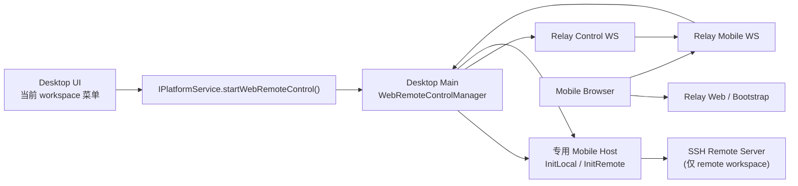

# Planejamento Mínimo de Acesso Remoto por Celular (solução histórica)

> **Obsoleto:** este documento descreve o relay dentro do repositório e a solução com um Host dedicado ao controle remoto, ambos já removidos; é mantido apenas como registro histórico.
> A implementação atual seleciona um relay externo por endpoint: em produção `wss://zcode.z.ai/ws`, e no test padrão `wss://zcode.z.ai/ws`. A entrada padrão via QR code escolhe `/remote/v3` ou `/remote/v4` conforme a versão do App;
> o limiar de estabilidade `3.4.0` e as regras de versões pré-lançamento estão no documento de arquitetura vigente, e a sobrescrita explícita de URL tem precedência.
> O celular conecta via shared-host attachment ao scope de workspace local/remote do único Window Host da janela de desktop alvo;
> não sobe um Host/Agent dedicado para o celular. Os fatos atuais estão em [Web Remote Control Architecture](./web-remote-control-architecture.md).

Documentos relacionados:

- `todo/web-remote-control.md`
- `docs/remote-workspace-session-in-current-window.md`

## 0. Conclusão antes de tudo

Se esta entrega for feita como "**mínimo funcional, sem se preocupar com segurança**", é recomendável **não** manter a solução de `todo/web-remote-control.md` de "abrir mais um servidor WebSocket local dentro do processo host e depois fazer o processo main fazer bridge até o relay", e sim mudar para o caminho abaixo, mais próximo da situação atual do código:

1. O main do Desktop, depois que o usuário clica em "Ativar Controle Remoto Web", **inicia uma linha dedicated de host process exclusiva para controle remoto web**
2. Esse host não é usado pelo renderer; o próprio main guarda o `MessagePort` dele
3. O main estabelece a conexão de controle com o relay
4. O relay, depois que o celular conecta, aloca para o main uma WebSocket de session data
5. O main faz bridge direto: `relay data ws <-> MessagePort <-> host ChannelServer`
6. O lado do celular reaproveita `packages/web`, apenas trocando o ponto de entrada de serviço do `/ws` local para o ws mobile do relay

Os motivos são bem diretos:

1. **O código atual já não segue o modelo "um host = um activeServices".**
   A implementação histórica era "base host + remote workspace session host"; o contrato atual foi unificado em um único Host expondo o scope de remote workspace por workspaceKey.
2. **Subir um mobile host separado deixa local / remote uniformes.**
   Workspace local sobe `init-local` e workspace remoto sobe `init-remote`, e ambos obtêm um `IServiceAccessor` completo.
3. **Não é preciso adicionar mais um servidor ws local ao host existente.**
   Basta reutilizar o `MessagePortProtocol + ChannelServer` que já funciona, o que reduz a mudança total e o risco.
4. **Não afeta a cadeia que o renderer do desktop está usando agora.**
   O Controle Remoto Web é uma capacidade paralela; em caso de falha, é difícil levar junto a cadeia RPC da janela principal.

Além disso, embora o repositório já tenha `packages/relay/dist/*`, atualmente **não há definição de source/package correspondente**; deve ser tratado como artefato histórico e não como base para esta implementação. Nesta entrega o relay precisa ser reconstruído como um pacote formal do monorepo.

## 0.1 Suplemento trazido pela implementação histórica

Em torno de "ciclo de vida da sessão e página de erro" e "estabilização do SSH remote", esta fase inicial de implementação acrescentou mais estas coisas:

1. O relay mantém por um curto tempo um tombstone para sessões mobile encerradas e registra o motivo do encerramento
2. O web mobile, nos seguintes cenários, cai direto em uma página de erro explícita em vez de ficar carregando para sempre:
   - link expirado
   - sessão já ocupada por outra página
   - desktop desconectou ou parou de compartilhar
   - relay indisponível / erro de conexão
3. O main do Desktop mantém `error + failure reason` quando o Controle Remoto Web fecha de forma anormal, sem voltar direto para `idle`
4. No modo SSH remote, o host dedicado do mobile espera o remote host realmente chegar a `Connected` antes de começar a ponte, evitando que o celular fique travado na inicialização

Limites de produto mantidos naquela fase histórica:

1. O Controle Remoto Web só suporta entrar em workspaces que o Desktop **já abriu**
2. Não suporta criar workspaces Docker / SSH / WSL pelo celular
3. Não suporta reconexão após queda nem recuperação de sessão

A implementação atual já evoluiu para shared-host attachment + recuperação no lugar: o `/remote` do celular conecta ao scope de workspace local/remote que já existe no único Window Host da janela de desktop alvo, sem criar um mobile host dedicado; o fluxo de mensagens do celular usa recuperação por snapshot/replay `replayable`, enquanto o desktop continua usando stream direto `continuous`. As seções seguintes deste documento são mantidas apenas como registro da solução mínima inicial.

## 1. Escopo e Limites

### Objetivos desta entrega

1. O workspace atual do Desktop pode gerar um QR code de Controle Remoto Web
2. O navegador do celular, após ler o QR code, abre a UI que reaproveita `packages/web`
3. O lado do celular consegue acessar as capacidades de serviço iguais às do workspace atual do Desktop
4. Suportar pelo menos duas classes de workspace:
   - workspace local
   - workspace SSH remoto

### O que fica explicitamente fora

1. Não fechar o ciclo de TLS / OAuth / validação de token
2. Não fazer dialog de confirmação no lado do Desktop
3. Não suportar múltiplos celulares conectados ao mesmo tempo
4. Não suportar reconexão após queda / recuperação de sessão
5. Não sincronizar em tempo real com a tab/tarefa atual do Desktop
6. Não implementar controle de permissão somente leitura
7. Não garantir consistência de broadcast entre dispositivos

### Definição mínima de produto desta entrega

"Mínimo funcional" é definido como:

1. O Desktop inicia "Ativar Controle Remoto Web" a partir do workspace atual
2. Depois de ler o QR code, o celular entra diretamente nesse workspace
3. O lado do celular consegue ao menos navegar arquivos, fazer um chat básico e conectar um terminal básico
4. Depois que o Desktop desativa o Controle Remoto Web, a conexão do celular é inválida imediatamente

## 2. Restrições Atuais

## 2.1 Situação Atual do Desktop

A estrutura de serviços do desktop hoje é:

- O App tem apenas 1 janela principal de workspace e 1 Host Process
- Dentro do Host, é mantido 1 CLI por workspace conforme o workspaceKey
- O renderer recebe os base services por `MessagePort`
- A tab de remote workspace combina "base services + remote workspace services" em um único `IServiceAccessor`

Isso significa:

1. **O scope de remote workspace dentro do Host só expõe os serviços relacionados a aquele workspace**
   Não há as capacidades globais locais `setting/credential/oauth/modelProvider`
2. **O base host também não representa a tab remota atual**
   Porque os file/system/terminal/zcode task/session que a tab realmente usa podem vir de outro remote session host

Portanto, se o Controle Remoto Web "pegar emprestado o host existente", é muito provável surgir serviço incompleto nos cenários local / remote.

## 2.2 Situação Atual do Web

`packages/web/src/main.tsx` hoje tem apenas duas entradas:

1. `/ws`
2. `/ws/remote/:id`

E o `Root` já suporta `initialWorkspaceAbsPath`, o que é importante para o Controle Remoto Web, porque podemos fazer o celular **cair direto no workspace alvo**, sem precisar passar antes pela página de seleção de projeto.

## 2.3 Situação Atual do Relay

O `packages/relay/` atual tem apenas artefatos compilados, sem:

- `src/`
- `package.json`
- `tsconfig.json`
- scripts de build/dev

Então nesta entrega o relay deve ser tratado como **reempacotamento**, e não como iteração sobre o código existente.

## 3. Solução Recomendada

## 3.1 Arquitetura Geral



## 3.2 Decisões de Design Chave

### Decisão A: a cada ativação do Controle Remoto Web, criar um mobile host dedicado

Sem reaproveitar a cadeia atual do renderer.

Motivos:

1. O ciclo de vida fica mais fácil de gerenciar
2. local / remote ficam uniformes
3. A superfície de falha é menor
4. O main pode segurar diretamente o `MessagePort` para fazer a ponte

### Decisão B: o relay separa plano de controle e plano de dados

Recomenda-se dividir em dois tipos de ws:

1. **desktop control ws**
   - Usado para registrar o tunnel
   - Usado para avisar "alguma sessão mobile já se conectou"
2. **desktop session data ws**
   - Uma por sessão mobile
   - Depois de entrar na ponte, transmite apenas quadros RPC binários, sem misturar mensagens de controle

Isso evita:

1. Fazer multiplexação entre mensagens de controle JSON e stream binário na mesma ws
2. Empacotar quadros RPC em base64
3. Escrever uma camada extra de protocolo de multiplexação de sessões no relay / nas duas pontas

### Decisão C: o Controle Remoto Web é orientado a "workspace", não a "janela"

A UI precisa levar o contexto do workspace atual para o main ao iniciar:

- workspace local: `workspacePath`
- workspace remoto: `workspacePath + remoteSessionId`

E então o main usa o `remoteSessionId` para decidir se o mobile host atual deve subir `init-local` ou `init-remote`.

## 4. Planejamento por Módulo

## 4.1 `packages/shared`

Adicionar os tipos de domínio do Controle Remoto Web, de preferência em um arquivo separado, por exemplo:

- `packages/shared/src/mobile-access.ts`

Sugestão de conteúdo:

```ts
export interface WebRemoteControlContext {
  workspacePath: string;
  remoteSessionId?: string;
}

export interface WebRemoteControlStartResult {
  status: "running";
  sessionId: string;
  qrUrl: string;
  connectUrl: string;
  workspacePath: string;
}

export interface WebRemoteControlStatus {
  status: "idle" | "starting" | "running" | "error";
  sessionId?: string;
  qrUrl?: string;
  connectUrl?: string;
  workspacePath?: string;
  error?: string;
}
```

E também expandir:

- `packages/shared/src/channels.ts`
  - `PlatformChannels.StartWebRemoteControl`
  - `PlatformChannels.StopWebRemoteControl`
  - `PlatformChannels.GetWebRemoteControlStatus`
- `packages/shared/src/platform.ts`
  - `IPlatformService.startWebRemoteControl(context)`
  - `IPlatformService.stopWebRemoteControl()`
  - `IPlatformService.getWebRemoteControlStatus()`

Se as mensagens de controle do relay quiserem compartilhar tipos, adicionar também:

- `DesktopControlMessage`
- `RelayControlMessage`

## 4.2 `packages/desktop/src/main`

Este é o campo principal desta entrega; recomenda-se criar um módulo específico, por exemplo:

- `packages/desktop/src/main/webRemoteControlManager.ts`

Responsabilidades:

1. Receber `start/stop/status` iniciados pela UI
2. Resolver se o workspace atual é local ou remoto
3. Iniciar um host process separado para o Controle Remoto Web
4. Guardar o `MessagePort` desse host
5. Estabelecer o relay control ws
6. Só criar o relay data ws quando a sessão mobile realmente conectar
7. Responsável pela ponte binária `MessagePort <-> relay data ws`
8. Responsável pela limpeza unificada ao fim da sessão

Recomenda-se manter internamente no main:

```ts
interface WebRemoteControlRuntime {
  windowId: number;
  workspacePath: string;
  remoteSessionId?: string;
  remoteTarget?: RemoteTarget;
  hostProcess: ElectronUtilityProcess;
  messagePort: MessagePortMain;
  controlSocket: WebSocket;
  dataSocket?: WebSocket;
  relayTunnelId: string;
  sessionId: string;
  qrUrl: string;
  status: "starting" | "running" | "stopped" | "error";
}
```

Também é preciso ajustar a estrutura atual de rastreamento de remote session:

- Hoje `remoteWorkspaceSessionProcessMap` registra apenas `process + webContentsId`
- Nesta entrega é preciso pelo menos adicionar `target`
- Sem isso, o main não consegue reconstruir o `RemoteTarget` que o `init-remote` exige a partir do `remoteSessionId`

### Por que não mudar o host aqui

Porque o host já suporta:

- `InitLocal`
- `InitRemote`
- `MessagePortProtocol`
- `ChannelServer`

Basta o main extrair um pouco a lógica de spawn, permitindo "**não enviar a port para o renderer, e sim mantê-la no main**", e já é suficiente.

## 4.3 `packages/desktop/src/preload`

Expandir a bridge `window.zcode`:

- `startWebRemoteControl(context)`
- `stopWebRemoteControl()`
- `getWebRemoteControlStatus()`

Manter apenas o encaminhamento de IPC para o main, sem lógica de negócio.

## 4.4 `packages/desktop/src/renderer/src/main.tsx`

Conectar a nova capacidade ao `desktopPlatform`:

- `startWebRemoteControl`
- `stopWebRemoteControl`
- `getWebRemoteControlStatus`

## 4.5 `packages/ui`

Tratamento mínimo na UI, sem abrir páginas complexas: apenas uma entrada leve + painel de estado.

Posições sugeridas para a entrada:

1. Menu "mais" do workspace atual
2. Ou a entrada de ferramentas no footer da sidebar de workspaces

Interação mínima:

1. Clicar em "Controle Remoto Web"
2. Abrir um dialog / popover
3. Mostrar internamente:
   - QR code
   - Botão de copiar link
   - Estado atual
   - Botão de encerrar o acesso

Fora do escopo desta entrega:

1. Lista de dispositivos conectados
2. Configurações de permissão
3. Dialog de confirmação de conexão no celular

Pontos de atenção:

1. Log da UI sempre por `packages/ui/src/logger.ts`
2. Os textos precisam vir em dois idiomas, Chinês e Inglês
3. A nova UI precisa ser compatível com os 4 temas
4. Reutilizar o sistema existente de dialog/button/tooltip conforme `DESIGN.md`, sem criar um estilo visual paralelo

## 4.6 `packages/web`

O modo Controle Remoto Web reaproveita a UI web existente, mas adiciona um caminho de bootstrap.

Fluxo sugerido:

1. O celular abre `https://relay-domain/r/<token>`
2. A entrada web lê o `token`
3. Primeiro requisita `GET /api/remote-control/bootstrap/<token>`
4. Recebe:
   - `workspacePath`
   - `wsUrl`
5. Depois chama `connectViaWebSocket(wsUrl)`
6. Passa `workspacePath` como `Root.initialWorkspaceAbsPath`
7. Ao mesmo tempo desliga `restoreSession`, para evitar que o celular traga o estado de tab residual do navegador local

Para o mobile web desta entrega, recomenda-se deixar explícitos dois pontos:

1. **Cair direto no workspace**
2. **Não restaurar a sessão local anterior do navegador**

## 4.7 `packages/relay`

Nesta entrega o relay é reconstruído como pacote formal do monorepo. Sugestão de estrutura:

```text
packages/relay/
  package.json
  tsconfig.json
  src/
    index.ts
    entry.ts
    server.ts
    sessionManager.ts
    tunnelManager.ts
    bridge.ts
    types.ts
```

### Papéis

1. Gerenciar o tunnel do desktop
2. Gerar a sessão de Controle Remoto Web
3. Manter o mapeamento token -> session
4. Oferecer a API de bootstrap mobile
5. Conectar o ws mobile e o desktop data ws
6. Oferecer health check

### Interface mínima

```text
GET  /health
WS   /ws/desktop/control
POST /api/remote-control/sessions
GET  /api/remote-control/bootstrap/:token
WS   /ws/remote-control/:token
WS   /ws/desktop/session/:sessionId
GET  /r/:token
```

### Explicação essencial

`GET /r/:token` pode ter duas implementações:

1. Em produção: devolver diretamente a entrada do artefato do build web
2. Em desenvolvimento: encaminhar/redirecionar para o web dev server

Para uma implantação mínima, recomenda-se que o relay support a variável de ambiente:

- `WEB_REMOTE_CONTROL_ORIGIN`

Quando presente, usa dev redirect / proxy; quando ausente, usa os recursos estáticos locais.

## 5. Sugestão de Protocolo

## 5.1 Desktop ativando o Controle Remoto Web

1. A UI chama `startWebRemoteControl({ workspacePath, remoteSessionId? })`
2. O main decide:
   - sem `remoteSessionId` -> sobe `InitLocal`
   - com `remoteSessionId` -> encontra o `RemoteTarget` correspondente e sobe `InitRemote`
3. O main estabelece o relay control ws
4. O relay devolve `tunnelId`
5. O main chama `POST /api/remote-control/sessions`
6. O relay devolve:
   - `sessionId`
   - `token`
   - `connectUrl`
   - `qrUrl`
7. O main devolve o resultado ao renderer

## 5.2 Entrada do celular

1. O celular abre `/r/:token`
2. A página busca o bootstrap
3. A página conecta em `ws/mobile/:token`
4. O relay encontra a sessão correspondente e notifica o desktop control ws:

```ts
{ type: "mobile-session-request", sessionId }
```

5. O main, ao receber, cria imediatamente `ws/desktop/session/:sessionId`
6. Depois que o mobile ws e o desktop session ws estiverem prontos, o relay começa a repassar os dados binários sem alteração
7. O main faz a ponte local:

```text
desktop session ws <-> MessagePortMain <-> host ChannelServer
```

## 5.3 Encerramento

Quando qualquer lado encerra:

1. O relay fecha o ws do outro lado
2. O main destrói o mobile host
3. O main limpa o runtime map
4. O estado da UI volta para idle

## 6. Plano de Implementação por Fases

## Fase 0: empacotamento e scaffolding

Objetivo: transformar o relay de "resíduo histórico que só tem dist" em um pacote formal.

Itens de trabalho:

1. Criar `packages/relay/package.json`
2. Criar `packages/relay/src/*`
3. Integrar aos scripts da raiz:
   - `pnpm --filter @zcode/relay dev`
   - `pnpm --filter @zcode/relay build`
4. Adicionar o relay ao `typecheck` da raiz
5. Adicionar o relay ao `lint` da raiz

Critérios de saída:

1. `packages/relay` consegue rodar dev/build de forma independente
2. A cadeia de build da raiz reconhece esse pacote

## Fase 1: cadeia local funcionando (sem UI ainda)

Objetivo: provar primeiro que "relay data ws <-> main MessagePort <-> host RPC" funciona.

Itens de trabalho:

1. O main passa a suportar a criação do mobile host e a guardar a port
2. O relay passa a suportar os três tipos de conexão: desktop control / session / mobile
3. O web conecta primeiro ao relay por um modo de URL parâmetro temporário
4. Verificação manual digitando o token, para confirmar que o workspace local abre

Critérios de saída:

1. Sem depender do QR code, abrir a URL manualmente já mostra o workspace local no celular
2. Pelo menos uma operação do serviço de arquivos ou do serviço de terminal tem sucesso

## Fase 2: ciclo completo na UI do Desktop

Objetivo: conectar "Ativar Controle Remoto Web -> mostrar QR code -> encerrar acesso" à UI do produto.

Itens de trabalho:

1. `IPlatformService` ganha start/stop/status
2. Bridge de preload / renderer ligada
3. A UI ganha a entrada e a camada de QR code
4. Adicionar botão de copiar link, mensagem de erro e botão de encerrar

Critérios de saída:

1. O usuário não precisa montar a URL à mão
2. É possível iniciar e encerrar completamente o Controle Remoto Web pela UI do desktop

## Fase 3: suporte a Remote Workspace via SSH

Objetivo: conectar também o workspace remoto atual ao mesmo fluxo.

Itens de trabalho:

1. O main complementa `remoteWorkspaceSessionProcessMap` com `target`
2. `startWebRemoteControl(context)` passa a suportar `remoteSessionId`
3. O main cria o mobile host usando `InitRemote`
4. O web mobile vai direto ao caminho do workspace remoto

Critérios de saída:

1. É possível ativar o Controle Remoto Web a partir de uma tab remota via SSH
2. O celular enxerga o sistema de arquivos e o terminal remotos

## Fase 4: estabilidade e acabamento

Objetivo: transformar esta cadeia em uma capacidade mantível de forma sustentável, e não em uma demo de uso único.

Itens de trabalho:

1. Completar os logs
2. Completar a limpeza em casos de exceção
3. Adicionar os testes unitários/de integração mais críticos
4. Atualizar a documentação de desenvolvimento e os comandos de integração

Critérios de saída:

1. Uma desconexão do celular no meio do caminho não deixa sessões zumbi de host / ws
2. Cenários como reinício do relay ou fechamento do desktop conseguem completar a limpeza

## 7. Plano Mínimo de Logs

### Logs do main

Usar uniformemente `packages/desktop/src/main/logger.ts`, com prefixos sugeridos:

- `[mobile-access] start`
- `[mobile-access] relay-control-connected`
- `[mobile-access] session-created`
- `[mobile-access] data-bridge-open`
- `[mobile-access] stop`
- `[mobile-access] cleanup`

### Logs da ui

Usar uniformemente `packages/ui/src/logger.ts`, registrando apenas logs de baixa frequência, por exemplo:

- Abrir a camada de diálogo
- Copiar o link
- O usuário clicar em encerrar

### Logs do relay

O relay mantém seus próprios prefixos estruturados, por exemplo:

- `[relay] tunnel-registered`
- `[relay] session-created`
- `[relay] mobile-connected`
- `[relay] desktop-session-connected`
- `[relay] bridge-closed`

## 8. Sugestões de Teste

Nesta entrega é preciso adicionar pelo menos as seguintes categorias:

1. Teste unitário do `SessionManager` do relay
2. Teste unitário de matching desktop/mobile e limpeza por timeout no relay
3. Teste unitário de ciclo de vida do `WebRemoteControlManager` no main
4. Teste unitário de bootstrap do web

Os casos de regressão manual devem incluir pelo menos:

1. Leitura do QR code bem-sucedida em workspace local
2. Leitura do QR code bem-sucedida em workspace remoto via SSH
3. Depois que o desktop encerra o acesso, o celular é invalidado imediatamente
4. Depois que o celular desconecta ativamente, o estado do desktop volta para idle
5. Na saída do desktop, não resta sessão de relay pendente

## 9. Riscos e Trade-offs

### Risco 1: a resolução do remote workspace ainda depende do `remoteSessionId` existente

Este é o caminho mínimo atual, mas isso mostra que o Controle Remoto Web ainda depende de "o renderer saber qual remote session está por trás do workspace atual".

Esta entrega aceita esse acoplamento; mais adiante, se o repositório introduzir um `workspaceId / workspaceDescriptor` de verdade, os dois podem ser atualizados juntos.

### Risco 2: o mobile host cria novamente serviços globais locais

Por exemplo setting / credential / oauth / modelProvider serão iniciados de novo no novo host.

Esta entrega aceita isso, porque:

1. Isso uniformiza local / remote
2. A arquitetura fica mais limpa
3. Primeiro fazer funcionar

Se depois for preciso otimizar o uso de recursos, considera-se separar "serviços globais locais" e "serviços de workspace" em uma montagem de host comparável.

### Risco 3: a web UI no celular pode expor problemas de interação típicos do desktop

Esta entrega aceita primeiro que a adaptação da UI desktop para celular não seja perfeita, garantindo apenas que funcione.

Depois disso, otimiza-se especificamente o layout para celular.

## 10. Ordem Recomendada de Implementação

Sugere-se a seguinte ordem real de trabalho:

1. Reconstruir `packages/relay`
2. Mobile host + bridge de MessagePort no main
3. Bootstrap de mobile no web
4. Fazer o workspace local funcionar
5. Entrada com QR code na UI do desktop
6. Fazer o workspace remoto via SSH funcionar
7. Testes e acabamento da documentação

## 11. Versão em uma frase

A solução mínima mais estável desta entrega é: **fazer do Controle Remoto Web uma "sessão de host dedicada mantida pelo main + canal duplo de controle/dados pelo relay + modo de web com entrada direta no workspace reaproveitando a UI existente"**, em vez de continuar assumindo que existe dentro do host um `activeServices` unificado que represente ao mesmo tempo o workspace local / remoto atual.

## 12. Status Atual de Implementação

Até o momento neste worktree, a cadeia já concluiu o esqueleto mínimo:

1. `packages/relay` já é um pacote formal, com as entradas básicas de desktop control, mobile bootstrap e desktop/mobile data ws
2. O main do desktop já está integrado ao `WebRemoteControlManager`, consegue subir um host dedicado para o workspace atual e criar a sessão pelo relay
3. O web já suporta o modo de bootstrap `remoteControlToken + relayOrigin`, e o celular pode ir direto ao workspace alvo
4. A UI do desktop já tem entrada na sidebar e a camada de QR code
5. Workspace local e workspace remoto via SSH são modelados pela mesma interface de início

Além disso, já foi feita uma rodada das correções de estabilidade mais críticas:

1. O relay faz cache dos quadros RPC que o celular envia antes do establishing da ponte, evitando que a requisição de inicialização da primeira tela seja engolida depois da leitura do QR code
2. O main do desktop preserva o estado de erro do Controle Remoto Web, evitando voltar direto para `idle` depois de uma falha de ponte
3. A camada de QR code faz polling do estado atual do Controle Remoto Web, permitindo ver a mudança `running -> active / error`
4. No modo SSH remote, o main espera o mobile host concluir a conexão remota antes de iniciar a ponte RPC, evitando que o celular fique preso na inicialização por muito tempo
5. A detecção de Docker / WSL no web mobile é agora encaminhada de volta ao main do desktop pelo relay control socket, sem mais usar por engano o `false / []` fixo do fallback web

Atualmente ainda permanece um limite explícito:

1. "Criar nova remote session" dentro da página de Controle Remoto Web ainda não tem a cadeia de injeção de `MessagePort`
2. Portanto, hoje a página do celular só suporta acessar **o workspace atual que já foi iniciado e aberto pelo desktop**
3. Se depois for preciso suportar "criar uma conexão SSH / Docker / WSL dentro da página do celular", é preciso projetar separadamente o protocolo de takeover móvel de remote session

## 13. Comandos Locais de Integração

A integração mínima atual deve ser iniciada na seguinte ordem:

1. Iniciar o relay
   - `pnpm dev:relay`
2. Iniciar o web
   - `pnpm dev:web`
3. Iniciar o desktop apontando para o relay
   - `ZCODE_WEB_REMOTE_CONTROL_RELAY_URL=http://localhost:8787 pnpm dev:desktop`

Na integração também é preciso adicionar uma convenção de ambiente:

1. O relay precisa saber para qual endereço web o celular deve ir depois de ler o QR code
2. No desenvolvimento local pode-se definir `WEB_REMOTE_CONTROL_ORIGIN=http://localhost:5173`

Portanto, o exemplo mais completo de inicialização do relay é:

```bash
WEB_REMOTE_CONTROL_ORIGIN=http://localhost:5173 pnpm dev:relay
```