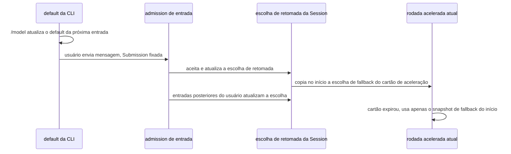

# Estado da seleção de modelo

> **Implementado:** o [Plano de ciclo de vida em background do período ocioso](../../../../off-peak-task/background-lifecycle-plan.md) separa o `cliDefaultSelection` por sessão, mantém a Runtime Session Selection responsável pela retomada, reutiliza o armazenamento existente e não faz migração de configuração nem de banco de dados. O escopo de verificação e o registro das correções de review estão nesse plano.

ModelSelection é a intenção de modelo que pode ser persistida e transportada:

```ts
interface ModelSelection {
  providerId: ProviderId;
  modelId: ModelId;
  options?: {
    reasoningLevel?: string;
  };
}
```

Ela guarda a identidade do modelo e o nível de reasoning já escolhido. A Selection usada para execução precisa
carregar um `reasoningLevel` válido; a intenção persistida pode estar temporariamente incompleta e isso não pode
impedir abrir a sessão.
`maxOutputTokens` é um parâmetro de execução de uma única requisição e não entra na Selection. Endpoint, credenciais,
Properties, Option Specs e Adapter são fornecidos pelo Registry e pelo ModelFactory no momento da execução.

```text
产品 Draft / Config / Record
        |
        | modelSelection?：是否指定模型
        v
ModelSelection
|- providerId + modelId：明确身份
`- options：已经选定的具体值
        |
        | + 当前 Registry 校验与请求绑定值
        v
ModelFactory
        |
        v
Active Model.options：本次生命周期的完整执行事实
```

A persistência oficial não salva `options: {}` nem `null` em folhas de option. A API de atualização pode usar `null`
temporariamente para expressar "remover a sobrescrita explícita", mas o repository precisa normalizá-lo como a remoção
da folha correspondente; depois que a última folha é removida, o `options` vazio também é omitido.

## Composer e Draft

A Selection do Composer representa a próxima submissão que o usuário está editando. O Draft guarda o que o Composer
ainda não submeteu:

```text
Draft
├─ prompt
├─ attachments
├─ mode
└─ ModelSelection
```

Enquanto o Composer está vivo, o estado em memória prevalece. Após mudanças em texto, anexos, mode ou seleção de
modelo, o Draft persistente acompanha; os anexos continuam sendo mantidos em memória e não são serializados entre
reinícios nesta rodada. Depois que a Submission é aceita, apenas o conteúdo já submetido é limpo, preservando o mode e
a ModelSelection atuais. Quando o App reinicia ou a Session é restaurada, o Draft reinicializa o Composer.

Quando uma atualização do Registry invalida a Selection de um rascunho não submetido, o **resultado efetivo temporário**
é tratado por camada de invalidação, sem limpar a intenção original persistida; esvaziar por si só não exibe nenhuma
mensagem de erro:

- Provider ou Model comum inválido: mantém o controle de modelo vazio, aguardando o usuário escolher de novo; não
  substitui automaticamente por outro Provider nem pelo modelo padrão; planos de conta comuns correspondem
  uniformemente à conexão atual conforme a seção seguinte;
- Provider/Model ainda válidos, mas Reasoning ausente ou inválido: mantém Provider/Model e limpa apenas o
  `reasoningLevel`, exigindo que o usuário escolha o nível novamente, sem substituir automaticamente pelo mais alto,
  mais baixo ou padrão.

Um draft inteiramente novo, que nunca teve uma Selection histórica, inicializa normalmente e não exibe notificação de
invalidação. A causa da invalidação é um estado transitório calculado a partir do `ModelSelectionView` Ready atual e
não é persistido como um segundo fato de modelo.

## Seleção efetiva atual (Todo 87, implementado)

```text
原持久意图 / 用户最新编辑
        + 目标 Host 当前已应用的 Registry 与 Account State
        -> getView({ selection })
        -> 候选 View + 本次输入的 effectiveSelection / selectionIssue
             | 只展示、编辑文本             | 权威接纳 / 显式保存
             v                            v
          原选择不变                 按各领域既有边界采用有效值
```

`getView()` sem argumentos continua devolvendo os candidatos compartilhados e o preferredSelection; a leitura com
argumentos apenas calcula o resultado para aquela entrada, sem colocar a escolha do consumidor em eventos
compartilhados nem no cache global do Host. Passar null significa explicitamente não haver seleção e não adota o
preferredSelection.

A resolução pura unificada identifica primeiro se a seleção original é um Provider comum de conta oficial: se sim,
procura no mesmo snapshot o único Provider comum com `current=true`; caso contrário mantém o Provider original
(incluindo Off-Peak). A classificação de identidade é injetada pela camada de montagem de service, que reaproveita as
definições de ID oficiais existentes; o módulo puro de Provider não copia uma tabela de IDs, não importa o barrel
inteiro de shared e não adivinha a identidade por string. Quando o alvo está ausente ou há múltiplos current, o
resultado é incompleto e nenhum primeiro item é escolhido arbitrariamente. Em seguida casa com precisão o modelId e o
reasoningLevel original: faltando o modelo o resultado fica vazio, faltando o nível apenas o nível do resultado efetivo
é limpo, sem completar com o valor máximo. Os menus comuns ainda filtram hidden, e a checagem de validade da
identidade original do Off-Peak usa o mesmo fato interno do Registry, sem enfiar modelos ocultos no menu comum.

O Todo95C (desativação da renomeação de níveis) é a exceção limitada para níveis inválidos: quando o valor original
continua válido, ele é mantido; caso contrário, apenas quando há um acerto explícito na origem Built-in renomeada e o
alvo suporta `disabled`, o antigo `off/nothink` é correspondido no resultado efetivo temporário. Node Host/Worker
reaproveita a mesma decisão de origem, e o `none` nativo da API e os valores personalizados não têm substituição
global. O valor de domínio/Map de推理 do Personal ou a configuração fixa não se submetem à inferência dos nomes
antigos embutidos. O Registry/ModelFactory final continua com a validação exata, sem migração na camada de execução.

Leitura/atualização de configuração não escreve arquivos. O salvamento automático de texto e anexos continua salvando a
seleção original; quando o usuário limpa explicitamente, é uma nova intenção vazia.
Depois que a submissão é aceita e o valor efetivo desta vez é adotado, é obrigatório verificar que a intenção original
e o escopo não foram substituídos por edições posteriores. A Submission já fixada, o run, o Active Model e o
histórico não são reassociados a outra conta. A configuração de longa duração das tarefas agendadas só muda quando a
edição é salva, e o run atual é fixado antes do primeiro despacho no Host de destino; o Off-Peak não troca de Provider
ou Ticket entre contas e apenas protege a leitura sem destruir a intenção original.

Falha de leitura da interface é separada do resultado incompleto normal: o hook público continua assinando, uma primeira
leitura temporária com falha permite um retry limitado e cancelável, sem repetir a incompletude da seleção nem o
despacho; após esgotar, há um reload explícito. Sem alvo ou com o remoto não conectado, não há fallback para o local.
Não existe barreira de sincronização de configuração antes do envio.

## App Recent

O App Recent guarda a ModelSelection da submissão bem-sucedida mais recente do App em determinado Workspace:

```text
App Recent
├─ scope = App × workspaceKey
├─ App 启动时从持久化载体加载到内存
├─ App 运行期间由内存值初始化新 Session
└─ Submission 被 App 接收后同时更新内存与持久化值
```

Onde `workspaceKey = workspaceIdentity?.trim() || workspacePath`. Esta rodada não adiciona `environmentId`. Um
Workspace remoto precisa fornecer `workspaceIdentity`; `workspacePath` serve apenas como fallback de compatibilidade
local e como caminho de execução de arquivos/comandos.

O App Recent não é atualizado quando a troca no menu ainda não gerou uma Submission. Goal com continuação automática,
wake de Background, tarefas ociosas e Subagent também não atualizam o App Recent. Prompt CLI e TUI não leem nem
escrevem o App Recent.

## Session Selection

Criar ou abrir uma Session não exige que um modelo já esteja vinculado. Após o registro de criação v4, um comando
nativo trata a Selection explícita, sem gerar um snapshot do protocolo antigo que seria depois descartado para a
inicialização. O contrato de campo de modelo do snapshot antigo não é afrouxado pelo V4; ao iniciar de fato uma
requisição, a Selection ainda é validada, e não se pode escolher automaticamente outro modelo ou nível só para que a
criação tenha sucesso.

A Session Selection guarda a ModelSelection que a Session continuará usando nas execuções seguintes. Uma mensagem comum
do usuário a atualiza quando é aceita pelo admission serial da CLI; uma mensagem já enfileirada usa o próprio snapshot da
sua Submission ao ser executada, sem sobrescrever a escolha de retomada determinada por uma entrada mais recente. Tarefas
off-peak mantêm uma escolha de retomada temporária no próprio ciclo de vida, e, depois que a entrada do usuário assume,
passa-se a escolha submetida pelo usuário. O registro de verificação está no Plano de ciclo de vida em background do
período ocioso.

### CLI Default e fallback do cartão de aceleração

O `cliDefaultSelection` é mantido pelo Bootstrap por sessão e serve apenas para completar o modelo das entradas de
usuário da CLI/TUI que não têm uma escolha explícita. Uma sessão nova é inicializada a partir do
`config.defaultModelSelection` de `~/.zcode/v2/provider_config.json`, e uma sessão restaurada reutiliza a escolha comum
de usuário já existente; o default global não é relido a cada requisição. `/model` e `/effort` modificam e salvam esse
valor padrão, e não alteram a escolha de retomada da Session enquanto a mensagem não foi aceita. O App continua mantendo
o rascunho do Composer e não ganha um segundo estado de default da CLI.

O `highspeedFallbackSelection` designa **apenas a escolha de fallback da expiração do cartão de aceleração**: ela é
copiada e congelada da escolha comum da Session no momento, antes de qualquer inicialização assíncrona da rodada
acelerada. O tratamento de erro lê somente esse snapshot e não pode ler uma Session atualizada depois por novas
mensagens. O fallback preserva o histórico da rodada e remove a autenticação de requisição do cartão de aceleração; sem
uma escolha comum, o erro real de expiração do cartão é preservado. Não é uma troca de ticket off-peak nem um fallback
genérico de erro.



Essa separação de responsabilidades reutiliza o Provider Config e o Session entry existentes e não acrescenta migração
de configuração nem de banco de dados.

A atualização do Provider Config não reescreve a Session Selection. A execução seguinte consulta o Registry mais recente
com essa Selection e cria um novo Model. Como apenas a Selection é guardada na Session, atualizações de API Key,
Endpoint ou configuração de modelo podem entrar em vigor na criação do novo Model.

Sessions antigas sem Selection salva são restauradas por migração unidirecional; o Reader em execução não relê campos
antigos nem estende a prioridade da inicialização normal.

## Migração offline (Todo 96)

A migração apenas decodifica o formato antigo publicado e identidades estáticas de Provider, sem ler o login atual, a
conexão, entitlement, Registry ou a lista de modelos atual.
O antigo `builtin:bigmodel-coding-plan` / `builtin:zai-coding-plan` migra de forma fixa para o Individual ID do mesmo
domínio; é um destino de intenção determinístico, não uma afirmação sobre o plano histórico e muito menos uma troca
da conexão atual.

```text
旧字段 -> 纯格式/静态身份迁移 -> 正式原意图
                                  |
                     getView({ selection })
                                  |
                         临时 effectiveSelection
                                  |
                     原接纳/派发边界 -> 最终 Model 校验
```

Quando o campo atual existe (inclusive vazio ou corrompido), ele não é reparado com o campo antigo. Um
modelo/Provider comum desconhecido mantém a identidade explícita e a indisponibilidade temporária não impede a
migração.
A restauração da Session devolve a seleção original sem descartá-la de antemão pelo Registry; o vínculo real em Runtime
ainda permite apenas uma seleção legal e completa. Trocar ou limpar no Composer altera apenas o draft, e a seleção
oficial/Recent é atualizada pela fronteira de aceitação no envio, sem escrever vazio em caso de falha ou refresh.
A migração de identidade/Ticket das tarefas ociosas continua excluída. A migração in-place dos Markdown de Subagent do
diretório do usuário é definida pelo Todo97; nenhuma outra origem grava automaticamente.

## Configured Default

O Configured Default é a preferência inicial de novas Sessions fornecida pelo Host dono do Workspace de destino. Ele
guarda uma ModelSelection e não guarda Provider, Endpoint, credenciais ou capacidades de modelo, portanto usa um
documento versionado independente do Provider Config:

```json
{
  "schemaVersion": 1,
  "configuredDefault": {
    "providerId": "deepseek",
    "modelId": "deepseek-v4-pro",
    "options": {
      "reasoningLevel": "high"
    }
  }
}
```

A localização física padrão de um Workspace Node local é `.zcode/v2/model-selection.json`. Host, Prompt CLI e TUI
podem compartilhar essa preferência de Workspace; o App Recent continua sendo estado exclusivo do App e não é escrito
aqui.

O campo `model` nos arquivos antigos de usuário da CLI só é migrado de forma unidirecional para `configuredDefault`
quando o novo documento ainda não existe. As definições de Provider dos arquivos antigos são tratadas pela migração
do Personal Provider Config, e as duas não voltam a se fundir em um único Runtime Model Config antigo.

O Host de destino resolve o Configured Default e o Fallback ao gerar o mesmo `ModelSelectionView` e devolve
`preferredSelection`. Um Configured Default ainda selecionável tem prioridade; quando o Provider ou o modelo já
desapareceu, entra a Fallback Policy. A Fallback Policy atual toma o primeiro modelo visível ao usuário na View ordenada
do Model Selection Facade e pode ser substituída depois por uma estratégia de recomendação do ZCode Built-in. Provider
hidden não participa do Fallback. O Fallback apenas inicializa o Composer/Session desta vez e não sobrescreve
automaticamente o Configured Default persistido.

O Entry não chama mais um segundo RPC `resolveInitialSelection()`. Ele lê os candidatos, os Option Specs e o
`preferredSelection` do Host a partir da mesma View e decide o valor inicial do Composer pelo estado local:

```text
Target Host ModelSelectionView
|- providers / models / optionSpecs
`- preferredSelection = Configured Default 或 Fallback
                 |
                 v
Entry 初始化 Composer
已有 Composer / Draft
  > 当前 View 中仍可选的 workspace App Recent
  > Host preferredSelection
```

Um Entry de longa duração relê o Configured Default ao criar cada nova Session. Atualizações de arquivo ou de outro
portador persistente só afetam as Sessions criadas depois; uma sessão CLI/TUI já iniciada tem as requisições sem escolha
explícita completadas pelo cliDefaultSelection, e a retomada em background é decidida pela Session Selection.

O Configured Default não é lido ao restaurar uma Session existente. A Session Selection persistida mantém a intenção
original mesmo quando está temporariamente indisponível, e a interface avisa ou a execução reporta que não foi possível
vincular; o sistema não troca silenciosamente pelo primeiro modelo atual.

## Active Model

O Active Model é o objeto em execução e não entra na persistência da Session. É criado pelo Registry a partir da
Selection no início do Loop; o ModelFactory apenas valida e congela o reasoning já escolhido e não deriva mais o valor
de execução da requisição a partir do Option Spec. O Agent/chamador precisa decidir explicitamente `maxOutputTokens` a
cada requisição; o `spec.max` do modelo escolhido também é uma decisão explícita válida. Mudanças comuns de
configuração não modificam um Model já criado. O Guide pode criar e alternar um novo Active Model nos limites
explícitos de Step do Loop atual.

Usage, Trace, Token e atribuição de erros da chamada de modelo vêm do Active Model. O nome de modelo devolvido pelo
Provider pode servir como informação de diagnóstico de roteamento, mas não substitui a identidade local do Model.

Se o histórico de execução precisar provar qual option foi realmente usada, ele deve registrar o Active Model ou os
execution facts, e não pode reinferir depois a partir do Option Spec atual.

## Selection na configuração do produto

Produtos como Automation, Repo Wiki, Bot, Off-Peak e Subagent mantêm seus próprios Draft, Config, Record, eventos de
salvamento e momento de execução, unificando apenas o tipo de valor que referencia o modelo:

```text
各产品自己的 Draft / Config / Record
                 |
                 | 可选地包含 modelSelection
                 v
          Target Worker ModelFactory
```

A ausência do `modelSelection` externo significa que o produto não tem um modelo fixo, e a origem de herança concreta e
o momento da resolução são definidos pelo contrato do produto; assim que o produto escreve uma Selection, ele escreve
o modelo concreto e o reasoning level escolhidos naquele momento. Os dois não podem ser fundidos, nem a herança pode
ser expressa com pseudo model IDs como `model: "inherit"`.

Um Subagent sem override explícito herda o Parent Active Model; uma execution selection de Off-Peak já salva usa a
própria identidade no despacho. O Automation, ao ser criado, resolve o preferred atual do Host ou a escolha explícita
do usuário em uma Selection concreta e salva, sem manter um estado de formulário virtual de "herança/modelo padrão".

## Estado de leitura assíncrona no Renderer

O `ModelSelectionView` do Host de destino é o fato completo de candidatos, mas no Renderer a leitura dele é um processo
assíncrono. O ponto de entrada interativo precisa tratar primeiro o ciclo de vida da leitura e não pode usar `null`
para expressar ao mesmo tempo carregamento, espera remota, alvo ausente e erro:

```ts
type ModelSelectionState =
  | { status: "loading" }
  | { status: "ready"; view: ModelSelectionView }
  | { status: "unavailable"; reason: "remote-waiting" | "missing-target" }
  | { status: "error"; error: Error };
```

```text
明确 Workspace Target
        |
        +-- 缺失 ----------------> unavailable/missing-target
        +-- Remote 尚未连接 ------> unavailable/remote-waiting
        `-- 目标 Host Service
                 |
                 +-- 初次读取 ----> loading
                 +-- 首次失败 ----> error + reload
                 `-- 成功 --------> ready(ModelSelectionView)
```

- O helper de projeção de candidatos só aceita uma View Ready e não converte estados não-Ready em candidatos vazios.
- Na mesma renderização de uma troca de Service/Target, o loading do novo owner aparece imediatamente, e Promises ou
  eventos atrasados do Host antigo não podem sobrescrever o novo owner.
- A revision do mesmo owner cresce monotonicamente; um evento novo que chega primeiro não pode ser sobrescrito por um
  `getView()` antigo retornado depois.
- Uma falha de leitura em segundo plano depois de obter a Ready View mantém o Last Known Good; a primeira falha entra
  em error e oferece um reload explícito.
- Espera remota não faz fallback para o Host Base/Local. O continuous do desktop e o replayable do celular apenas
  compartilham o fato de seleção do Host de destino, e esta seção não muda a semântica de recuperação das mensagens de
  tarefa.
- Composer, Automation, Subagent, Repo Wiki e o gate de inicialização do Root mantêm seus próprios Drafts e suas
  semânticas de submissão, unificando apenas o ciclo de vida da leitura de candidatos.

## Regras de inicialização

Nova Session do App:

```text
Draft
  >
当前 View 中仍可选的 workspace App Recent
  >
Host preferredSelection
```

Nova Session da TUI:

```text
TUI Draft
  >
Host/domain preferredSelection
```

Restaurando uma Session existente no App e na TUI:

```text
Draft
  >
Session Selection
```

Nova Session do Prompt CLI:

```text
显式 --model provider/model + --reasoning
  >
domain preferredSelection
```

Restaurando uma Session existente no Prompt CLI:

```text
显式 --model / --reasoning
  >
cliDefaultSelection（从持久普通用户选择初始化）
```

O Configured Default pertence à configuração do Host/domain do Workspace de destino. O `preferredSelection` do Host já
contém atomicamente o resultado da resolução do Configured Default e da Fallback Policy; o Renderer não repete esse
algoritmo.

Ao criar de fato uma seleção padrão, a fronteira de escolha pode usar, pela regra de preenchimento padrão, o último item
da lista ordenada `reasoningLevel.values`.
Quando o usuário escolhe ativamente um novo modelo no menu, apenas a identidade do modelo é determinada e o Reasoning
fica vazio aguardando uma escolha explícita; essa não é a entrada de preenchimento padrão.
Quando o modelo de uma Session/Composer existente está ausente ou inválido, o campo fica vazio; quando o modelo é
válido e o Reasoning está ausente/inválido, apenas o nível é limpo, sem completar com o máximo/mínimo, sem trocar
para o preferred e sem exibir aviso de campo vazio, e não é possível submeter antes do preenchimento. Estruturas
antigas só são convertidas na fronteira de migração por fatos explícitos e a seleção atual não é reparada a partir de
campos antigos. Chamadas auxiliares de baixo custo escolhem explicitamente `values[0]` no ponto de chamada; o
ModelFactory apenas valida e congela, sem preencher defaults.

## Eventos de escrita

| Estado              | Evento de escrita                                      | Escopo de persistência       |
| ------------------ | ------------------------------------------------------ | ---------------------------- |
| Draft Selection    | Edição no Composer                                     | Entry Draft                  |
| App Recent         | O App aceita a Submission do usuário                   | App × workspaceKey           |
| Session Selection  | Submission comum é aceita; a execução off-peak faz uma atribuição temporária | Session (apenas a escolha comum é persistida) |
| CLI Default Selection | /model e /effort da CLI/TUI; inicialização da sessão | Reaproveita o armazenamento da escolha comum de usuário já existente |
| Active Model       | Início do Loop, ou troca do Guide no limite de Step    | Agent Loop atual, sem persistência |

Esses estados compartilham a semântica de ModelSelection, mas não compartilham o momento de escrita. Depois que um
estado muda, outro pode ser atualizado por um evento explícito; nenhum estado adivinha o que deve salvar observando o
valor atual dos outros estados.

Tarefas off-peak atualizam temporariamente a Session Selection em memória, para que a recuperação/despertar do background
pertencente a elas possa lê-la; elas não escrevem no App Recent, no Configured Default, no CLI Default nem na escolha de
usuário persistida. Quando o item inteiro é concluído e não foi assumido pelo usuário, a escolha comum original é
restaurada; depois que a entrada do usuário é aceita, a escolha do usuário prevalece, e o fechamento off-peak antigo não
sobrescreve mais nada.