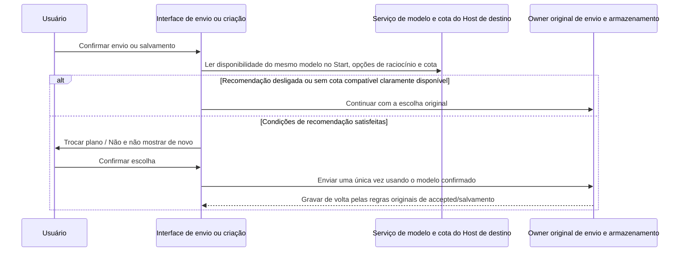

# Todo154: Start como Provider independente e recomendação de plano de experiência no momento do envio

> Status: implementado e com o review desta rodada concluído. Em 2026-09-16 o Todo foi executado com autorização do usuário; o E2E via SSH no Pro admin e as verificações necessárias passaram; o escopo de validação e os limites de plataforma estão em §8.
> O objetivo final está em [Design V2 §4.5](../design-v2/design.md#45-start-独立-providertodo154), as decisões históricas em [C25](../design-v2/evidence-and-contradictions.md#c25-start-独立-provider-与现行单连接语义).
> Os fatos de código e as correções da investigação estão na [pesquisa dedicada](../research/todo154-start-plan-independence-impact.md).
> Feedback posterior: este item mantém o registro de entrega da rodada; as decisões finais de correção do feedback do Air e da revisão complementar estão em [Todo156](todo-156-start-plan-followup-final-decisions.md), aguardando implementação unificada; o Todo155 mantém a investigação inicial e §8 não representa problemas posteriores já corrigidos.

## 1. Objetivos confirmados

O Start usa o login do App atual, elimina o passo de conexão separada e pode ser usado ao mesmo tempo que o plano pessoal/equipe atual. Esta rodada apenas separa o Start e não inicia a coexistência completa de planos pessoal/múltiplas equipes do Todo101.

| Item            | Decisão final                                                                                     |
| ------------- | ---------------------------------------------------------------------------------------------- |
| Identidade do Provider | Mantém `account:zai-start-plan` e `account:bigmodel-start-plan`, sem mesclar IDs e sem adicionar Provider virtual |
| Nome e logo   | Os dois Starts usam um nome de exibição unificado, reaproveitando respectively os logos atuais de Z.ai/BigModel; o filtro de marca atual decide qual deles é exibido |
| Local nas configurações | Como um item de Provider independente dentro do grupo 「智谱」 existente, reutilizando os componentes atuais de exibição e detalhe |
| Detalhe          | Remove apenas a conexão/desconexão do Start e mantém benefícios, cota, resgate e gestão de modelos; abrir o detalhe não modifica a conexão paga |
| Disponibilidade        | Login, benefício do Start, habilitação de modelos e completude da configuração continuam passando pelas validações existentes e não há resgate automático |
| Dados          | Não migra a seleção de modelo, não adiciona versão de migração, snapshot de conexão atualizado nem reescrita em massa; mantém o formato atual e a capacidade de leitura |
| Nova otimização      | Ao enviar/criar, se o mesmo modelo do plano pago tiver cota no Start e as opções de raciocínio forem compatíveis, pergunta se quer trocar |
| Corrida na requisição      | Reaproveita a proteção de conta existente e não adiciona validação, interrupção ou reenvio na janela entre a leitura de identidade e a leitura do token |

A exibição unificada não cria uma nova identidade de execução. Depois da troca de marca, o ID de Start salvo não é alterado automaticamente para o Start da nova marca; o Start da nova marca oferece normalmente os modelos selecionáveis. As configurações de modelo existentes das duas marcas são mantidas, sem mesclar ativação/desativação, ordenação ou sobrescritas do usuário.

## 2. Estado da Account, resolução de modelo e autenticação

### 2.1 `current` separado do benefício

Mantém-se `current`, cujo significado é claramente 「se o Provider corresponde ao contexto de acesso da conta atual」, e não o modelo de chat atual nem equivalência a ter benefício.

- Start: corresponde à marca da conta atualmente conectada e não depende da seleção pessoal/equipe.
- Pessoal/equipe: corresponde à marca da conta atual e à seleção de conexão paga atual.
- Start e um plano pago podem ter `current=true` ao mesmo tempo; um plano pessoal não selecionado não é ativado por este recurso mesmo tendo benefício.
- Um Start expirado pode ter `current=true`, `entitled=false` e `availability=unavailable`.
- A identidade real de login, o benefício, a habilitação de modelos e a completude continuam confirmados pela cadeia existente de Account/Registry; não se pode presumir login apenas por uma configuração de marca residual.
- O contrato original de Off-Peak que não define `current` é mantido, e não se contorna a restrição de conta omitindo `Start.current`.

O `connectionKey` do Start depende apenas do titular da conta, da marca e do tipo Start, e não inclui a conexão paga; trocar de equipe não muda a identidade do Start, mas trocar de conta continua mudando. Reaproveita-se o LKG de mesma identidade, `resetPrevious`, o pareamento por revision e a conferência de conta/configurações antes da publicação, sem novos estados de sincronização nem cópias de token.

| Estado                        | Esperado                                                                                |
| -------------------------- | ------------------------------------------------------------- |
| Não conectado, sem benefício, pendente     | Mostra o estado real, não oferece modelos de Start inexecutáveis e não pede mais para conectar o Start |
| Vigente e com modelos disponíveis           | O Start e o plano pago disponível atual oferecem modelos ao mesmo tempo          |
| Vigente e o servidor devolve explicitamente lista vazia de modelos | Limpa a lista dinâmica de modelos deste ciclo e não mantém a whitelist antiga    |
| Falha temporária na consulta de mesma identidade | Reaproveita o último fato confirmado existente; sem um fato bem-sucedido anterior, não fabrica disponibilidade |
| Expiração clara / credencial indisponível  | Mantém a escolha do usuário e relata o motivo correspondente, sem trocar de plano automaticamente   |

### 2.2 Seleção de modelo

O Start sai do conjunto de 「procurar o único plano da conta atual e mapear」 e é resolvido pelo Provider ID/modelId/options reais salvos. Pessoal/equipe continuam com o mapeamento de conexão paga existente, e Provider comum e Off-Peak mantêm as regras atuais.

Host e Workers gerenciados compartilham a classificação pelo node facade. O uso interno de uma categoria `account-start` independente é consolidado pela implementação, sem criar um conjunto próprio de mapeamento de identidade na UI e no Worker.

Quando o Start está indisponível, não há troca silenciosa por um modelo pago. O usuário aceitar explicitamente a recomendação conta como um novo envio de escolha e pode mudar o modelo da entrada atual para o Start; isso não é migração de dados antigos nem altera a conexão paga global.

### 2.3 Autenticação da requisição

A requisição do Start valida a marca e a identidade de login correspondentes e lê o `zcodeJwtToken` do repositório de credenciais OAuth existente, sem exigir mais que uma selection exista ou que o kind seja igual a Start. A Key pessoal, a Key do scope completo da equipe e o Ticket de Off-Peak seguem o caminho original. A falta do JWT do Start não faz fallback para a Key da equipe/pessoal; reaproveita-se a atualização existente e a classificação de erros.

Quando o usuário aceita explicitamente, reaproveita-se o tratamento existente de troca de conta, sem adicionar para esta necessidade uma barreira de conferência de identidade antes do envio nem um fluxo de interrupção/reenvio.

## 3. Inicialização e fronteira de não migração

- Após o login ou a restauração, o Start fica disponível automaticamente pela atualização de conta e benefício, e não é mais habilitado escrevendo `kind: start-plan`.
- Para novos usuários, o plano pago mantém a ordem de inicialização original: pessoal, equipe, entrada de compra original; as conexões pagas salvas são mantidas na reinicialização.
- O antigo `kind: start-plan` continua legível, mas não controla mais a execução do Start; o estado vazio causado pela remoção do valor antigo não pode ser tratado como usuário novo, escolhendo silenciosamente uma conexão paga.
- O que for salvo na seleção de modelo é interpretado pelas novas regras: o Start mantém seu ID, pessoal/equipe continuam com o mapeamento pago; seleção vazia, herança e fatos históricos de execução mantêm a semântica original.
- O Start voltando a ficar disponível nãorouba um modelo já salvo; sem nenhuma seleção, valem as regras de inicialização existentes.

Uma Session comum persiste a seleção deste ciclo quando a execução começa, e o rascunho é escrito de volta após o accepted; por isso a inferência anterior de que 「todas as sessões antigas manteriam o Start original para sempre e seria necessária uma migração total」 fica arquivada. Configurações de longo prazo de tarefas automáticas e configurações explícitas de Subagent não são necessariamente gravadas de volta; o usuário já aceitou manter as escolhas explícitas delas: se Start estiver salvo e antes dependia do mapeamento pago, passa a usar o Start; sem benefício do Start, é preciso que o usuário escolha de novo. Não se afirma que o efeito de execução de todos os usuários antes e depois do upgrade é exatamente o mesmo.

Não é adicionada migration de banco, conversão única de banco inteiro na camada de negócio, versão semântica por armazenamento ou snapshot de conta de upgrade. O importer do formato histórico existente não é removido por esta necessidade, e arquivos de task, sessão, automação, Bot, Wiki e Subagent não são reescritos em massa.

## 4. Recomendação de plano de experiência para o mesmo modelo no momento do envio

### 4.1 Julgamento comum

Sob os fatos de modelo e cota do App/Host de destino, a notificação só aparece quando todas as condições abaixo são satisfeitas:

1. A escolha válida deste ciclo vem de um plano pago pessoal/equipe.
2. Para a conta atual, existe o mesmo modelo no Start, e ele é executável no Registry de destino.
3. As opções de raciocínio do modelo atual são compatíveis; não se pode resetar o nível nem mudar para outro modelo às escondidas por causa da recomendação.
4. O mesmo modelo tem uma cota restante explicitamente disponível; apenas entitlement=true não basta para provar que há saldo.
5. O usuário não desativou esse tipo de recomendação.

Reaproveita-se o serviço UsageEntitlement existente e o julgamento do bucket de cota do mesmo modelo, sem criar um novo owner de saldo. Também é preciso conseguir ler a cota do Start correspondente mesmo quando o plano pago atual já está selecionado; não se pode reutilizar diretamente uma condição de consulta que só é habilitada quando o Start já está selecionado. Cota desconhecida ou falha na consulta pula a recomendação e mantém o envio original, sem acrescentar uma porta de sincronização de cota que bloqueie o envio. Múltiplos buckets, buckets expirados e correspondência de modelo seguem as regras existentes, e desconhecido não pode ser tratado como cota positiva.

### 4.2 Texto e botões

- Título: o plano de experiência tem cota disponível.
- Corpo: no seu plano de experiência, {nome do modelo} ainda tem cota disponível. Quer trocar?
- Botões: Trocar plano / Não.
- Checkbox: não mostrar de novo.

「Trocar plano」 muda a seleção de modelo da entrada atual para o mesmo modelo do Start, preservando as opções compatíveis, e então continua este envio/salvamento. 「Não」 continua o envio/salvamento da escolha original; fechar o diálogo preserva o rascunho e não executa esta operação. Esse botão não modifica a conexão pessoal/equipe.

A confirmação da recomendação acontece antes do envio do comando original; as regras originais de Submission, escrita de volta do accepted, deduplicação e preservação do rascunho em falha continuam em uso. Não se envia primeiro a requisição paga e depois se complementa a troca, nem se forma uma segunda fila accepted.

### 4.3 Escopo das entradas

| Entrada                                  | Local da notificação e efeito colateral                                                                    |
| --------------------------- | ------------------------------------------------------------------------------------------ |
| Primeiro envio de nova conversa, nova mensagem em conversa existente | Antes do envio na cadeia original; botão/atalho/anexo compartilham uma única verificação e, após a confirmação, segue a escrita de volta de Session/rascunho |
| Mensagem enfileirada/guia recém-enviada   | Verificação antes do primeiro envio; uma fila já enviada que começa a executar não gera maisa notificação |
| Criar tarefa agendada                   | Após a validação do formulário e antes da criação; o resultado da troca é salvo na configuração de modelo da tarefa |
| Editar tarefa agendada                  | Ao salvar alterações que envolvem a seleção de modelo; alterações apenas de título/horário não gerama notificação |
| Salvar e executar imediatamente        | Aa notificação acontece uma única vez na fase de salvamento e a fase de execução não verifica de novo |
| Wiki geração manual/regeneração completa | Antes do envio da nova requisição de geração; o resultado fica fixado nesta escolha |
| Criação/edição de Subagent customizado   | Ao criar um modelo explícito novo ou ao editar e mudar o modelo, antes de salvar o formulário; alterar apenas descrição/ferramentas não gera notificação |
| Subagent embutido/de plugin              | O modelo inline é salvo na hora; a notificação vem antes de salvar, na confirmação do novo modelo; 「Não」 salva o modelo pago recém-escolhido e fechar mantém a configuração antiga |

A troca de Subagent é salva como configuração de modelo de longo prazo, e não como uma chamada temporária; Subagent embutido/de plugin usa o armazenamento de sobrescritas do usuário já existente e não modifica arquivos do plugin. Herança/restaurar padrão, ajustar apenas a intensidade de raciocínio e ativar/desativar não gera notificação; na execução vale a herança do modelo pai existente ou a configuração explícita. O texto de Subagent explica 「se deve trocar o modelo deste subagente para o plano de experiência」.

Exclusões explícitas: envio/recepção de Bot, 「Executar agora」 na lista de tarefas agendadas, disparo agendado, criação de tarefas por ferramenta do Agent, chamadas de Subagent em segundo plano, atualização automática do Wiki, tarefas off-peak, envio imediato de filas já existentes, retry da requisição original e preenchimento da página de falha do Wiki. Editar/retry de mensagens históricas não adiciona novos parâmetros de seleção de modelo nem semântica de troca de modelo. O usuário acabou retirando 「Executar agora」 do escopo da solução.

### 4.4 Não mostrar de novo

Usa a preferência unificada e persistida do App/Host atual, compartilhada entre as entradas e ainda válida após reinicialização; quando o celular se conecta ao mesmo Host, a mesma preferência é respeitada. Não é introduzida sincronização de conta em nuvem entre dispositivos, nem é salva separadamente por sessão. Isso desliga apenas a recomendação e não desliga o feedback real de erros como cota esgotada ou credencial inválida.

Na próxima vez a execução segue a seleção de modelo já salva por cada entrada, e 「não mostrar de novo」 não é interpretado como 「da próxima vez escolher Start automaticamente」 nem como 「da próxima vez usar sempre o plano pago」. Depois de marcar e clicar em 「Trocar plano」, o Start é gravado por este fluxo de envio/salvamento original e a entrada usa o resultado salvo da próxima vez; depois de marcar e clicar em 「Não」, a escolha paga original é mantida. As configurações de modelo de outras sessões, tarefas e Subagents não são modificadas junto, apenas a preferência de desligar a recomendação é compartilhada.

## 5. Falha do Start e notificação de conexão paga

Mantém-se os banners e a lógica de recuperação existentes de cota baixa, cota de modelo/dia esgotada e limite de concorrência do Start; expiração de benefício e problemas de credencial mostram o motivo real e não trocam automaticamente para o plano pago.

O observador global de falha de conexão observa apenas a conexão pessoal/equipe atual e não trata `Start.current=true` como um plano que exige conexão manual. Mantêm-se as sugestões de troca existentes entre planos pagos e remove-se a ação de trocar para o Start escrevendo `kind: start-plan`. O Start é expresso pelo seu próprio feedback de cota, pelo estado de modelo indisponível e pelo detalhe de configurações, evitando que o usuário receba uma notificação global de falha de conexão do Start em segundo plano enquanto usa um plano pago. Não se estende a fila de notificações de múltiplos Starts/pagos.

## 6. Propriedade de estado e cadeia

| Fato/intenção                  | Owner original ou alvo                                                                |
| --------------------------- | -------------------------------------------------- |
| Identidade de login, JWT               | Serviço OAuth e repositório de credenciais                               |
| Seleção de conexão paga                | SettingService                                     |
| current, benefício, membros dinâmicos de modelo | Account Source, com State e Overlay publicados pela mesma revision  |
| Modelos executáveis e escolha válida        | Registry do Host/Worker de destino e Selection Facade compartilhada |
| Cota                        | Serviço UsageEntitlement existente; a UI só consome snapshots          |
| Se a recomendação está desligada                | Preferência unificada de configuração do App/Host atual                      |
| Rascunho, configuração e envio            | Owner original de cada entrada; a recomendação devolve a escolha e segue o caminho de envio original         |

Fechar o diálogo não entra no envio original. `continuous` do desktop, `replayable` do celular e o isolamento por `workspaceIdentity` de destino são mantidos; a leitura de disponibilidade de modelo não usa o cache local de um Host incorreto no lugar dos fatos de destino.

## 7. Etapas de implementação e aceitação

| Fase | Trabalho                                                            |
| ---- | --------------------------------------------------------------- |
| P0   | Convergência deste documento com o Design V2; permanece pendente até a autorização de implementação                     |
| P1   | Testes de expectativa primeiro e só então a alteração conjunta de `current`, da classificação do mapeamento pago e da autenticação da requisição do Start |
| P2   | Agrupamento de configurações, nome unificado e ícone de marca, detalhe independente e remoção da ação de conectar o Start |
| P3   | Inicialização mantendo o valor antigo legível e parando de escrever a conexão do Start; limitar a observação e a sugestão de falha do plano pago |
| P4   | Julgamento e diálogo de recomendação compartilhados, preferência do Host e integração nas entradas de envio |
| P5   | Regressões afetadas e validação de interação desktop/celular, e extração de docs formais quando estabilizar |

A seguir estão os cenários de aceitação confirmados; o método de validação desta rodada e as fronteiras não cobertas estão em §8, e a simples passagem do código por determinado estado não substitui asserções.

| ID     | Cenário e asserções-chave                                                                                                                                                  |
| ------ | ---------------------------------------------------------------------------------------------------------------------------------------------------------------- |
| SIP-01 | Login em cada uma das duas marcas; com benefício do Start e sem seleção de plano, o Start é executável e a requisição usa o JWT                                                                       |
| SIP-02 | Start e o plano pessoal/equipe atual estão current ao mesmo tempo, o mesmo modelo pode ser executado separadamente e as credenciais não se misturam                              |
| SIP-03 | Trocar entre pessoal/equipe/Team scope não muda a identidade do Start, a intenção de modelo nem o connectionKey                                                                                            |
| SIP-04 | Start independente no grupo 「智谱」, nome unificado e logo da marca correspondente; detalhe sem conectar/desconectar, mantendo benefício e gestão de modelos; navegar não escreve conexão paga           |
| SIP-05 | Não conectado, sem benefício, pending, unknown, lista de modelos explicitamente vazia e modelo desabilitado são exibidos e validados conforme o contrato original                    |
| SIP-06 | Depois de salvar o Start, a reinicialização continua usando aquele ID; a escolha paga ainda mapeia a conexão paga atual e a indisponibilidade do Start não troca de plano automaticamente        |
| SIP-07 | O antigo `kind:start-plan` é legível e o Start fica disponível automaticamente; não há migração de dados de modelo, a inicialização de usuário novo não escolhe plano pago por engano e o único plano pessoal não current ainda pode ser escolhido explicitamente |
| SIP-08 | Reaproveita a troca de conta existente, o logout, o LKG e a proteção de credenciais de requisição; sem nova barreira de janela de leitura de identidade                                                                    |
| SIP-09 | Erros de cota/concorrência do Start mantêm o banner original e, ao ficar disponível de novo, nãorouba outras escolhas                                                                              |
| SIP-10 | Com Start e pago current ao mesmo tempo, a observação global de falha só identifica a conexão paga e não sugere mais escrever a conexão do Start                                                    |
| SIP-11 | Após o resgate bem-sucedido o Start é atualizado sem sobrescrever o modelo original ou a conexão paga; o deep link abre o próprio Start                                                                                                              |
| SIP-12 | Automation/Bot/Subagent explícito/Wiki lêem a escolha salva pelas novas regras de resolução, sem migração total; herança e run congelado não são reinterpretables                                                                                             |
| SIP-13 | Desktop, celular conectado ao mesmo Host e workspace remoto leem o modelo e a cota corretos; os contratos de recuperação continuous/replayable são mantidos                                                                                       |
| SIP-14 | O mesmo modelo pago está disponível no Start com cota e é compatível com o nível: a recomendação aparece; com modelo diferente, nível incompatível ou Start já selecionado, não aparece                                                          |
| SIP-15 | Cota desconhecida, falha, bucket expirado ou esgotado não reporta disponibilidade indevidamente; o envio original é mantido e o uso pago normal não é bloqueado                                                                          |
| SIP-16 | Primeiro envio, envio seguinte, anexo, atalho e novo envio enfileirado/guia do chat: após a troca, a requisição real é do Start e só é enviada uma vez; 「Não」 mantém o modelo original; fechar preserva o rascunho         |
| SIP-17 | Criação/modificação do modelo de tarefa agendada e salvar-e-executar: a notificação acontece só na fase de salvamento e o resultado é salvo; 「Executar agora」 e a agendação em segundo plano não gera notificação                            |
| SIP-18 | A nova geração do Wiki pode gerara notificação, enquanto a atualização automática e o preenchimento da página de falha não geram, e os fatos de geração existentes não são reescritos                                                                          |
| SIP-19 | O salvamento de Subagent customizado e o salvamento imediato de Subagent embutido/de plugin seguem a semântica dos botões; herança, restaurar padrão, alterar apenas intensidade de raciocínio/texto e a execução não gerama notificação        |
| SIP-20 | 「Não mostrar de novo」 vale entre entradas, após reinicialização e no celular conectado ao mesmo Host; validam-se separadamente que, depois de marcar e trocar/não trocar, a próxima escolha ainda vem do resultado salvo daquela entrada e que o modelo das outras entradas não muda; sem nova sincronização de conta entre Hosts diferentes e sem bloquear os avisos de erro reais |
| SIP-21 | Provider de API comum, Off-Peak, Bot e retry da requisição original não geram diálogo de recomendação nem efeito colateral novo de troca de modelo                                                                              |

Os portões de implementação seguem o AGENTS da raiz e dos subníveis: freshness/git status, testes afetados, typecheck, lint, `architecture:check --changed`; interações do App ganham E2E de desktop/celular e verificação de tema/ internacionalização, e o CLI segue suas regras próprias. Adição e manutenção de E2E seguem o e2e-case-lifecycle, sem tomar varredura estática como verificação ponta a ponta.

O comportamento formal já foi sincronizado na [especificação do Start](../../../zai-start-plan-provider.md); este item mantém a matriz de validação dedicada; I27/MP-R03 são testes de injeção Recent e de restauração do modelo padrão, e não podem ser reescritos como prova de que uma Session comum precisa migrar. desvios concretos estão no research.

## 8. Entrega e evidências desta rodada (2026-09-16)

P1～P4 foram implementados e a especificação formal do Start foi atualizada conforme a solução final. O Start mantém os dois IDs reais, reaproveitando o Account Source e a facade de Host/Worker; não foi adicionada migration de banco, versão de Schema nem reescrita em massa de configurações. A revision estática de release do Built-in foi de 28→29 apenas para identificar a atualização do nome de exibição, e a configuração de teste foi derivada pelo script original, e não é uma migração de dados do usuário.

### 8.1 Testes e verificações

| Verificação             | Resultado e evidências                                                                                                                                                              |
| ------------------ | ------------------------------------------------------------------------------------------------------------------------------------------------------------------------------------ |
| Regressõesdirecionadas de núcleo e UI | 16 arquivos, 399 casos passando: resolver/config source da Account, facade compartilhada, julgamento e confirmação da recomendação, escrita de volta do accepted, Session, Automation, Subagent, navegação, inicialização e observação de falha; `/tmp/start154-final-units.log` |
| Regressões de revisão de fronteiras       | 10 arquivos, 276 casos passando: estado/store do Wiki, autenticação de requisição, resolução de Automation, lifecycle/failures do Web remote e UI relacionada; `/tmp/start154-review-boundaries.log`                                      |
| Testes unitários de dependências nativas do Pro   | 11 arquivos, 143 casos passando; suítes relacionadas sem ambiente nativo de Electron local foram executadas no Pro, `/tmp/start154-pro-native-unit.log`                                                                           |
| Regressões complementares do review    | 2 arquivos, 188 casos passando: o único plano pessoal não conectado ainda tem uma entrada de escolha acionável, falha de leitura da preferência de recomendação pula e falha de escrita ainda respeita o botão desta rodada e avisa que não foi salvo; `/tmp/start154-review-fixes.log`                                  |
| Encerramento de suítes que falhavam no início   | 11 arquivos de UI não nativa, 186 casos passando na execução conjunta final, cobrindo todas as correções de mock/entrada relacionadas e o WorkflowArtifactSidePane; `/tmp/start154-related-closures.log`                                                |
| Configuração Built-in      | Verificações de sincronia e consistência passaram; 8 arquivos, 106 casos passando de ciclo de vida, completude, mapeamento de modelos, consumo e build, `/tmp/start154-builtin-review-final.log`; mais 1 caso do node facade real passando                               |
| Typecheck          | O `pnpm typecheck` da raiz passou, incluindo o E2E de desktop e o Web; `/tmp/start154-typecheck-final2.log`                                                                                              |
| Lint/arquitetura         | lint com 0 erro e 54 warnings preexistentes; `architecture:check --changed` com 0 violation e 0 baseline; `/tmp/start154-lint-final3.log`, `/tmp/start154-architecture-final3.log`                   |
| Fixture            | O fixture checker do caso pending passou; os avisos das 4 asserções de resposta `_DONE` marcadas sem request matcher são esperados; `/tmp/start154-fixture-final2.log`                                                     |

Os grupos de teste acima têm sobreposição, então as contagens não devem ser somadas como total de casos independentes. A varredura ampla inicial de relacionados cobriu 1150 arquivos, dos quais 24 falharam: problemas de ambiente nativo foram verificados no Pro; mocks necessários ao novo hook, a antiga conexão e as asserções de navegação foram atualizados e passaram de forma direcionada; as falhas de temporização já existentes do WorkflowArtifactSidePane passaram ao serem reexecutadas isoladamente. Essa varredura ampla em si não é evidência de tudo verde, e não se afirma que todos os testes do repositório passaram.

### 8.2 Execução real com Electron via SSH no Pro admin

Conforme solicitado pelo usuário, a execução foi feita via `macbook-pro-admin` em uma árvore de trabalho isolada em `/Users/dev/zcode-start154-pro-e2e`. O diretório de desenvolvimento diário do Pro não foi alterado. As dependências externas de modelo/benefício/verificação de segurança usaram fixtures locais do caso; UI, Registry do Host/Worker, envio, construção das requisições do SDK e persistência usaram código real, sem chamar serviços reais de modelos pagos.

| Spec                                                                                             | Comportamento já asseverado                                                                                                                                                                                                                                                                    | Execução no Pro                                                                                                                                                     |
| ------------------------------------------------------------------------------------------------ | ----------------------------------------------------------------------------------------------------------------------------------------------------------------------------------------------------------------------------------------------------------------------------- | ----------------------------------------------------------------------------------------------------------------------------------------------------------- |
| `conversation-session/manual-review/pending/conversation-session-start-plan-independent.test.ts` | Navegação independente do Start, ausência de botão conectar, escolha paga inalterada; Subagent com fechar restaura/confirmar salva/apenas raciocínio não gera notificação; criação de tarefa agendada trocando para Start e verificando o SQLite, edição de texto não gera notificação; chat com Não/fechar/Trocar, Provider e nível high da requisição real, envio único, escrita de volta do accepted; desligar a recomendação vale entre entradas e após reinicialização; larguras 1280/390 e layout nos temas claro e escuro | Release final 29: `desktop-e2e-20260916133532026-p27004-0077916f12a51fd1`, passou; a execução anterior do fluxo estendido `desktop-e2e-20260916131850282-p22060-1763fdf90a220931` também passou |
| `repo-wiki/repo-wiki-model-plan-selection.test.ts`                                               | Coexistência entre pago e Start; padrão pago e, após Não, geração persistida como paga; regeneração completa após a troca salvando Start no wiki.json                                                                                                                                                                                      | `desktop-e2e-20260916132805627-p25424-cd18c54e0f1f4fc0`, passou                                                                                               |
| `ui-shell/marketing-touch-entitlement.test.ts`                                                   | O antigo `kind:start-plan` persiste na reinicialização; resgate/refresh/navegação não mudam a conexão; o plano pessoal único pode ser selecionado ativamente; modelo de Start salvo em Subagent não é sobrescrito pela escolha paga                                                                                                                                                     | `desktop-e2e-20260916133328079-p26502-2678ae04ad3d916c`, passou                                                                                               |

O `summary.md` de cada execução está na árvore de trabalho do Pro em `packages/desktop/.e2e-artifacts/<run>/`. Os screenshots dos quatro layouts de diálogo ficaram na máquina local em `/tmp/start154-visual-review/` e todos foram inspecionados visualmente. Os novos casos foram mantidos como pending, sem promoção manual por conta própria nem alegação de admissão no CI.

### 8.3 Conclusões e correções do review

Foi concluída a revisão do diff de produção completo, dos componentes compartilhados e dos efeitos colaterais nas entradas, e todos os problemas encontrados foram corrigidos com verificação adicional; esta revisão não encontrou itens bloqueadores remanescentes.

- Foram verificados o `current` da Account/identidade de conexão, a publicação de estado pela mesma revision, o desvio entre JWT e Key paga, a resolução precisa do Start e a leitura de dados antigos; nenhuma nova barreira de corrida de token nem fallback silencioso para pago foi adicionada.
- A execução real mostrou que a leitura de cota da recomendação precisa passar explicitamente o accountAccess do Start, caso contrário um snapshot vazio é obtido quando um plano pago está selecionado; isso foi corrigido com um teste de contrato do hook, e a E2E de envio real passou em seguida.
- A recomendação fica depois da confirmação da fila, do comando e da validação de modelo, e antes do envio original; o resultado da troca é memorizado pelo caminho original de accepted/salvamento. Fechar mantém o rascunho original, e retry/fila já enviada/Bot não entram no novo caminho de recomendação.
- A revisão corrigiu o deep link do Start atingindo por engano o contêiner de family e o seletor ficar oculto quando um usuário antigo do Start tinha apenas um candidato pago; o segundo item falhou antes e passou depois, sendo verificado pelo fluxo de resgate com configuração antiga no Pro, e não por uma correção de migração.
- Foram verificados a diferença entre fechar o diálogo e 「Não」, o reset do checkbox entre diálogos, a semântica de Enter no foco do botão, falhas de leitura e escrita da preferência e a memorização do modelo após aceitação no Wiki, evitando reescrever o modelo sem confirmação ou em caso de falha.
- O fixture antigo do Wiki com GLM-5.2 por padrão já não pertence à lista paga atual e volta normalmente para GLM-5.3; agora a verificação usa GLM-5.3-Flash/high, comum a pago e Start, sem ampliar a lista de modelos de produção.
- Mudanças de conteúdo do Built-in incrementam a revision conforme as regras de release existentes e sincronizam a configuração de teste, evitando o conflito de mesma revision com conteúdos diferentes; o Schema persistido pelo usuário não muda.

### 8.4 Cobertura de aceitação e fronteiras

| SIP            | Evidências desta rodada                                                                                                                                              |
| -------------- | ---------------------------------------------------------------------------------------------------------------------------------------------------------- |
| 01～03, 05～08 | Resolver das duas marcas, seleção sem benefit/paga/legacy, connectionKey estável, LKG/logout; node facade real com mapeamento preciso Start/pago; reinicialização no Pro e preservação da escolha antiga do Start e troca explícita para pessoal |
| 04, 10～11     | Testes unitários de navegação/cartão de estado/observer/sugestão de perda; navegação independente e refresh de resgate no Pro                                                                                       |
| 09, 12, 21     | Reuso dos owners originais de cota/autenticação e de cada armazenamento, com regressões de resolução e fronteiras afetadas; sem novo caminho de aviso em segundo plano nem reescrita total                                    |
| 13             | E2E com Host/Worker reais no desktop; testes de envio de Session no desktop/`compactForRemoteControl` e regressões de lifecycle/failures do Web; cota e preferência ainda vêm do serviço base Host                     |
| 14～15         | Testes de julgamento de mesmo modelo, marca, raciocínio, inexecutável, desconhecido/falha/expirado/múltiplos buckets; confirmação real da requisição no Pro                                                                             |
| 16             | Primeiro envio/envio seguinte e requisição única no Pro, fechamento com rascunho preservado, escrita de volta do accepted; ramo de envio de Session no desktop/celular e testes afetados existentes de anexo/comando                          |
| 17～19         | Criação de tarefa e edição de texto, geração/regeneração do Wiki e salvamento imediato de Subagent embutido no Pro; regressões dos formulários originais de Automation/Subagent customizado e do julgamento de recomendação compartilhado              |
| 20             | Os dois botões do hook e a preferência de supressão, entre instâncias e tratamento de erros; no Pro, após marcar Não, a reinicialização continua usando o pago e os modelos das outras entradas não são reescritos                     |

Não foram executados de fato o Safari em aparelho físico com celular/Web completo, a cadeia conjunta de shared-host do Web, nem o Electron de Windows/Linux, e nenhuma API paga de conta real foi acessada. 390px é apenas a verificação de tela estreita do mesmo diálogo real e não substitui as conclusões ponta a ponta dessas plataformas; cada combinação de formulário de Subagent customizado e de plugin não teve E2E individual, reaproveitando a entrada de salvamento comum e as evidências de regressão. Os limites das evidências são listados aqui, e não se marca cada combinação de dimensão dos SIP como cobertura total em aparelho real.

### Registro de atualização da linha de base

Nesta rodada foi feito pull e fast-forward até o `2772217134` de `origin/staging`, como solicitado (linha de base anterior `c9f959050b`, mais 672 commits). O upstream já tinha ocupado o Todo153, então este item e todos os índices foram postergados para Todo154, preservando o Todo153 do upstream. A implementação foi feita na branch `start-plan-independent-provider`; após a verificação de freshness/git status, os testes de expectativa foram escritos antes da implementação. Os 17 testes da fase de discussão e os números de linha antigos servem apenas como investigação histórica e não como evidência final de conclusão.