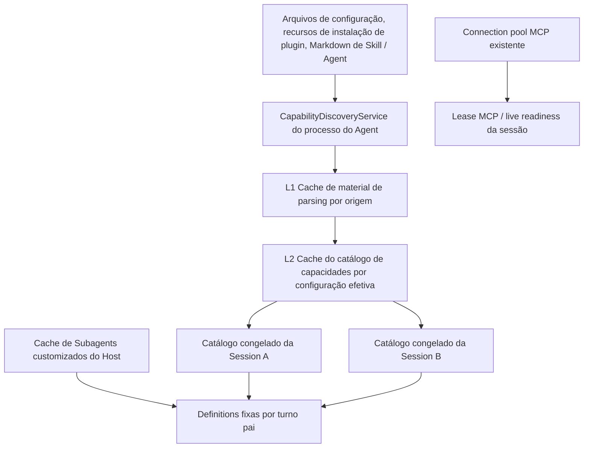
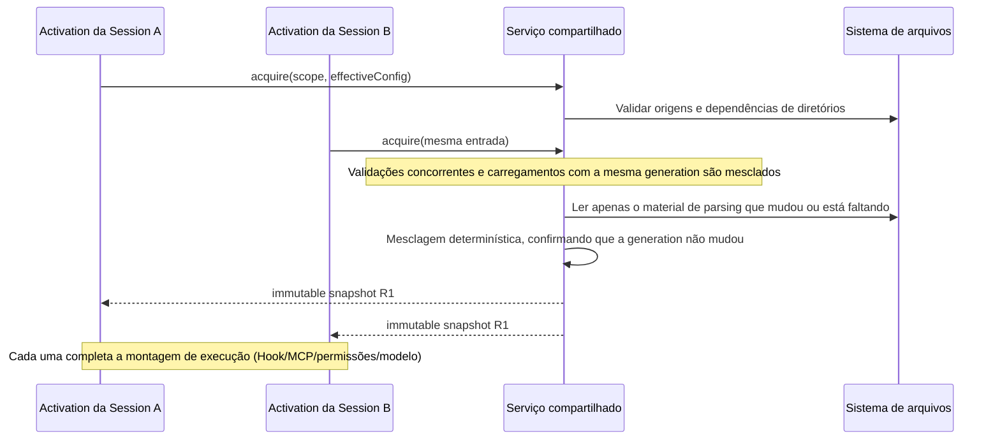

# Cache de descoberta de capacidades externas do workspace

> Estado: rascunho de design, 2026-10-09; não implementado, sem aceitação de performance concluída. Este documento apresenta a decisão recomendada e não registra os casos de teste candidatos como já cobertos.
> Escopo: dentro do mesmo processo do Agent, reutilização da descoberta, leitura e resultados de parsing de configurações externas por sessões criadas novamente / restauradas a frio.
> Níveis de mudança: option-source, persistence (apenas cache em memória), recovery. O estado de execução em runtime e o protocolo de entrega de mensagens mantêm sua atribuição original.

## 1. Objetivo e situação atual

O objetivo é que, depois que a Session A do mesmo workspace já carregou as capacidades, a Session B não leia novamente Skills, manifests de plugin, Markdown de Agent de plugin e o corpo das configurações que não mudaram, nem faça parsing deles novamente. Permitem-se ainda as validações de metadados de arquivo necessárias, sem prometer zero operações no sistema de arquivos em caso de acerto de cache.

Atualmente `createZCodeApp()` chama `createConfig()`, `resolveStartupPlugins()` e `loadPluginAgentTemplates()` toda vez que cria um App, e cria um `NodeSkillAdapter` independente. `ensureContextInitialized()` armazena o resultado da descoberta neste Runtime; isso não pode fornecer um cache de parsing para outro Runtime.

Capacidades existentes devem ser reutilizadas, sem criar outro owner:

| Fato existente                                      | Owner atual                                        | Tratamento neste design                              |
| -------------------------------------------------- | -------------------------------------------------- | ---------------------------------------------------- |
| Snapshot de parsing de Subagent do usuário/projeto  | Local Host `createSubagentRuntimeConfigCache`       | Preservar; a inicialização local e os novos turnos pai continuam lendo o snapshot do Host |
| Catálogo de referências de Skill/plugin              | `AgentRuntime`/App da sessão                        | Preservar o catálogo congelado; novos Runtime constroem novo snapshot a partir do material compartilhado |
| Conexões MCP ativas e lista de ferramentas           | Adapter MCP / connection pool existentes           | Preservar o isolamento padrão de sessão e o isolamento explícito por workspace |
| Arquivos de instalação de plugin, arquivos de config, Markdown | Sistema de arquivos e os pontos de escrita de config existentes | Continuam sendo a fonte autoritativa; o cache não é uma nova fonte de persistência |
| Provider Registry, contas, credenciais, confiança de Hook | Cada owner existente                            | Continuar lendo ao obter fatos de execução; não restaurar a partir do cache de capacidades |

Documentos de fato relacionados: [Ciclo de vida do catálogo de skills](ui/conversation-skill-catalog-lifecycle.md), [Refresh de subagents conforme o contexto pai](subagent-runtime-refresh.md), [Plugins de workspace](plugins/workspace-level-plugin-architecture.md), [Restauração a frio](v4-refactor/17-cold-resume-runtime-activation.md).

## 2. Limites recomendados

1. Na primeira fase há apenas cache em processo. Após reiniciar o Agent o cache é reconstruído; o `plugins/cache` em disco continua expressando apenas recursos instalados, não serve como cache de parsing.
2. Acerto e erro de cache devem produzir capacidades, prioridades, namespaces, diagnósticos e regras de desabilitação equivalentes. Otimiza-se trabalho repetido, não se amplia a capacidade executável.
3. Apps criados novamente, restaurados a frio ou derivados por fork podem reutilizar o material de parsing compartilhado; sessões já inicializadas continuam com o próprio catálogo imutável, sem hot update.
4. Subagents customizados mantêm a regra existente e independente de "inicialização / novo turno pai lê o Host, fixo dentro do turno", e não podem ser congelados uniformemente no ciclo de vida da sessão. Agent de plugin armazena em cache apenas o template bruto; a cobertura de modelo por contexto pai é remixada de novo a cada turno pai conforme as regras existentes.
5. Este design não altera o momento de execução de `SessionStart`, nem armazena em cache a saída de Hooks, os resultados de execução ou as flags de "já executado". Se a leitura do histórico dispara execução é uma decisão de ciclo de vida separada.
6. Não se alteram a espera pela declaração de ferramentas MCP, a prontidão ao vivo (live readiness), permissões, sampling, elicitation ou o ownership de App. O [MCP tool catalog cache](mcp-async-tool-catalog-cache.md) planejado é uma otimização independente, não é uma dependência já implementada.

## 3. Owner único e cache de dois níveis

O bootstrap cria um `CapabilityDiscoveryService` na inicialização do `app-server`, disponibilizado via injeção de dependência para os Apps; o CLI standalone cria a mesma implementação em seu próprio processo. O recurso não deve ficar em um singleton global de módulo, para que testes, chamadas embarcadas e diferentes origens de configuração não se misturem.

O adapter é responsável por I/O de arquivos, cache de parsing, watcher, generation e agendamento de concorrência; o bootstrap é responsável pela mesclagem da camada de configuração, montagem das dependências e pela projeção final de cada activation; o core apenas consome resultados estritamente tipados e imutáveis, sem importar a implementação concreta do adapter. Os nomes são contratos propostos e não representam APIs já existentes.

Preparações com efeitos colaterais, como seed de plugins, migração de configuração offline e transações de instalação, continuam sendo feitas pelo owner original; somente a revision dos recursos publicada com sucesso pode entrar no cache. Não se deve aplicar memoization diretamente a todo `createConfig()` ou `createZCodeApp()`, o que saltaria migração, abertura de storage e montagem de sessão.



| Nível                | Conteúdo guardado                                                                                | Conteúdo não guardado                                                                                |
| -------------------- | ----------------------------------------------------------------------------------------------- | ----------------------------------------------------------------------------------------------------- |
| L1 parsing por origem | AST/resultado de validação da config, manifest e declarações de componentes, metadados de Skill, templates de Agent de plugin, diagnósticos de origem e lista de dependências | client, handle de processo, histórico de sessão, objetos de modelo, execução de Hook, resultados de consulta a serviço de credenciais |
| L2 catálogo efetivo | Identidade de plugin mesclada por config, catálogo de Skills, índice de templates de Agent de plugin, templates de declaração de config de MCP/Hook | Caminhos interpolados exclusivos da sessão, broker token, header OAuth corrente, aprovações de confiança, disponibilidade final de modelo, estado de execução de ferramentas |
| Sessão / turno pai   | Snapshot final aceito nesta activation / contexto pai e o estado de execução existente         | Referências graváveis de outras sessões, fila de accepted input compartilhada                        |

Campos sensíveis em L1 que venham de arquivos de configuração continuam sendo tratados como dados sensíveis de configuração: usados apenas em memória, sem persistência, sem logs e sem exposição em dumps de depuração. Referências a variáveis de ambiente e credenciais preservam, na medida do possível, a forma declarada e são resolvidas na fronteira de montagem de execução existente.

O CLI não cria uma segunda cópia atualizável de cache de parsing para Subagents customizados locais; o CLI mantém apenas a cópia devolvida pelo Host naquele turno. Quando o CLI standalone / remoto não tem a porta do Host conectada, seu caminho de carregamento de arquivos existente pode entrar no L1, mas isso não lhe confere a semântica de refresh por turno pai do Local Host.

## 4. Chave e identidade de origem

Não se pode construir uma chave compartilhada com `sessionId`, nem apenas com o cwd. Define-se:

```text
workspaceKey = workspaceIdentity?.trim() || workspacePath
scope = ownerInstanceEpoch + workspaceKey + remoteSessionId (quando existe o attachment lógico remoto)

L1 key = scope + sourceKind + logicalPath + canonicalPath
       + parserVersion + discoveryPolicy + sourceRevision

L2 key = scope + effectiveDiscoveryFingerprint + dependencyRevisionVector
```

`ownerInstanceEpoch` é um identificador de isolamento dentro do processo, reconstruído no reinício. Requisições remotas devem validar primeiro `workspaceIdentity`, `remoteSessionId` e o binding do Host existente, e só então escolher o Agent owner alvo; na ausência da identidade remota não se pode degradar para o cache local do mesmo caminho. Não há compartilhamento de cache entre janelas ou entre processos de Agent diferentes.

`effectiveDiscoveryFingerprint` deve cobrir:

- Origens de configuração do usuário/projeto, storage root, capability roots ordenados por prioridade; para cada root: origem, scope, namespace e política de symlink.
- Revision do manifesto de instalação de plugins, estado de habilitado/desabilitado/suppressed, revision da versão/conteúdo instalado e as options relacionadas.
- Caminhos desabilitados de Skill, feature switches, versão dos recursos embutidos e overrides de CLI/sessão que afetam a descoberta.
- Entradas de ambiente que afetam a resolução de caminhos; se o resultado do carregamento de fato depender de conta ou identidade, incluir a revision opaca dessa origem. Não se pode omitir uma dependência futura só porque a implementação atual por acaso não a usa.

Objetos equivalentes usam serialização determinística; arrays mantêm a ordem definida pela prioridade do produto e não podem ser reordenados livremente para desduplicação. Colisão de hash não pode ser tratada diretamente como equivalência; a entry também guarda a verificação por descritor canonical interno. Chaves com material sensível não vão para log.

Na primeira fase, L1 é isolado por scope, resolvendo primeiro múltiplas sessões do mesmo workspace; não se reutilizam ASTs de usuário/plugin entre workspaces, para não ampliar o escopo antes de as permissões de origem e os namespaces serem verificados. O compartilhamento existente de Subagents do usuário no Host permanece como está.

## 5. Aquisição, congelamento e carregamento compartilhado

Contrato interno recomendado:

```ts
interface CapabilityDiscoveryService {
  acquire(
    input: DiscoveryInput,
    options: {
      freshness: "validate-sources" | "force-reload";
      signal?: AbortSignal;
    },
  ): Promise<Readonly<CapabilityDiscoverySnapshot>>;
  invalidate(input: DiscoveryInvalidation): void;
  dispose(): Promise<void>;
}
```

`DiscoveryInput` aceita apenas scope, configuração de descoberta e revision de origem já validados; não recebe uma chave global de cache arbitrariamente especificada pela UI. O snapshot contém `snapshotId`, revisions de dependências, material imutável e diagnósticos, e não contém campos variáveis da sessão.



- Para cada key＋generation idênticos há apenas uma Promise compartilhada. Registra-se o flight antes de iniciar o I/O; após aguardar a permissão de concorrência, reexaminam-se o cache e a revision.
- Mesmo em acerto de cache, a validação de frescor (freshness) das origens é concluída primeiro; não se pula a verificação de arquivos adicionados/removidos só porque existe uma entry de diretório. Ativações concorrentes compartilham a validação em andamento; ativações seguintes não substituem a validação por um TTL curto.
- O cancelamento do consumidor cancela apenas a sua própria espera, sem abortar o carregamento dos outros esperadores. Na primeira fase, mesmo que todos os esperadores saiam, permite-se que o carregamento limitado termine e fique disponível para uso posterior; o dispose do owner deve cancelar todo o I/O e proibir publicações atrasadas.
- O resultado compartilhado é somente leitura. Código existente que reescreva campos como `PluginLoadOutcome.skillRoots` deve passar a derivar um novo objeto ou copiar na fronteira de montagem da sessão; não se pode entregar uma referência mutável a vários Apps. O wire devolve cópias defensivas.
- A evicção de cache remove apenas as referências mantidas pelo serviço; snapshots de sessões já inicializadas não são afetados. O Runtime descartado não limpa o cache compartilhado do mesmo processo.
- O cache de Skill fixa apenas os metadados do catálogo; a leitura do corpo, a busca dinâmica, o truncamento e as semânticas de erro da ferramenta `Skill` explícita seguem as regras existentes, sem congelar permanentemente o corpo.

## 6. Validação de origem e invalidação

Cada material em L1 precisa de uma lista explícita de dependências: arquivos lidos, diretórios percorridos, caminhos candidatos inexistentes, symlinks e seus alvos, candidatos de ancestrais de configuração, registros de instalação de plugins e revision dos recursos embutidos. Caso contrário, arquivos novos e diretórios recriados não conseguem invalidar um resultado antigo vazio.

### 6.1 Regras de freshness

Na primeira fase, cada activation faz uma validação assíncrona de metadados das origens mutáveis: lista de membros de diretório e impressões digitais disponíveis de arquivo, como `dev/ino/size/mtime/ctime`; a precisão usa o maior valor suportado pela plataforma. Mantém-se a profundidade de descoberta e os limites de ancestrais atuais, sem introduzir novas capacidades por ampliar a varredura recursiva. Somente itens alterados têm seu corpo lido, checksum verificado e parsing realizado; quando a impressão digital não pode ser determinada com confiabilidade, trata-se como alteração.

Valida-se a impressão digital do arquivo antes e depois da primeira leitura; valida-se a revision de dependências antes e depois da varredura/construção. Alterações detectadas descartam o candidato e exigem nova leitura. Substituições no lugar que os metadados não conseguem identificar são cobertas por eventos de arquivo que forçam dirty / reload explícito; isso não é uma garantia transacional de sistema de arquivos para escritas externas arbitrárias concorrentes. Os testes devem cobrir escrita de mesmo tamanho, substituição atômica e escrita que preserva o mtime.

Para assets embutidos imutáveis e gerenciados por versão publicada, pode-se usar a revision do recurso após a instalação em vez da verificação arquivo a arquivo; conteúdo inline, caminhos de desenvolvimento local e diretórios de instalação de marketplace editáveis pelo usuário não podem ser considerados imutáveis apenas pelo número de versão.

O watcher é o mecanismo de invalidação antecipada e de redução de construções inúteis, não a única fonte de correção. Eventos podem ser mesclados, mas ao receber o primeiro evento válido incrementa-se imediatamente a generation, marca-se dirty e só então se faz o refresh assíncrono; o debounce serve apenas para mesclar I/O e não decide se o snapshot está expirado.

### 6.2 Matriz de invalidação

| Evento                                          | Escopo de invalidação                                                   | Sessões já em execução                                              |
| ----------------------------------------------- | ------------------------------------------------------------------------ | -------------------------------------------------------------------- |
| Skill adicionada/modificada/removida, root alterada | L1 afetado; o L2 que depende dela                                      | Mantém o catálogo congelado; um novo Runtime busca novamente          |
| Instalação/upgrade/remoção/suppressed/ativação/desativação de plugin/options | Índice de instalação, templates correspondentes e L2; Skills/Agent/MCP/Hook vinculados ao plugin são invalidados juntos | Segue o ciclo de vida de plugin existente, sem forçar refresh por causa do cache |
| Alteração de config de user/project             | O L2 que depende daquela config; dependências são reconstruídas quando os roots de descoberta mudam | As regras vigentes de settings de runtime continuam valendo |
| Alteração de Subagent customizado do Host       | Watcher existente do Host; o CLI não duplica o owner                      | O próximo contexto pai lê; o turno atual/child não muda               |
| Revogação de confiança, troca de conta/credencial | A verificação live existente trata na hora; a revision que envolve o resultado da descoberta é invalidada junto | Não se permite que cache antigo substitua a verificação de execução existente |
| Perda de watcher/diretório removido e recriado/troca de geração da conexão remota | Origem fica unhealthy, a elegibilidade de acerto da entry antiga é revogada, listeners e validações são reconstruídos | Snapshots existentes não são modificados; erros seguem a lógica de runtime original |
| Refresh explícito                                | force reload, contornando L1/L2 do escopo correspondente, sem reutilizar flight antigo | Settings/workspace query obtém o valor corrente; session query continua obtendo o da própria sessão |
| Eviction de Runtime / unsubscribe comum da UI  | Não invalida o cache do processo                                         | Libera as referências próprias daquele Runtime                         |
| Shutdown do Agent                                | Cancela flights, fecha watchers, limpa o cache                           | Encerrado pelo ciclo de vida de runtime existente                      |

Os pontos de escrita existentes de plugin/config dentro do CLI sincronizam a invalidação após a escrita bem-sucedida, antes de completar a resposta. O Host não ganha uma nova barreira de ACK entre Hosts: a validação de origens da nova activation e os watchers existentes são responsáveis por descobrir as mudanças. Mantém-se o contrato existente de Subagents de "cada Host observa por si"; não se cria um protocolo de broadcast de configuração.

Consultas de diretório de workspace sem sessão e o refresh explícito de Settings continuam pelo caminho de leitura autoritativo atual; na primeira fase esses acessos não passam a retornar L2 diretamente. Se forem integrados mais adiante, devem preservar a semântica atual de catálogo e o force reload. A invalidação do prewarm de rascunho segue o ponto de gestão existente, e um novo snapshot não pode substituir no lugar um Runtime oficial já promovido.

### 6.3 Resultados atrasados e erros

```text
generation 7 começa a leitura
    → arquivo mudou: generation 8, entry antiga dirty
    → generation 7 termina: não escreve no cache nem é devolvida a um novo Runtime cujo acquire ainda não terminou
    → o acquire busca novamente a generation 8
```

A condição de publicação verifica simultaneamente o owner epoch, o token da entry e o vetor completo de revisions de dependências; evita-se o problema ABA causado por remoção e recriação no LRU. A invalidação afeta tanto a escrita de volta no cache quanto os waiters em andamento; não se pode apenas impedir a entrada de resultados antigos no cache e ainda assim devolvê-los à Session B.

Quando modificações contínuas impedem a obtenção de material estável, há no máximo 3 reconstruções por alteração de origem; depois disso retorna-se um `sources_changed_during_load` identificável, com nova tentativa pela entrada de retry de inicialização já existente, sem esperar por sleep. Erros comuns de I/O são devolvidos conforme as regras de diagnóstico/falha do loader atual, e a Promise de falha é removida imediatamente; não se pode manter em cache por muito tempo um diretório vazio nem tratar silenciosamente um resultado antigo bem-sucedido como o valor corrente.

Erros de parsing determinísticos podem ser armazenados em cache junto da impressão digital da origem; diretórios opcionais ausentes podem ter o resultado vazio armazenado, mas seu diretório pai/caminhos candidatos precisam entrar nas dependências. Resultados degradados por falha de I/O não entram em um L2 reutilizável; a próxima activation pode se recuperar.

## 7. Concorrência e orçamento de memória

Constantes internas iniciais sugeridas, a ajustar com fixtures reais, sem exposição como setting do usuário:

| Item                                  | Sugestão inicial   | Restrição                                                                |
| ------------------------------------- | ------------------ | ------------------------------------------------------------------------ |
| Construções simultâneas de catálogos efetivos diferentes | 4  | Mesclagem por key; a fila de espera pode ser cancelada                    |
| Varredura de root                    | 8                  | Semaphore compartilhado por todo o owner, não 8 por sessão               |
| Tarefas de leitura/parsing de arquivo | 32                 | Limite global do owner, não 32 por root; o parsing de CPU também cede o event loop em lotes |
| Entries concluídas de L2／L1         | 64／512            | LRU; sujeitas também ao orçamento de bytes                                |
| Dados retidos pelo cache             | orçamento estimado de 32 MiB | Não inclui os snapshots retidos pela própria sessão; métricas registradas separadamente; uma entry que exceda o limite pode ser devolvida sem ser retida |
| Keys de acquire diferentes na fila   | 64                 | Ao exceder, retorna busy estruturado, com retry pela entrada existente; sem fila infinita |

Lê-se apenas trechos pequenos de texto somente-leitura e os metadados necessários; não se armazenam em cache o corpo completo de Skills, o stdout de Hooks ou assets como imagens. Ao remover um índice de origens sem referências, liberam-se também watcher, dependências inversas e bookkeeping de revisions; origens que estão em flight não podem ser limpas antecipadamente. Ao atingir o limite do orçamento, a evicção não altera o resultado de capacidades.

Mudar a descoberta de arquivos síncrona atual para I/O assíncrono dentro do adapter é pré-requisito de implementação; envolver `readdirSync/readFileSync` síncronos fora de `Promise.all()` não melhora o bloqueio do event loop do CLI. Após a concorrência terminar, a mesclagem segue a prioridade original dos roots e a ordem estável de caminhos, preservando as regras de nomes/caminhos iguais e a ordem dos diagnósticos.

## 8. MCP, Hook e fronteiras multi-dispositivo

- O cache de MCP cobre apenas a descoberta e o parsing dos templates de declaração de config. O cwd do runtime, o ambiente, os dados do broker e o header de auth são gerados na fronteira de montagem original e depois entregues ao key de config completo do pool existente; o isolamento padrão `session` nunca muda automaticamente para `workspace`.
- Entradas existentes do workspace MCP pool podem ser reutilizadas como de costume. Acerto de cache não significa conectado: não se pula o live tool schema, as permissões, o roteamento de sampling/elicitation nem a verificação de atribuição de sessão MCP do App.
- Hooks armazenam em cache apenas a declaração; a verificação de confiança e a execução continuam com o owner original. O fato de uma sessão já ter executado um Hook não significa que outras sessões possam pulá-lo.
- O snapshot de Subagents customizados do Host, os templates de plugin, as coberturas de modelo do usuário e o Provider Registry corrente mantêm suas origens. O turno pai lê primeiro o snapshot completo do Host e então mescla os templates de plugin congelados e as coberturas correntes; o profile final não é tratado como cache permanente entre turnos pai.
- O desktop fixa `desktop-continuous`; o celular fixa `web-remote-replayable`. Ambos acessam o mesmo Host/Agent já existente; o cache não fica no renderer, no relay ou no desktop main, não gera runtime novo e não mantém projection, seq, queue nem owner lease.
- `workspacePath` é usado para a execução de arquivos; o isolamento usa workspaceKey. Requisições remotas atravessam `workspaceIdentity`/`remoteSessionId`; reconexão após queda não reproduz efeitos colaterais de configuração. Caminhos do Windows, caixa e resolução de symlinks reutilizam as ferramentas de caminho existentes.
- history-first é independente deste cache: a leitura do histórico não precisa de acquire; a inicialização do runtime pode usar o cache, mas um acerto não pode marcar a execution readiness como concluída. Uma inicialização falha continua preservando o histórico.

## 9. Impact Brief

### Feature Summary e UI Surface Matrix

O modo é planning; forma-se apenas design e validação candidata. Não há nova UI, persistência de schema ou setting do usuário; não se modificam a seleção de modelo, as filas nem o contrato de eventos de Hook.

| Cenário/ponto de entrada do usuário | Implementação compartilhada                  | Exibição/rascunho e origem padrão                    | Validação e envio                                   | Owner autoritativo/destino                        | Modo/isolamento                                                  |
| ----------------------------------- | ------------------------------------------- | -------------------------------------------------- | ---------------------------------------------------- | ------------------------------------------------- | ---------------------------------------------------------------- |
| Abrir `SessionPane` de histórico   | activation → `createZCodeApp`                | projection de histórico; o rascunho continua no renderer | readiness de runtime original; comando de envio original | CLI Runtime, transcript persistido            | desktop continuous/mobile replayable inalterados                     |
| Picker de Skills `/`、`$`          | `useSkills` → `getSkillReferenceCatalog`    | Com sessão, o catálogo congelado; sem sessão, o workspace corrente | Consulta e mention canônicos originais             | Runtime ou sistema de arquivos; sem novo cache de UI | Requisições de scope antigo não podem preencher um scope novo         |
| Picker de plugins `@`              | plugin reference catalog                     | Identidade congelada da sessão corrente            | Validação de referência e envio de entrada originais | Catálogo do App de sessão/transcript              | Não amplia o estado de habilitação de plugins                       |
| Página de settings de Skill/plugin  | Serviços de Skills/Plugins                   | Estado atual em disco e rascunho da página          | Entradas originais de instalação/ativação/refresh    | Arquivos e registros de instalação                | Refresh da página de settings não faz hot update da sessão oficial   |
| Settings de Subagent/início do turno pai | Host runtime config, templates de plugin   | draft do formulário; snapshot mais recente do Host no turno pai | Salvar/disponibilidade de modelo/launch originais   | Markdown, state, definitions do turno pai         | O modelo da child atual não muda                                   |
| Settings de MCP/execução de ferramenta | MCP config, connection pool existente      | Estado live; sem estado cache-connected            | connect/auth/permission/call originais              | Adapter live/arquivo de config original           | Preserva o session isolation e o roteamento confiável              |

### Shared And Divergent Behavior

O que é compartilhado é o parsing do adapter e a mesclagem determinística do catálogo. Cada UI continua dono do seu rascunho original, cada domínio continua executando suas validações e envios originais; a configuração de usuário/projeto continua determinando padrões e coberturas. A persistência não muda; a restauração apenas troca a origem do material usado pelo Runtime. Skills/plugins são fixos por sessão, Subagents são fixos por contexto pai, o estado de MCP é em tempo real — não é possível unificar em uma única regra de refresh.

### Feature Relationships, State Owners And Commit Sinks

| Nível             | Origem → aresta semântica → destino                     | Motivo/evidência                                                                 |
| ----------------- | --------------------------------------------------------- | ---------------------------------------------------------------------------------- |
| must-inspect      | bootstrap → montagem → discovery service                  | `createZCodeApp`, `resolveStartupPlugins`, `NodeSkillAdapter`                        |
| must-inspect      | cache snapshot → material congelado → catálogo do Runtime | `ensureContextInitialized`, `getSkillReferenceCatalog`, `getPluginReferenceCatalog` |
| must-inspect      | Subagents do Host → fornece definições → novo contexto pai | `createSubagentRuntimeConfigCache`, `subagent-runtime-refresh.md`                   |
| should-inspect    | pontos de escrita de settings/instalação → mudam a origem → cache validation | `createSkillsService`, config de plugin de workspace e registros de instalação     |
| conditional       | remote attachment → escolhe o owner → scope               | Identidade remota ligada à sessão lógica corrente                                    |
| invariant-only    | declaração de MCP em cache → montagem → pool/live client  | `createMcpConnectionPool`, sem compartilhar estado live não autorizado               |
| invariant-only    | cache → não possui → CommandInbox/projection              | Os três documentos de fatos remotos atuais e o conversation protocol                |
| evidence-only     | testes unitários existentes → validam a baseline → novos testes | Os testes listados na seção seguinte provam apenas a semântica existente, não que o cache esteja implementado |

O owner de L1/L2 é o novo serviço adapter; as entradas autoritativas vêm dos owners de arquivo/config; as únicas mutações de cache são a publicação no acquire, o invalidate e o dispose. Depois de a sessão instalar o snapshot, o cache não escreve mais de volta. O cache de Subagents do Host e o pool de MCP não mudam de owner.

### Codegraph Evidence

Foi usado o codegraph, com escopo principal em chamadores diretos e owners a um salto (profundidade de análise 2). A ferramenta não oferece um parâmetro de profundidade estrito, portanto não se afirma ter feito uma enumação completa de alcançabilidade em dois níveis; relações estáticas de mesmo nome servem apenas de navegação, e as conclusões se baseiam no código-fonte deste ciclo e nos documentos de fato.

| Seed                               | Chamadores diretos/cadeia chave                | Evidência de testes existentes                                                     |
| ---------------------------------- | -------------------------------------------- | ---------------------------------------------------------------------------------- |
| `resolveStartupPlugins`            | `createZCodeApp`, lista MCP do protocolo       | bootstrap `plugins.test.ts`, `visualize-skill-gate.test.ts`                         |
| `createZCodeApp`                   | entrypoint do protocolo, chamadas standalone/embarcadas | bootstrap `mcp-project-config.test.ts`, `provider-registry-app-runtime.test.ts` |
| `getSkillReferenceCatalog`         | servidor do protocolo, UI `useSkills`          | bootstrap `skill-reference-catalog.test.ts`                                         |
| `getPluginReferenceCatalog`        | servidor do protocolo, notificação do App MCP  | bootstrap `plugin-reference-protocol.test.ts`                                       |
| `createSubagentRuntimeConfigCache` | `createSubagentsService` → service collection | services `subagentRuntimeConfig.test.ts`, testes de watcher                        |
| `createMcpConnectionPool`          | factory do adapter MCP → entrypoint do protocolo | adapters `mcp-connection-pool.test.ts`, testes de appConnections                 |

### Graph Drift Candidates e Graph Delta

- O novo owner de cache ainda não existe; propõe-se adicionar `capability.workspace-capability-discovery-cache`, `state.capability-discovery-cache` e o serviço de injeção do bootstrap, conectando-os a `state.session-skill-catalog` e `state.plugin-reference-session-catalog` já existentes.
- O `capability.subagents` existente deve ganhar a relação com o refresh por contexto pai e com o documento de cache do Host; trata-se de um graph-drift-candidate a conferir.
- O nó de tool catalog cache no graph pode descrever algo planejado; não se pode inferir uma fiação de runtime já existente.
- Neste ciclo registra-se apenas o delta proposto: o grafo semântico oficial, o catálogo de conversas e a coverage matrix já têm trabalhos adjacentes, e este design ainda não foi aprovado para implementação, portanto não se registram nós propostos nem casos candidatos como comportamento existente.

## 10. Decisões e entrega de validação

### Clarification Log, Boundary Decisions, Unresolved Questions

| Decisão                                                                | Origem/estado            | Significado                                                       |
| --------------------------------------------------------------------- | ------------------------ | ------------------------------------------------------------------ |
| Design de cache de múltiplas sessões no mesmo workspace               | Requisito explícito do usuário | Autorização de design; não inclui implementação de código em runtime |
| Catálogo de sessão congelado, Subagent atualizado por turno pai, isolamento padrão de MCP | Contrato existente, accepted | O cache precisa preservar                                        |
| Cache em processo de dois níveis, validação de metadados, limite global de concorrência | Recomendado neste documento, aguardando revisão de design | Os valores concretos podem ser ajustados com o benchmark            |
| Persistência em disco/compartilhamento entre processos/cache de anúncio de ferramentas MCP | Podado nesta edição | Protocolo e custo de invalidação próprios, não é objetivo desta edição |

Não há perguntas em aberto que impeçam a produção deste design. Se for exigido que "após reiniciar o processo do Agent não haja mais descoberta" ou que "um acerto de cache não faça nenhuma operação no sistema de arquivos", é preciso alterar à parte o escopo da primeira fase e o contrato de freshness; não se pode afrouxar isso silenciosamente durante a implementação.

### Domain Scope, Concept Map e Dimensions

O domínio principal é a descoberta de capacidades, o ciclo de vida de sessão, a autoridade/persistência de configuração e a identidade multi-dispositivo. Os conceitos-chave são source revision, configuração efetiva, snapshot congelado e fato de execução live, correspondendo respectivamente a origem, cache, Runtime e owners de execução existentes.

| Dimensão      | Valores representativos                                                     | Cruzamentos de alto risco                   |
| ------------- | --------------------------------------------------------------------------- | ------------------------------------------- |
| Ciclo de vida | Primeiro miss, hit no mesmo processo, eviction de Runtime, restart de processo | eviction × snapshot congelado               |
| Concorrência  | Mesma key, keys diferentes, cancelamento, carregamento em invalidação, dispose | invalidação × conclusão atrasada           |
| Configuração  | Overrides equivalentes/diferentes, ativação/desativação, atualização de plugin, mudança de confiança | config identity × reuse                    |
| Arquivos      | Adição, modificação, remoção, rename, symlink, erro de permissão, perda de watcher | source health × freshness                |
| Ambiente de execução | local, SSH/WSL/Docker, mesmo path com identidade diferente | remote scope × cache key                   |
| Clientes      | desktop continuous, mobile replayable, acesso simultâneo pelos dois lados | delivery × single owner                  |

### Candidate Combinations e Accepted Cases

Os casos C01–C13 abaixo são casos de implementação recomendados, com estado `undefined` (aguardando a revisão deste design, e não uma semântica de produto desconhecida); os invariantes existentes de congelamento/isolamento são accepted, mas suas novas evidências de cache são planned. Nenhum teste unitário/E2E novo foi executado, e não se afirma cobertura.

| ID  | Setup → Action                                                    | Guardas/efeitos que devem ser afirmados                                          | Camada de evidência/status de E2E                        |
| --- | ----------------------------------------------------------------- | ------------------------------------------------------------------------------- | -------------------------------------------------------- |
| C01 | Workspace fixo, A completa → criação a frio de B                    | Número de leituras e parsings do corpo de arquivos inalterados é 0; validação de metadados é permitida; o resultado é igual ao do caminho sem cache | adapter + bootstrap, planned                  |
| C02 | Cache vazio, criação simultânea de 10 sessões                       | No máximo um parsing por origem/generation; ordenação estável; o pico global de concorrência não ultrapassa o limite | Promise controlada + contadores de I/O, planned    |
| C03 | A/B compartilham o flight → cancelamento de A                       | B tem sucesso; A não recebe o resultado; após o dispose nenhum resultado atrasado é publicado | adapter, planned                              |
| C04 | Pausa da leitura antiga → modificação de arquivo/config → liberação | A generation antiga não é escrita de volta nem entregue a um novo Runtime; não há acerto por ABA | adapter + bootstrap, planned                  |
| C05 | A quente → instalação/desativação de Skill ou plugin → novo B        | O catálogo de A fica fixo; B é o mais recente; Settings é o corrente; o prewarm de rascunho segue a invalidação existente | UI do Desktop + snapshot do Agent/arquivos, planned |
| C06 | Mesmo workspace com roots/options/overrides diferentes; identidades diferentes no mesmo path | Sem acertos indevidos; nomes iguais de origens diferentes e a política de symlink são preservados | adapter/protocol, planned                     |
| C07 | Agent customizado do Host e template de plugin → mudança na cobertura de modelo → novo turno pai | Reaproveita o parsing do template; o novo turno usa a nova cobertura; turno antigo/child não muda | services + core + fixture de provider, planned   |
| C08 | Primeiro EACCES/arquivo inexistente → correção/criação              | Não armazena resultado vazio de falha; o novo root é descoberto; o próximo acquire se recupera | sistema de arquivos temporário real, planned                 |
| C09 | Perda de watcher, substituição atômica de root, reescrita do mesmo tamanho preservando mtime | A validação detecta a mudança de dependência ou faz uma releitura forçada; não se reaproveita cache não confiável | fixtures macOS/Windows/Linux, planned          |
| C10 | Eviction de Runtime, LRU do cache, entry muito grande, restart de processo | A eviction não afeta snapshots já aceitos; itens muito grandes podem ser usados sem serem retidos; restart do processo é um miss | adapter + process harness, planned            |
| C11 | Duas sessões com a mesma config MCP, respectivamente session/workspace isolation | O isolamento por sessão não mescla; o workspace pode ser reutilizado conforme as regras existentes; acerto de cache não falsifica "connected" | MCP pool + regressão de auth/elicitation/App, planned |
| C12 | Desktop/celular assinando a frio ao mesmo tempo, identidades remotas diferentes no mesmo path | O mesmo owner pode compartilhar material; identidades diferentes não compartilham; os limites de recuperação continuous/replayable não mudam | protocol + fixture remoto, planned            |
| C13 | Cache lento/em falha, rodando junto com history-first                  | O histórico continua legível; readiness não é antecipada; o retry é single-flight; não se cria nova fila de entrada | gateway + E2E do Desktop, planned                |

Poda: tema/idioma/todos os modelos não são enumerados porque não há mudança de UI nem de seleção de modelo, e reutiliza-se um único representative de entrada estreita/dual; não se enumeram todas as ferramentas MCP, apenas representantes de alto risco: ferramenta comum, auth, elicitation e roteamento sampling/App. Ajuste de tempo de Hook e cache em disco são funcionalidades separadas; nesta edição apenas se afirma que o Hook não é executado a menos nem a mais por causa de acerto/erro de cache.

### Matrix Backfill e E2E Handoff

Antes da confirmação do design e do início da implementação, C05/C12/C13 devem voltar ao conversation case catalog e à coverage matrix; C07 deve voltar à matriz de validação de refresh de Subagents; novos casos centrais de cache vão para os testes de adapter/bootstrap. Reutilizam-se os testes existentes S08, de MCP pool, de Subagent watcher e de cold resume, sem sobrepor ou substituir a numeração de casos adjacente de history-first.

Os E2E entram primeiro em manual-review/pending. As fixtures usam diretórios temporários, arquivos controlados de plugin/Skill e replay fixo de provider; a ordem de load/invalidate é controlada por latch/Promise, sem sleep para adivinhar a conclusão de eventos. O Docker roda primeiro instâncias isoladas, e só depois entra no preset de conversation/plugins. Sem celular/SSH/WSL/Docker reais conectados, os itens pendentes são mantidos explicitamente.

## 11. Métricas, ordem de implementação e rollback

A cada activation, agrega-se uma vez `capability.discovery.completed`: hit/miss/shared-flight, duração de cada etapa (validate/read/parse/merge), número de leituras de corpo, número de parsings, número de reconstruções de candidatos, número de entries/bytes estimados/pico de concorrência. Os campos não contêm conteúdo de arquivo, chaves sensíveis ou credenciais. Lookups de alta frequência usam apenas debug; a contagem de invalidações é agregada, sem escrever info de produção por arquivo.

O benchmark cobre ao mesmo tempo o primeiro session em um processo novo, o segundo session no mesmo processo, 10 sessões concorrentes, mudanças de arquivo e a reconstrução após eviction de Runtime. Registram-se as durações de runtime-ready e de history-first-frame, além do tempo da primeira espera de MCP e do tempo de Hook, que não podem ser contados como ganho do cache de config. Primeiro aceita-se pela asserção de volume de trabalho de C01/C02, depois comparam-se p50/p95 de várias execuções na mesma máquina e a latência do event loop; não se promete antecipadamente um número de milissegundos.

Ordem de implementação:

1. Estabelecer o cronômetro de fases e testes com loader controlável; mudar o caminho de descoberta compartilhada para I/O realmente assíncrono, preservando a ordem e o contrato de capacidades.
2. Introduzir L1, validação de origens, carregamento compartilhado, generation e gestão de capacidade dentro do adapter existente; cobrir primeiro config/plugin/Skill/Agent de plugin, preservando os caminhos públicos de chamada originais.
3. O bootstrap injeta o owner de processo, conecta o L2 e a montagem imutável da sessão; ligar a invalidação aos pontos de escrita e concluir os testes de equivalência entre resultados novos e antigos.
4. Rodar C01–C13 e as regressões relacionadas, medindo no CLI dev/production realmente compilado; reportar a primeira tela e a inicialização separadamente.

Não se cria uma nova UI de chave de cache. Na validação de desenvolvimento pode-se injetar uma implementação sem cache para comparação de equivalência; o rollback em produção retira a montagem de cache do bootstrap, continuando a usar o mesmo loader assíncrono. Os dois caminhos não podem manter regras de descoberta diferentes.

Portões de validação: antes da implementação, rodar a checagem de arquitetura e obter o contexto dos módulos relevantes; a implementação do código escreve os testes primeiro, conforme a spec. Após a implementação, executar o typecheck/lint da raiz, o typecheck/lint do CLI, os testes afetados de adapter/core/bootstrap/services e os E2E que envolvem interação. Este ciclo entrega apenas o documento de design; os resultados das checagens são registrados nas notas de entrega, e a checagem de design não é tomada como aceitação da implementação.
